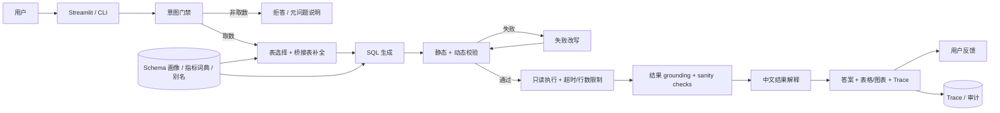

# 01 · Chinook ChatBI 项目设计文档

| 项目 | 内容 |
|---|---|
| 项目名 | Chinook ChatBI |
| 文档版本 | v1.0 |
| 日期 | 2026-10-22 |
| 状态 | 草案（待课程评审与团队立项签字） |
| 读者 | 课程评审、团队立项人员、产品/业务负责人、技术负责人 |
| 关联文档 | `00_context.md`、`02_功能设计.md`、`03_技术设计.md`、`04_统一能力地图与差距分析.md`、`05_范围定稿.md` |
| 本期定义 | MVP，建议 6 周内交付；V1/V2 仅作路线图，不是本期承诺 |
| 文档说明 | 本版按「项目设计文档」提纲重写，吸收了 v0.1 的能力分析与 04/05 的范围裁决；所有“当前状态”以 `06_SQL-Agent-Project/` 代码实测为准 |

---

## 0. 结论摘要

1. **Chinook ChatBI 的定位不是“会写 SQL 的聊天框”，而是“业务用户可验证的中文取数助手”。** 核心交付是：中文问题 → 可信 SQL → 有依据的中文结论。
2. **执行链路已经成型，可信链路仍是缺口。** 七步流水线、双层 SQL 校验、只读执行、超时与行数限制已落地；指标口径、结果正确性校验、答案 grounding、评测治理、审计与反馈尚未闭环。
3. **当前 30/30 只能作为 demo 基线，不能作为验收证据。** few-shot 与 gold 集存在重合，评测使用“排序后集合比较”，不校验列名、顺序与指标口径；选表只算 recall，全选表也能拿 100%。
4. **本期 MVP 锁定为“单库、只读、单轮、中文、可信取数”。** 以“可信评测、指标口径、答案 grounding”为三个支点；多轮、权限、部署、多源、归因全部后置。
5. **验收以 holdout 为准，不以 demo 数字为准。** 目标：holdout 执行准确率 ≥95%，答案数字 grounding 100%，P95 ≤8 s，单题成本 ≤¥0.02，试点任务完成率 ≥80%。

---

## 1. 项目背景与问题

### 1.1 项目背景

Chinook 是一个典型的音乐商店业务数据库，覆盖艺人、专辑、歌曲、流派、媒体类型、歌单、客户、员工、发票与发票明细。当前数据库的实测规模如下：

| 事实 | 数值 |
|---|---|
| 业务表数量 | 11 张 |
| 歌曲数 | 3,503 |
| 发票数 | 412 |
| 发票明细数 | 2,240 |
| 客户数 | 59 |
| 员工数 | 8 |
| 歌单数 | 18 |
| 歌单-歌曲关系数 | 8,715 |
| 发票日期范围 | 2009-01-01 至 2013-12-22 |
| 2014 年及以后发票数 | 0 |

业务人员关心的问题并不复杂，例如“销售额最高的 5 个国家”“2009 年每月销售额”“某个歌单里有多少首摇滚歌曲”。但要把这些问题变成正确的 SQL，需要同时理解业务口径、表关系、英文枚举值、日期格式和多对多桥接表。对非技术用户，这是一道很高的门槛；对数据团队，这会产生大量重复取数需求。

现有 `06_SQL-Agent-Project/` 已经实现了一条七步流水线：

```text
数据库解析 → 表选择 → SQL 生成 → SQL 校验 → SQL 改写 → SQL 执行 → 结果汇总
```

它证明了“中文提问 → SQLite 查询 → 中文回答”在 Chinook 上是可行的，也沉淀了 schema 画像、外键桥接、双层校验、只读执行、失败改写、Streamlit UI 与 30 条评测集。但从“能演示”到“能被业务信任并使用”，还差一层可信度与治理能力。

### 1.2 要解决的核心问题

| # | 问题 | 具体表现 | 业务影响 | 当前证据 |
|---|---|---|---|---|
| P1 | 取数门槛高 | 业务人员不会写 SQL，或需要理解 11 张表的关系 | 等待数据团队，决策变慢；重复取数消耗人力 | 现有 CLI/UI 只服务会运行 Python 的人 |
| P2 | 业务口径不统一 | “销售额”可能指 `invoices.Total`，也可能指 `invoice_items.UnitPrice * Quantity` | 同一个问题得到不同的数，业务方不再信任系统 | `eval/gold.jsonl` 中 q07 与 q22 对“销售额”使用了不同口径 |
| P3 | “看起来全对”的错误 | SQL 能执行、表格也正常，但答非所问、重复计数、粒度错误 | 比报错更危险，可能导致错误决策 | 现有校验只保证“能执行”，不保证“答对”；评测只比较排序后的结果集 |
| P4 | 失败不可解释 | 校验/执行失败时直接展示英文错误；空结果不区分“超范围/条件过严/真为零” | 用户不知道下一步怎么办，容易放弃 | 现有 `app.py` 直接展示 `result.error`；汇总只有“没有查询到符合条件的数据” |
| P5 | 数据边界未声明 | 数据止于 2013-12-22，但 Prompt、UI、汇总都没有明确说明 | 用户把“数据没到”误读为“业务为零” | 现有 catalog 有 min/max，但未形成 `data_until` 契约 |
| P6 | 评测不可信 | few-shot 与 gold 重合；只算 recall；不校验列名、顺序、指标 | 团队误以为已达 95%，真实流量中能力未知 | 7 条 few-shot 均能在 gold 中找到对应题；`eval/evaluate.py` 排序后比较集合 |
| P7 | 不可运营 | Trace 只在进程内；无反馈入口、无 token/成本计量、无审计 | 无法定位失败、无法复盘、无法证明合规 | `AgentResult.steps` 仅随本次请求返回；`llm.py` 无 token 计量 |
| P8 | 安全边界是“够用”而非“可证明” | 只读 URI + 黑名单已具备；无 AST 允许列表、无审计留存、无 PII 策略 | 进入真实数据环境后风险不可控 | `validator.py` 使用危险关键字黑名单；`catalog.py` 仅排除部分敏感列 |

### 1.3 为什么现在做

| 条件 | 说明 |
|---|---|
| 技术可行性已被验证 | LLM 生成 SQLite SQL 在 Chinook 这类中小 schema 上已可用；`sqlglot` 提供静态解析；SQLite 支持只读 URI 与 `EXPLAIN` |
| 成本可接受 | 单题上下文可控制在 schema + 样例行 + 值域 + few-shot 的规模；DeepSeek 兼容接口便于切换与降本 |
| 业务范围可控 | 单库、只读、中文、单轮，边界清晰，适合作为团队第一个 ChatBI 闭环 |
| 已有工程底座 | catalog / selector / generator / validator / rewriter / executor / summarizer / agent 已拆分，便于按设计补齐 |
| 评测条件具备 | 已有 30 条中文 gold 与自动评测脚本，可在其基础上重建 dev/holdout |

**结论：** 本期不再扩大功能面，而是把“答得对、能证明答得对”做实。否则功能越多，错误被放大的风险越大。

---

## 2. 项目目标与非目标

### 2.1 项目目标（可量化）

| # | 目标 | 量化指标 | 测量方式 | 基线 |
|---|---|---|---|---|
| G1 | 取数准确 | holdout 30 题执行准确率 ≥95%（29/30）；dev 30 题 ≥93%；3 次运行波动 ≤5 个百分点；TopN 顺序与列名断言 100% | 60 题 dev30/holdout30；结果集 + 顺序 + 列名 + 指标断言；holdout 不参与调参 | 30/30 仅为 demo 基线，不作为验收 |
| G2 | 答案可信 | 答案数字 grounding 一致率 100%；10 条边界题（空/截断/NULL/超范围/数据截止）100% 正确；人工抽检 30 条答案 0 编造 | 自动抽取答案数字并与结果集比对；边界题人工复核；抽检记录 | 未度量 |
| G3 | 口径统一 | 6 个核心指标 × 3 种问法，结果 100% 一致；100% 答案标注所用指标口径与时间范围 | 指标词典 + 固定问法集；答案结构化字段校验 | 未度量；现有 q07/q22 口径冲突 |
| G4 | 响应与成本可控 | P95 ≤8 s，P50 ≤4 s；20 s 整请求硬 deadline；超时率 <1%；单题成本 ≤¥0.02 | 50 次采样；端到端计时；token 日志 × 实际单价 | 平均约 3.0 s/题；P95 与成本未统计 |
| G5 | 可被真实用户采纳 | 3–5 名试用者、每人 ≥15 次提问、总样本 ≥50；任务完成率 ≥80%；回答采纳率 ≥60%；≥50% 用户在 2 周内至少 2 天使用 | 预设任务 + 自然使用日志；赞/踩 + 60 秒内是否重述同一问题；按用户/日期去重 | 未度量 |

### 2.2 非目标（本期明确不做）

- **任何写操作**：`INSERT`、`UPDATE`、`DELETE`、DDL、`PRAGMA`、`ATTACH` 等。
- **多数据源与跨库查询**：本期只支持 SQLite + Chinook；不接 PostgreSQL/MySQL/ClickHouse。
- **生产级鉴权**：登录、RBAC、多租户、行级/列级权限隔离本期不做。
- **生产部署**：容器、HTTP API、SLA、监控告警、CI/CD 上线流水线本期不做；保留本地 CLI 与 Streamlit。
- **自动建模、ETL、指标平台、看板搭建**：不替代数据仓库与 BI 平台。
- **因果推断与预测**：不回答“明年卖多少”“为什么下降”的完整归因；V2 只做有据对比，不做因果结论。
- **复杂定制图表、语音交互、移动端**：本期只保留表格与基础柱状图。
- **无监督自动调优**：不自动改 Prompt、不自动扩 few-shot、不自动改评测集。
- **完整多轮对话与完整澄清反问**：本期只做最小意图门禁；多轮与完整澄清放 V1。
- **历史记录、CSV 导出、分享、定时推送**：V1/V2。
- **反馈自动回流评测**：本期只采集反馈，V1 再做回流。
- **PII 脱敏与审计留存策略**：V2；本期沿用现有敏感列排除规则，并将审计字段落盘。
- **完整 SQL 列名中文化与复杂规范**：本期只做结果契约与最小可读性。

### 2.3 目标优先级与取舍

| 优先级 | 目标 | 取舍原则 |
|---|---|---|
| 1 | 答得对（G1） | 宁可拒答或澄清，也不静默给出错误答案 |
| 2 | 能证明答得对（G2/G3） | 每个数字可回溯；每个指标有口径；每次回答有 Trace |
| 3 | 可控（G4） | 20 s 硬 deadline；超时/成本超限时降级或终止 |
| 4 | 好用（G5） | 在可信前提下优化交互；不为“看起来智能”牺牲准确性 |
| 5 | 覆盖更多问题（范围） | 新增能力必须移除一项现有 MVP 或移入 V1，不允许净增范围 |

**一句话：** 本期宁可少答，也不答错；宁可承认“不知道”，也不编造。

---

## 3. 用户画像与核心场景

### 3.1 用户画像

| 角色 | 典型职责 | 核心诉求 | 当前痛点 | 成功标准 | 使用方式 |
|---|---|---|---|---|---|
| 业务分析师 | 临时取数、验证假设、做周报 | 不写 SQL 快速拿到可验证的数据 | 等数据团队、反复沟通口径 | 1 分钟内拿到结果 + SQL + Trace；能自己验证 | Streamlit 聊天、查看 SQL/Trace |
| 运营人员 | 看销售、客户、歌曲、歌单指标 | 口径一致、结果快、能看懂 | 同一个词不同数；不知道数据截止 | 答案 + 表格/柱状图；口径和时间范围清楚 | Streamlit 聊天、示例问题 |
| 管理者 | 看结论、趋势、对比 | 不关心 SQL，只要可信结论 | 结果黑盒；数字无法追溯 | 一句话结论 + 关键数字 + 证据表 | Streamlit 聊天；V1 导出/分享 |
| 数据/平台管理员 | 维护配置、评测、审计 | 可配置、可回归、可追责 | 改动后能力漂移；失败无法定位 | 一键评测、Trace 可回放、配置可刷新 | CLI/管理页；V1 管理控制台 |

### 3.2 核心场景

| # | 角色 | 问题示例 | 期望输出 | 涉及能力 | 易失败点 | 阶段 |
|---|---|---|---|---|---|---|
| S1 | 业务分析师 | 数据库里一共有多少首歌？ | 数字 + 口径说明 + SQL | Schema 画像、生成、校验、汇总 | “歌曲”是 `tracks` 行数还是歌单关系行数 | MVP |
| S2 | 运营 | 销售额最高的 5 个国家是哪些？ | Top5 表 + 结论 + 柱状图 | 选表、join、聚合、指标口径、汇总 | 销售额取 `invoices.Total` 还是 `invoice_items` 明细；国家取账单国家还是客户国家 | MVP |
| S3 | 运营 | 每位客服各负责多少客户？ | 客服-客户数表 + 结论 | 选表、LEFT JOIN、分组 | 无客户客服是否显示 0；姓名拼接 | MVP |
| S4 | 运营 | Grunge 歌单里有多少首摇滚歌曲？ | 数字 + 歌单说明 | 多对多、桥接表、值域映射 | 漏 `playlist_track`；重复计数；“摇滚→Rock” | MVP |
| S5 | 业务分析师 | 2009 年每个月的销售额是多少？ | 12 行趋势 + 折线/柱状图 | 时间函数、分组、图表 | 日期为文本；空月补 0 还是缺失 | MVP |
| S6 | 业务分析师 | 2014 年以后还有发票吗？ | 明确“无记录” + 数据截止说明 | 空结果契约、汇总话术、`data_until` | 把“数据没到”说成“没有销售”；编造数字 | MVP |
| S7 | 业务分析师 | 库里有什么数据？能问哪些问题？ | 表清单 + 说明 + 示例问题 | 意图门禁、Schema 描述 | 被当作取数生成 SQL | V1 |
| S8 | 运营 | 最近卖得怎么样？ | 先澄清口径，或给默认口径并声明 | 澄清反问、指标口径 | 静默按“本月金额”回答 | V1 |
| S9 | 运营 | （Top5 后）那 2009 年呢？只看美国。 | 同结构结果，仅改条件 | 多轮记忆、增量改写 | 丢上下文；重复全流程导致口径漂移 | V1 |
| S10 | 管理者 | 为什么今年销售额比去年低？ | 按国家/品类/月份拆解的对比 + 有据原因假设 | 多查询编排、对比分析、幻觉抑制 | 编造因果；单条 SQL 硬答；超时与成本 | V2 |

### 3.3 场景优先级理由

| 阶段 | 场景 | 理由 |
|---|---|---|
| MVP | S1–S6 | 覆盖 gold 集核心题型（单表、join、多对多、时间、空结果），全部单轮；完成即证明“能取数且可信” |
| V1 | S7–S9 | 解决“能否放心给人用”：路由、澄清、多轮属于交互完整性，复用现有流水线即可 |
| V2 | S10 | 多查询规划与洞察生成，幻觉、延迟、成本风险显著，应待准确率与可信度稳定后再做 |

---

## 4. 业务价值与成功指标

### 4.1 业务价值

| 价值 | 说明 | 可观测信号 |
|---|---|---|
| 提效 | 业务人员自助取数，减少“提需求—排队—等 SQL—对数”的往返 | 从提问到结论的时间；数据团队被重复取数打扰的次数 |
| 一致 | 同一个业务词使用同一指标定义与时间口径 | 同一指标多次提问结果一致率；答案口径标注率 |
| 可信 | SQL、选表理由、校验/改写历史、结果数字全部可追溯 | Trace 可回放率；答案数字 grounding 一致率 |
| 治理 | 只读、可审计、可评测、可回归 | 写操作拦截率；审计记录完整率；回归门槛阻断次数 |
| 可复用 | 沉淀 schema 画像、指标词典、评测集与评测脚本 | 新问题接入成本；评测集复用率 |

### 4.2 成功指标

| 类别 | 指标 | 目标 | 测量口径 | 当前基线 | 频率 |
|---|---|---|---|---|---|
| 准确率 | holdout 执行准确率 | ≥95%（29/30） | 60 题 dev30/holdout30；结果集 + TopN 顺序 + 列名；跑 3 次 | 30/30 仅 demo，不作为基线 | 每次变更 |
| 准确率 | 分题型准确率 | 每个 tag ≥90% | 单表/join/多对多/时间/空结果/值映射分别统计 | 未度量 | 每次变更 |
| 可信 | 数字 grounding | 100% | 自动抽取答案数字并与结果集比对，60 题全量 | 未度量 | 每次变更 |
| 可信 | 边界正确率 | 100%（10/10） | 空结果、截断、NULL、超范围、数据截止各 2 条 | 未度量 | 每次变更 |
| 口径 | 指标一致性 | 6 指标 × 3 问法 100% | 固定问法集；结果与口径标注一致 | 未度量 | 每周 |
| 响应 | P95 / P50 | ≤8 s / ≤4 s | 从提交到答案渲染，排除冷启动；50 次采样；20 s 硬 deadline | 平均约 3.0 s；P95 未测 | 每周 |
| 成本 | 单题成本 | ≤¥0.02 | token 日志 × DeepSeek 实际单价；50 题均值 | 未度量 | 每周 |
| 采纳 | 任务完成率 | ≥80%（16/20） | 3–5 名用户完成 20 个预设任务，用户确认结果可用 | 未度量 | 试点周 |
| 采纳 | 回答采纳率 | ≥60%（30/50） | 未点踩且 60 秒内未重述同一问题；总样本 ≥50 | 未度量 | 试点周 |
| 采纳 | 回访率 | ≥50% 用户在 ≥2 天使用 | 2 周试点日志，按用户与日期去重 | 未度量 | 试点周 |
| 治理 | 回归门槛 | 指标下降 >2 个百分点阻断 | 一键评测；dev 与 holdout 分开报告 | 无门槛 | 每次变更 |

### 4.3 护栏指标（Counter-metrics）

以下任一项不达标，即使功能可用也不能发布：

| 护栏 | 红线 |
|---|---|
| 写操作 | 任何写库、DDL、`PRAGMA` 写操作必须 100% 拦截 |
| 编造数字 | 答案中出现结果集之外的具体数字，0 容忍 |
| 静默误答 | 超范围/歧义问题不得静默生成 SQL；必须拒答或澄清 |
| 资源 | 单请求不得超过 20 s；单次结果不得超过 100 行；查询不得超过 10 s |
| 隐私 | 敏感列不得进入值域提示、日志与导出；V2 前不开放批量导出 |
| 成本 | 单题成本超过 ¥0.05 必须降级或终止，不得无上限重试 |

---

## 5. 项目范围与边界

### 5.1 MVP 范围（10 项能力包）

说明：10 项是可验收的能力包，不是 10 个代码模块；括号内为 `04_统一能力地图与差距分析.md` 的统一能力编号。

| # | 能力包 | 统一能力编号 | 交付物 | 验收标准 |
|---|---|---|---|---|
| 1 | 端到端可信 SQL 链路 | 2.1、4.2、5.1、5.2、5.3、5.4、6.1、6.2 | CLI/UI 共用七步链路；双层校验；只读执行 | 60 题运行无崩溃，SQL 产出率 ≥98%（59/60）；写操作/多语句 100% 拦截；超时 100% 中断；≤100 行 |
| 2 | Schema/值域画像与中文映射 | 3.1、3.2 | catalog 缓存；`entity_aliases.yaml` | 20 条实体题映射 ≥95%（19/20）；缓存失效与刷新可用 |
| 3 | 表/列选择与 Join 桥接 | 3.3 | 选表器；precision/fan-out 日志 | holdout 选表 precision ≥85%、recall ≥95%；全表兜底 ≤5%；fan-out 风险有告警 |
| 4 | 指标词典与口径输出 | 1.1、1.2 | `semantic/metrics.yaml`（6 指标）；口径假设输出 | 6 指标 × 3 问法结果 100% 一致；100% 答案标注口径与时间范围 |
| 5 | 结果 grounding 与结果契约 | 3.4、4.5、5.5、5.6 | grounding 校验器；ResultContract；sanity checks | 数字一致率 100%；10 条边界题 100%；10 条注入异常拦截 ≥9 条 |
| 6 | 失败反思改写 | 4.3 | 改写器；no-op/重复 SQL 检测 | 10 条首轮失败样本恢复 ≥8 条；同一 SQL 重复改写 0 次 |
| 7 | 可信评测与回归门槛 | 1.3、7.1、7.2 | dev30/holdout30；顺序/列名/指标断言；一键评测 | holdout ≥95%；分 tag 各 ≥90%；全选表策略 precision <70%；指标下降 >2pp 自动阻断 |
| 8 | 最小意图门禁与可读错误 | 2.5、4.4 | 取数/超范围/元问题三类门禁；错误文案映射 | 20 条非取数问题 100% 正确分流；10 类错误 100% 有中文原因+下一步 |
| 9 | 实时 Trace 与审计记录 | 1.6、2.3、6.5、7.3 | `trace_id`；JSONL/SQLite 审计；token/成本字段；赞/踩 | 100% 回答可按 `trace_id` 回放；token/成本 100% 可查；100% 回答展示反馈入口 |
| 10 | 运行保障 | 4.6、5.7、7.4 | 20 s 整请求 deadline；熔断；查询计划门槛 | P95 ≤8 s；P50 ≤4 s；超时率 <1%；单题 ≤¥0.02；大扫描/无 join 条件被拦截 |

MVP 期间保留现有 Streamlit 表格与柱状图，不投入自动图表选型；多轮、完整澄清、历史、导出不在 MVP。

### 5.2 范围外（Won't have）

- 写操作、跨库、多数据源、ETL、自动建模。
- 生产部署、HTTP API、鉴权、多租户、行/列级权限、SLA。
- 因果推断、预测、完整归因、复杂图表、语音、移动端。
- 无监督自动调优、自动扩 few-shot、自动改评测集。
- 完整多轮、完整澄清、历史记录、CSV 导出、分享、定时推送。
- PII 脱敏策略与审计留存策略（V2）。

### 5.3 约束与边界

| 维度 | 本期约束 | 说明 |
|---|---|---|
| 数据 | 仅 SQLite + Chinook，11 张表 | 不接第二数据源；不建数仓 |
| 读/写 | 只读、单条 `SELECT` / `WITH` | 只读 URI + 校验双层兜底 |
| 结果 | 最多返回 100 行 | 超出截断并明确提示 |
| 查询超时 | 10 s | `progress_handler` 中断 |
| 端到端 | 20 s 硬 deadline | 超过即终止并返回可读错误 |
| 语言 | 中文提问为主 | 库内英文枚举值通过值域/别名映射 |
| 数据边界 | 2009-01-01 至 2013-12-22 | 必须通过 `data_until` 声明 |
| 交互 | 单轮为主 | 最小意图门禁；完整多轮 V1 |
| 部署 | 本地 CLI + Streamlit | 不承诺生产可用性 |
| 模型 | DeepSeek `deepseek-chat`（OpenAI 兼容） | 通过网关接口预留切换能力 |

### 5.4 范围变更规则

1. MVP 能力包上限为 10；新增一项必须移除一项或移入 V1。
2. 任何指标目标调整必须同时更新测量口径、基线值与负责人签字。
3. holdout 题目一旦用于调参，立即降级为 dev，并补充同分布新题；保持 holdout 污染为 0。
4. 每项 MVP 能力验收通过后，才进入 V1；未通过不靠“下一阶段补”。
5. 范围变更须在周评审会上确认，并记录在本文变更记录中。

### 5.5 与 V1/V2 的关系

| 阶段 | 能力 | 退出标准 |
|---|---|---|
| V1（3–6 周） | 多轮上下文；完整澄清反问；完整意图路由；结果解释与趋势；折线/自动选图；历史记录+示例引导+CSV 导出；反馈回流评测+采纳看板；成本缓存/模型降级+限流；CI+Prompt/模型/数据版本化 | 3 轮连续追问 ≥80%；20 条歧义题澄清触发 ≥80%；采纳率 ≥70%；P95 ≤6 s；成本较 MVP 降 ≥30%；CI 自动阻断回归 |
| V2（3–6 个月） | 多查询编排+对比/归因洞察；语义层服务化（指标 YAML/版本/审批）；HTTP API+JWT/RBAC+审计；多数据源/方言；部署/监控/告警/成本看板；PII 脱敏与留存策略 | 20 并发稳定；审计 100% 可回放；越权 0；新数据源接入 ≤1 周；20 条“为什么”类问题有据回答人工评分 ≥70%；无编造因果 |

**升级触发条件：** 外部用户 >5 并发、需要 HTTP 集成、查询量 >500/日、出现第二数据源、审计/合规要求、超过 3 个团队使用。未触发就留在 MVP/V1。

---

## 6. 总体方案概述

### 6.1 一句话方案

用户用中文提问，系统先判断是否属于取数问题，再基于 schema 画像与指标词典选表、生成 SQL、做静态与动态校验，失败时带错误反思改写，随后在只读连接上执行并限制资源，最后用结果集做数字 grounding 并生成中文结论；全过程留下可回放的 Trace。

### 6.2 方案组成

| 层 | 组成 | 本期职责 |
|---|---|---|
| 交互层 | Streamlit 聊天 UI、CLI | 提问、展示答案/表格/图表、Trace、反馈入口 |
| 编排层 | `SQLAgent` | 串联七步；处理失败与重试；维护 Trace 与 deadline |
| 语义层 | catalog、指标词典、实体别名 | 让模型“看得懂库”和“看得懂业务词” |
| SQL 层 | selector、generator、validator、rewriter、executor | 选表、生成、校验、改写、只读执行 |
| 答案层 | grounding、summarizer、ResultContract | 数字校验、中文解释、空/截断/NULL 统一呈现 |
| 治理层 | eval、trace store、config | 评测回归、审计、配置与密钥管理 |

### 6.3 端到端流程



### 6.4 关键设计原则

| 原则 | 含义 | 落地方式 |
|---|---|---|
| 可信优先 | 不确定时拒答/澄清，不静默猜 | 意图门禁、低置信提示、口径标注、grounding |
| 确定性优先 | 能用规则/词典解决的，不交给模型 | 值域别名、指标词典、外键图、静态校验 |
| 只读由构造保证 | 不只靠 Prompt 约束 | 只读 URI + 单语句 + 校验 + 执行层兜底 |
| 证据可追溯 | 每个数字有来源 | SQL、结果集、Trace、`trace_id` |
| 可度量 | 不靠“感觉还行” | dev/holdout、分 tag 指标、回归门槛 |
| 小步演进 | 本期 A 架构，接口为 B 预留 | 抽 `TraceStore`、`SemanticCatalog` 接口，不提前上服务化 |

### 6.5 用户可见形态

| 形态 | 本期 | 说明 |
|---|---|---|
| Streamlit UI | 有 | 聊天、结果表、柱状图、Trace、反馈入口 |
| CLI | 有 | 单问与交互模式，适合调试与评测 |
| HTTP API | 无 | V2；本期只保留编排层接口，不暴露网络服务 |
| 管理控制台 | 极简 | 本期通过 `.env` 与缓存刷新；V1 再做管理页 |

---

## 7. 能力地图与优先级

### 7.1 统一能力地图

优先级定义：**P0 = MVP 必须**；**P1 = V1 应做**；**P2 = V2/远期**。状态以当前代码为准。

| 能力域 | 能力项 | 定义 / 用户价值 | 优先级 | 当前状态 | 本期落点 |
|---|---|---|---|---|---|
| 1 业务与语义 | 1.1 问题理解 | 把中文问题还原为实体、指标、维度、时间、过滤条件 | P0 | 部分具备（仅 Prompt） | 输出结构化口径假设 |
| 1 业务与语义 | 1.2 指标口径与语义层 | 对销售额、销量、客户数等给唯一定义 | P0 | 缺失 | `semantic/metrics.yaml`（6 指标） |
| 1 业务与语义 | 1.3 场景分析模板 | TopN、趋势、占比等常见范式 | P1 | 部分具备（仅 few-shot） | V1 参数化模板 |
| 1 业务与语义 | 1.4 澄清反问与超范围拒答 | 歧义时提问；超范围时拒答 | P0（最小门禁）/ P1（完整澄清） | 缺失 | 三类意图门禁；完整澄清 V1 |
| 1 业务与语义 | 1.5 结果解释与洞察 | 数字之外说明含义、趋势与可能原因 | P2 | 部分具备（仅客观汇总） | V2 有据对比，不做因果 |
| 1 业务与语义 | 1.6 用户反馈闭环 | 对错反馈回流评测与提示词 | P1 | 缺失 | 本期采集，V1 回流 |
| 2 交互与交付 | 2.1 中文自然语言输入 | 中文提问，无需查询语法 | P0 | 已具备 | 保持 |
| 2 交互与交付 | 2.2 多轮对话与上下文 | “那 2009 年呢”“只看美国” | P1 | 缺失 | V1 |
| 2 交互与交付 | 2.3 实时 Trace | 展示选表理由、SQL、校验错误、改写历史、耗时 | P0 | 已具备（进程内） | 补 `trace_id` 与落盘 |
| 2 交互与交付 | 2.4 结果可视化 | 表格/柱状图/折线图 | P1 | 部分具备（仅柱状图） | V1 折线与自动选图 |
| 2 交互与交付 | 2.5 可读错误与失败引导 | 用用户语言说明原因与下一步 | P0 | 部分具备（原始错误） | 错误分类 + 中文文案 |
| 2 交互与交付 | 2.6 历史记录与示例引导 | 会话历史、常用问题推荐 | P1 | 缺失 | V1 |
| 2 交互与交付 | 2.7 结果导出与分享 | CSV、链接、定时推送 | P2 | 缺失 | V1 CSV；分享 V2 |
| 3 语义与数据 | 3.1 Schema 采集与画像 | 表、列、类型、主外键、样例、值域、空值统计与缓存 | P0 | 已具备 | 加 `data_until` 与采样上限 |
| 3 语义与数据 | 3.2 中文实体与值域映射 | 摇滚→Rock、美国→USA、MPEG→MPEG audio file | P0 | 部分具备 | `entity_aliases.yaml` + 模糊匹配 |
| 3 语义与数据 | 3.3 表/列选择与 Join 路径 | 选表、补桥接表、列级链接、多跳与 fan-out 控制 | P0 | 部分具备 | 补 precision/置信度/fan-out 告警 |
| 3 语义与数据 | 3.4 数据质量与新鲜度 | 空值、重复、孤儿外键、范围、截止时间与空结果归因 | P0 | 部分具备 | `data_until` + 空结果三分法 |
| 3 语义与数据 | 3.5 多数据源与方言抽象 | 统一 DataSource/Dialect 接口 | P2 | 缺失 | 本期只留接口边界 |
| 4 LLM 编排 | 4.1 结构化 Prompt + few-shot | DDL、样例、值域、示例构造上下文 | P0 | 已具备 | 去泄漏；Prompt 版本化 |
| 4 LLM 编排 | 4.2 固定流水线编排 | 七步顺序执行，状态与耗时可见 | P0 | 已具备 | 加端到端 deadline |
| 4 LLM 编排 | 4.3 失败反思与重试 | 带错误与历史修复，≤3 次 | P0 | 已具备 | 加 no-op/重复检测 |
| 4 LLM 编排 | 4.4 意图路由 | 取数/闲聊/元问题/超范围分流 | P0（最小门禁） | 缺失 | 三类门禁 |
| 4 LLM 编排 | 4.5 幻觉抑制与事实一致性 | 结论只用结果数字；空/截断/单位/口径正确 | P0 | 部分具备 | 结构化汇总 + 程序化 grounding |
| 4 LLM 编排 | 4.6 成本、缓存与模型网关 | Token 计量、响应缓存、模型降级/切换 | P1 | 部分具备（仅 catalog 缓存） | V1 语义缓存 + 计量 |
| 4 LLM 编排 | 4.7 可观测性 | 每步 Trace、耗时、中间产物 | P0 | 已具备（本地） | `trace_id` + 落盘 + 聚合 |
| 5 SQL 工程 | 5.1 SQL 生成 | 方言正确、可执行的 SELECT | P0 | 已具备 | 补口径假设输出 |
| 5 SQL 工程 | 5.2 静态校验 | 单语句、类型、表列存在、危险关键字 | P0 | 部分具备 | AST 允许列表 + 完整作用域 |
| 5 SQL 工程 | 5.3 动态校验 | 只读 EXPLAIN，只编译不执行 | P0 | 已具备 | 加查询计划门槛 |
| 5 SQL 工程 | 5.4 只读执行与资源限制 | 只读 URI、超时中断、行数上限 | P0 | 已具备 | 补内存/join 上限 |
| 5 SQL 工程 | 5.5 结果正确性校验 | 量级、重复、负值、列契约、指标 golden | P0 | 缺失 | sanity checks + 10 条陷阱题 |
| 5 SQL 工程 | 5.6 SQL 规范与结果集契约 | 别名、中文列名、口径注释；空/截断/NULL 统一 | P1 | 部分具备 | `ResultContract`；列名中文化 V1 |
| 5 SQL 工程 | 5.7 性能防护 | 笛卡尔积、全表扫描、慢查询 | P1 | 部分具备（仅超时） | V1 计划门槛 + 索引 |
| 5 SQL 工程 | 5.8 方言适配 | 换库切换方言与函数 | P2 | 部分具备 | 本期不抽象 |
| 6 工程治理 | 6.1 SQL 安全与越权防护 | 防注入、防写、扩展禁用、导出限制 | P0 | 部分具备 | 函数白名单；禁扩展 |
| 6 工程治理 | 6.2 密钥与配置管理 | Key 不入代码；配置分层与校验 | P0 | 已具备 | 启动校验 |
| 6 工程治理 | 6.3 认证、授权与多用户 | 登录、RBAC、行/列策略、租户隔离 | P2 | 缺失 | V2 |
| 6 工程治理 | 6.4 隐私与 Prompt/日志脱敏 | PII 分类、敏感列不采样、日志脱敏 | P2 | 部分具备 | 本期沿用排除规则；V2 完整策略 |
| 6 工程治理 | 6.5 审计与 Trace 持久化 | who/what/when/SQL/rows/tokens/trace_id 可回放 | P0 | 缺失 | JSONL/SQLite 审计 |
| 7 工程化与评测 | 7.1 评测集与自动评测 | 中文 gold 集 + 自动比对，覆盖选表/校验/执行/答案 | P0 | 部分具备 | dev30/holdout30 + 多指标断言 |
| 7 工程化与评测 | 7.2 回归门槛与版本管理 | Prompt/模型/数据/代码版本，变更自动跑评测 | P0 | 缺失 | 版本字段 + 2pp 门槛 |
| 7 工程化与评测 | 7.3 可观测性与监控 | 成功率、P95、改写率、Token/成本、错误分布 | P1 | 部分具备 | V1 看板 |
| 7 工程化与评测 | 7.4 可靠性与端到端 deadline | 整请求 deadline、熔断、限流、队列 | P0 | 部分具备（仅 SQL 10 s） | 20 s deadline + 熔断 |
| 7 工程化与评测 | 7.5 测试与 CI | 单测、集成测试、CI | P1 | 缺失 | V1 补测与 CI |
| 7 工程化与评测 | 7.6 部署与 API | 容器化、HTTP 服务、健康检查 | P2 | 缺失 | V2 |

### 7.2 优先级统计

| 优先级 | 数量 | 说明 |
|---|---:|---|
| P0 | 22 | 本期必须交付或必须形成最小闭环 |
| P1 | 11 | V1 应做；本期只做接口或采集 |
| P2 | 7 | V2/远期；本期明确不做 |

### 7.3 最容易被低估的 5 项能力

| # | 能力 | 为什么容易被低估 |
|---|---|---|
| 1 | 意图门禁 + 澄清反问 | Demo 问题都是标准问题；真实用户会问“最近怎么样”。没有门禁，闲聊会被硬生成 SQL，歧义会被静默猜错。 |
| 2 | 指标口径与语义层 | “销售额”取错字段，技术再正确也会被业务否定。评测集覆盖不了口径分歧。 |
| 3 | 结果正确性校验 | 现有校验只保证“能跑”，不保证“答对”。一张看似正常、实则答非所问的表最危险。 |
| 4 | 失败时的可读反馈与降级 | 信任来自失败时刻。英文错误让用户放弃；明确“数据截止 2013-12”能让用户继续用。 |
| 5 | 评测治理与回归门槛 | 30/30 是快照不是能力。模型升级、Prompt 微调都会让指标漂移，没有门槛就会在“感觉还行”中退化。 |

---

## 8. 里程碑与交付物

### 8.1 6 周 MVP 计划

| 里程碑 | 时间 | 关键动作 | 交付物 | 退出标准 |
|---|---|---|---|---|
| M0 基线重建 | W1 | 冻结当前能力快照；删除 few-shot 与 gold 的重合；拆 dev30/holdout30；补 tag；记录 demo 基线 | 60 题评测集；基线报告；指标词典草案 | holdout 基线可复现；30/30 明确标注为 demo；评测脚本可一键运行 |
| M1 语义与映射 | W2 | 定义 6 个指标；建 `metrics.yaml`、`entity_aliases.yaml`；最小意图门禁；错误文案映射 | 指标词典、别名词典、意图门禁、错误码表 | 6 指标 × 3 问法一致率 100%；20 条实体题 ≥95%；20 条非取数问题 100% 分流 |
| M2 可信答案 | W3 | 结果 grounding；`ResultContract`；sanity checks；`data_until`；空结果三分法；改写 no-op 检测 | grounding 校验器；结果契约；边界题集 | 数字一致率 100%；10 条边界题 100%；10 条注入异常拦截 ≥9；改写恢复 ≥80% |
| M3 可运营 | W4 | `trace_id` + JSONL/SQLite 审计；token/成本字段；赞/踩；缓存刷新；20 s deadline | Trace/审计样例；成本报表；反馈入口 | 100% 回答可回放；token/成本 100% 可查；100% 回答有反馈入口 |
| M4 质量闸门 | W5 | 性能压测；安全检查；全量回归；3 次运行方差；修复 P0 缺陷 | 测试报告；性能报告；安全报告；回归报告 | holdout ≥95%；P95 ≤8 s；超时率 <1%；无高危安全问题 |
| M5 试点验收 | W6 | 3–5 名用户 × ≥15 次提问；20 个预设任务；采纳/回访统计；评审签字 | 试点报告；验收记录；V1 需求池 | 任务完成率 ≥80%；采纳率 ≥60%；回访率 ≥50%；评审通过 |

### 8.2 交付物清单

| 类别 | 交付物 | 验收方式 |
|---|---|---|
| 文档 | `01_项目设计.md`、`02_功能设计.md`、`03_技术设计.md`、`04`、`05` | 评审签字 |
| 代码 | 七步链路 + MVP 补齐能力；CLI/UI | 代码评审 + 自动化测试 |
| 数据 | 60 题 dev/holdout 评测集；10 条边界题；10 条注入/异常题 | 评测报告 |
| 配置 | `metrics.yaml`、`entity_aliases.yaml`、`.env.example` | 配置评审 |
| 审计 | `trace_id` 样例、JSONL/SQLite 审计记录、token/成本报表 | 回放演示 |
| 报告 | 基线报告、性能报告、安全报告、试点报告 | 评审会 |
| 计划 | V1 需求池与优先级 | 评审会 |

### 8.3 Definition of Done

一项能力只有同时满足以下条件才算完成：

1. 代码实现并通过代码评审。
2. 有对应的单元/集成测试或可复现的评测用例。
3. 有用户可见的行为说明与错误文案。
4. 有 Trace 字段与审计记录。
5. 通过该项能力的验收标准，且不导致已有指标下降 >2 个百分点。
6. 文档更新，且不扩大本期范围。

---

## 9. 资源、分工与依赖

### 9.1 角色与 RACI

| 角色 | 职责 | 范围 | 指标 | 实现 | 评测 | 试点 | 安全 |
|---|---|---|---|---|---|---|---|
| 产品/项目负责人 | 范围、优先级、验收签字 | A | A | C | C | A | C |
| 技术负责人/开发 | 架构、实现、代码评审、性能 | C | C | A/R | R | C | R |
| 业务/领域负责人 | 指标定义、口径签字、场景确认 | C | A | I | C | C | I |
| 评测/QA | 评测集、回归、缺陷跟踪 | I | C | C | A/R | C | C |
| 试点用户 | 真实提问、任务完成、反馈 | I | I | I | I | A/R | I |
| 评审/安全 | 范围评审、安全检查、验收 | C | C | I | C | I | A |

> R=负责执行；A=最终负责/签字；C=需咨询；I=需知会。

### 9.2 工作量估算

| 工作流 | 估算（人日） | 说明 |
|---|---:|---|
| 评测重建与回归 | 4–5 | 去泄漏、60 题、断言、3 次运行 |
| 指标词典与实体别名 | 2–3 | 6 指标、别名、口径标注 |
| 意图门禁与错误文案 | 2–3 | 三类门禁、错误码映射 |
| grounding 与结果契约 | 2–3 | 数字校验、边界题、sanity checks |
| Trace/审计/反馈 | 2–3 | `trace_id`、落盘、token/成本 |
| 性能与安全加固 | 2 | deadline、计划门槛、函数白名单 |
| 文档、试点与验收 | 3–4 | 三份文档、试点组织、报告 |
| **合计** | **17–23** | 1 名开发 6 周约 30 人日容量，留有缓冲 |

### 9.3 依赖与假设

| # | 依赖/假设 | 影响 | 验证方式 | 不成立时 |
|---|---|---|---|---|
| D1 | DeepSeek API 可用、Key 有效、网络稳定 | 全链路不可用 | 启动自检 + 评测 | 切换 OpenAI 兼容模型；降级模板 |
| D2 | Chinook 数据库路径可访问、只读权限正常 | 无法解析/执行 | 启动检查 `CHINOOK_DB` | 修正路径；复制只读副本 |
| D3 | `sqlglot` 版本支持 SQLite 方言 | 静态校验退化 | 单测 + 评测 | 升级/固定版本；EXPLAIN 兜底 |
| D4 | 业务负责人能确认 6 个指标口径 | 口径无法统一 | 指标评审会 | 缩小到 3 个核心指标 |
| D5 | 60 题评测集可在 W1 内完成 | 无法度量 | W1 评审 | 先用 30 条重建 holdout，再补题 |
| D6 | 3–5 名试点用户可参与 2 周 | 采纳指标无法验证 | 试点招募 | 延期试点，不降低质量门槛 |
| D7 | 本地 Streamlit/CLI 环境可运行 | 无法演示 | 冒烟测试 | 使用命令行 + notebook 演示 |
| D8 | 数据截止 2013-12-22 可被接受 | 时间类问题受限 | 用户访谈 | 数据刷新升级为 Must，增加 2–3 人日 |

---

## 10. 风险与应对

### 10.1 风险清单

| # | 风险 | 概率 | 影响 | 触发信号 | 应对 | 负责人 |
|---|---|---|---|---|---|---|
| R1 | 评测泄漏导致“假达标” | 高 | 极高 | 指标突然全 100%；换模型/改 Prompt 指标不动；真实新问题失败 | few-shot 与 gold 分离；dev/holdout 拆分；holdout 不参与调参；多次运行报区间 | 评测/QA |
| R2 | 指标口径分歧 | 高 | 高 | 同一问题不同答案；业务质疑“销售额”定义 | 6 指标书面定义；答案标注口径；q07/q22 统一；业务签字 | 业务负责人 |
| R3 | Schema linking 偏差 | 高 | 高 | recall 高但 precision 低；`unknown_column` 改写集中；全表兜底率上升 | 值域别名；列级链接；低置信提示；加 precision 指标 | 技术负责人 |
| R4 | SQL 语义错误 / 答非所问 | 高 | 极高 | SQL 合法且快，但量级异常；行数超过基表；SUM 与明细不一致 | 指标词典；grain/去重检查；sanity checks；指标 golden；模板降级 | 技术负责人 |
| R5 | 结果汇总幻觉 | 高 | 高 | 答案数字不在结果集；空结果答成 0；出现因果词 | 程序化 grounding；结构化汇总；空/截断契约；温度 0；模板兜底 | 技术负责人 |
| R6 | 数据新鲜度/空结果误读 | 中高 | 高 | 时间类问题空结果；用户问“为什么没有数据” | `data_until` 注入；空结果三分法；新鲜度徽标 | 产品负责人 |
| R7 | 性能/超时 | 中 | 中高 | P95 上升；改写率升；超时率 >1% | 20 s deadline；缓存；EXPLAIN 门槛；限制改写；索引 | 技术负责人 |
| R8 | 成本失控 | 中 | 中高 | 单题 token 上升；日花费与查询量不匹配 | token 计量；预算封顶；缓存；限制改写/汇总长度；模型降级 | 技术负责人 |
| R9 | 模型/供应商漂移 | 中 | 高 | 评测下降；JSON 解析失败；429/故障；SQL 风格突变 | 固定模型版本；LLM 网关；每模型回归；备用供应商 | 技术负责人 |
| R10 | 安全/PII 风险 | 中 | 极高 | Prompt/日志/结果出现敏感信息；批量导出请求；越权问法 | 只读；敏感列排除；审计；V1 鉴权；V2 脱敏与导出配额 | 安全/评审 |
| R11 | 工程化欠账 | 中 | 高 | 用户先发现回归；问题不可复现；查不到历史 Trace | 单测/集成测试；版本化；CI 门槛；Trace 落盘；容器化 V1 | 技术负责人 |
| R12 | 用户不采纳 | 中 | 高 | 任务完成率 <60%；重复提问多；反馈负面 | 试点访谈；示例引导；可读错误；先解决高频失败 | 产品负责人 |

### 10.2 最可能的失败链

**评测泄漏 → 团队过度自信 → 真实流量中 schema/指标错误 → 汇总幻觉放大 → 用户信任崩塌 → 用更多 Prompt 补丁救火 → 评测进一步失真。**

断点不在 SQL 生成，而在两处：**评测可信度**与**指标口径**。因此 M0/M1 必须先做，且不因功能开发压力跳过。

### 10.3 风险评审节奏与停止条件

| 节奏 | 动作 |
|---|---|
| 每周一 | 更新风险表；检查触发信号；确认本周缓解动作 |
| 每次变更 | 跑 dev/holdout；指标下降 >2pp 阻断 |
| 每次发布前 | 安全检查 + 边界题 + 性能采样 + 人工抽检 |

**停止条件（满足任一即暂停发布）：**

1. holdout 准确率 <85%，且两轮迭代无改善 → 缩小到 6 个模板题型，重新协商目标。
2. 出现任一编造数字或写操作 → 停止发布，修复后全量回归。
3. P95 >12 s 或单题成本 >¥0.05 → 先加缓存/降级；仍不达标则重新协商目标。
4. 发现敏感数据进入 Prompt/日志/导出 → 停止发布，走安全事件流程。

---

## 11. 验收标准

### 11.1 MVP 验收门槛

| # | 验收项 | 通过标准 | 证据 | 签字人 |
|---|---|---|---|---|
| A1 | 端到端链路 | 60 题无崩溃；SQL 产出率 ≥98%；写操作/多语句 100% 拦截；超时 100% 中断；≤100 行 | 评测报告 + 安全检查 | 技术负责人 |
| A2 | 取数准确 | holdout ≥95%；dev ≥93%；分 tag 各 ≥90%；3 次波动 ≤5pp；TopN 顺序/列名 100% | 评测报告 | 评测/QA |
| A3 | 答案可信 | grounding 100%；10 条边界题 100%；人工抽检 30 条 0 编造 | grounding 报告 + 抽检记录 | 产品负责人 |
| A4 | 口径统一 | 6 指标 × 3 问法 100%；100% 答案标注口径与时间范围 | 指标一致性报告 | 业务负责人 |
| A5 | 选表 | holdout precision ≥85%、recall ≥95%；全表兜底 ≤5%；全选表策略 precision <70% | 选表报告 | 技术负责人 |
| A6 | 失败恢复 | 10 条首轮失败样本恢复 ≥8；同一 SQL 重复改写 0 次 | 改写报告 | 技术负责人 |
| A7 | 意图与错误 | 20 条非取数问题 100% 分流；10 类错误 100% 有中文原因+下一步 | 用例记录 | 产品负责人 |
| A8 | 可运营 | 100% 回答可按 `trace_id` 回放；token/成本 100% 可查；100% 回答有反馈入口 | 审计样例 | 技术负责人 |
| A9 | 性能成本 | P95 ≤8 s；P50 ≤4 s；超时率 <1%；单题 ≤¥0.02 | 性能报告 | 技术负责人 |
| A10 | 采纳 | 3–5 人 × ≥15 次；任务完成率 ≥80%；采纳率 ≥60%；回访率 ≥50% | 试点报告 | 产品负责人 |

### 11.2 发布检查清单

- [ ] 60 题评测集可一键运行；dev/holdout 分开报告。
- [ ] few-shot 与 holdout 无重合；holdout 未参与调参。
- [ ] 6 个指标定义已签字；答案展示口径与时间范围。
- [ ] 10 条边界题全部通过；空结果说明包含 `data_until`。
- [ ] 写操作、多语句、危险关键字 100% 拦截；只读 URI 生效。
- [ ] 20 s deadline 生效；超时/行数/成本有可读提示。
- [ ] 每个回答有 `trace_id`；审计记录可回放。
- [ ] 反馈入口可用；反馈落盘。
- [ ] 无高危安全问题；日志/值域无敏感列泄漏。
- [ ] 文档与代码一致；变更记录已更新。

### 11.3 验收演示脚本（5 问）

| # | 问题 | 预期 | 重点验证 |
|---|---|---|---|
| 1 | 数据库里一共有多少首歌曲？ | 3,503 | 单表、数字 grounding、SQL 可见 |
| 2 | 销售额最高的前 5 个国家是哪些？ | Top5 国家 + 金额；口径标注 `invoices.Total`、账单国家 | join、TopN 顺序、指标口径 |
| 3 | Grunge 歌单里有多少首摇滚歌曲？ | 明确数字；值映射 Grunge/Rock；桥接表 | 多对多、值域映射、选表 |
| 4 | 2009 年每个月的销售额是多少？ | 12 行趋势 + 图表；时间范围说明 | 日期函数、分组、图表 |
| 5 | 2014 年以后还有发票吗？ | 0 条 + “数据截止 2013-12-22” | 空结果契约、`data_until`、不编造 |

### 11.4 不予验收的情形

出现以下任一情况，判定不通过：

1. holdout 未达到 95%，或用 dev 结果替代 holdout。
2. 任一答案出现结果集之外的数字。
3. 任一写操作/多语句未被拦截。
4. 空结果/超范围问题被静默答成 0 或编造原因。
5. 回答没有 Trace/`trace_id`，无法回放。
6. 指标口径未标注，或同一指标不同问法结果不一致。
7. P95 >8 s 或单题成本 >¥0.02，且无降级方案。
8. 发现高危安全/隐私问题未修复。

### 11.5 签字

| 角色 | 姓名 | 结论 | 日期 |
|---|---|---|---|
| 产品/项目负责人 |  |  |  |
| 技术负责人 |  |  |  |
| 业务/领域负责人 |  |  |  |
| 评测/QA |  |  |  |
| 评审/安全 |  |  |  |

---

## 12. 附录：术语表

| 术语 | 英文 | 含义 |
|---|---|---|
| ChatBI | Chat-based Business Intelligence | 用自然语言进行数据查询与分析的产品形态 |
| SQL Agent | SQL Agent | 能完成选表、生成 SQL、校验、执行、汇总的智能体流水线 |
| Schema | Schema | 数据库的表、列、类型、主外键等结构信息 |
| Schema 画像 | Schema Profiling | 在 schema 基础上采集行数、distinct、NULL、min/max、样例与值域 |
| Schema Linking | Schema Linking | 把问题中的实体/指标映射到表、列、枚举值的过程 |
| 桥接表 | Bridge Table | 多对多关系中连接两张实体的中间表，如 `playlist_track`、`invoice_items` |
| Fan-out | Fan-out | 一对多 join 导致行数放大，进而使 SUM/COUNT 重复计算 |
| 粒度 | Grain | 一行数据代表的业务含义，如“一首歌”“一张发票”“一个客户” |
| 指标 | Metric | 可被唯一定义的业务度量，如销售额、销量、客户数 |
| 语义层 | Semantic Layer | 集中管理指标公式、维度、时间口径与同义词的层 |
| Grounding | Grounding | 把答案中的数字/结论绑定到结果集，确保不编造 |
| ResultContract | Result Contract | 对空结果、截断、NULL、单位、口径的统一呈现约定 |
| Trace | Trace | 一次问答中各步骤的状态、耗时、中间产物与错误记录 |
| Trace ID | Trace ID | 贯穿一次请求的唯标识，用于审计与回放 |
| `data_until` | Data Until | 数据截止时间，本期为 2013-12-22 |
| Dev / Holdout | Development / Holdout Set | 调参集 / 留出集；holdout 不参与 Prompt 调整 |
| P50 / P95 | 50th / 95th Percentile | 延迟分位数，分别表示中位数与 95% 请求的上限 |
| Few-shot | Few-shot Examples | 放在 Prompt 中的示例问题-SQL 对 |
| `CANNOT_ANSWER` | Cannot Answer | 模型认为当前 schema 无法回答时的约定输出 |
| 只读 URI | Read-only URI | SQLite `file:...?mode=ro`，从连接层禁止写入 |
| EXPLAIN | EXPLAIN | 只编译 SQL 计划、不执行查询的动态校验方式 |
| MVP / V1 / V2 | Minimum Viable Product / Version 1 / Version 2 | 本期最小可用 / 下一阶段 / 远期 |
| 采纳率 | Adoption Rate | 未点踩且 60 秒内未重述同一问题的回答占比 |
| 任务完成率 | Task Completion Rate | 试点用户确认结果可用的预设任务占比 |

---

## 附录 A · 当前实现基线（2026-10-22）

| 项 | 现状 | 对本期的影响 |
|---|---|---|
| 七步流水线 | 已实现（catalog 在初始化时解析，agent 编排 ②–⑦） | 可直接复用，补 ⓪ 意图门禁与 grounding |
| Schema 画像 | 已实现，JSON 缓存按 mtime 失效 | 补 `data_until`、采样上限、敏感列标签 |
| 表选择 | 关键词提示 + LLM JSON + 外键 BFS 补桥接表 | 补 precision、置信度、fan-out 告警 |
| SQL 生成 | 结构化 Prompt + 7 条 few-shot，温度 0 | few-shot 与 gold 重合，必须去泄漏 |
| SQL 校验 | sqlglot 静态 + `EXPLAIN` 动态 + 危险关键字黑名单 | 补 AST 允许列表、完整作用域、函数白名单 |
| 失败改写 | 带错误与最近 3 次历史，≤3 次 | 补 no-op/重复检测与总调用上限 |
| SQL 执行 | 只读 URI、10 s 超时、100 行截断 | 补内存/join 上限与 20 s 端到端 deadline |
| 结果汇总 | 中文汇总，空结果固定话术，LLM 失败模板兜底 | 补数字 grounding、口径标注、空结果三分法 |
| Trace | 每步 `TraceStep`，仅进程内 | 补 `trace_id`、落盘、审计 |
| 评测 | 30 条，5 项指标，排序后集合比较 | 重建 60 条 dev/holdout，补顺序/列名/指标断言 |
| 评测基线 | 30/30，平均 3.002 s/题（2026-10-22） | **仅 demo 基线，不作为验收依据** |
| UI | Streamlit 聊天、结果表、2 列柱状图 | 补折线图、反馈入口、可读错误（V1） |
| 配置 | `.env` + `Settings`，Key 不入代码 | 保持不变；补启动校验 |

## 附录 B · 与 04/05 文档的关系

- `04_统一能力地图与差距分析.md` 提供 42 项统一能力、状态、工作量与冲突裁决；本文的优先级与 MVP 能力包以其为依据。
- `05_范围定稿.md` 锁定 MVP 10 项能力、目标/非目标、V1/V2 与验收指标；本文在其基础上展开“为什么做、为谁做、怎么验收”。
- `02_功能设计.md` 把本文的能力包拆成可测试的功能与用例；`03_技术设计.md` 给出架构、接口、错误码与技术权衡。
- 本文中的“本期”均指 MVP；V1/V2 是路线图，不是本期承诺。

---

## 变更记录

| 版本 | 日期 | 说明 |
|---|---|---|
| v0.1 | 2026-10-22 | 初稿：定位、用户、能力地图、场景与优先级 |
| v1.0 | 2026-10-22 | 按项目设计文档 12 章提纲重写；吸收 04/05 的范围裁决；补充可量化目标、里程碑、资源、风险、验收与术语表 |
