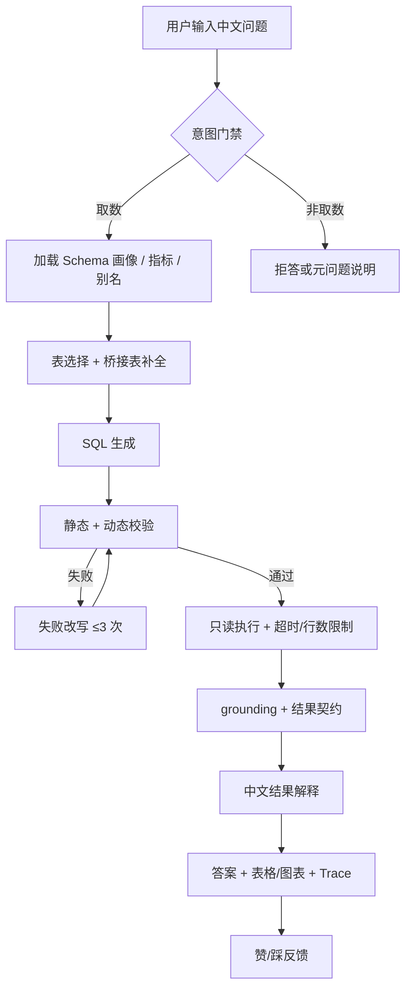

# 02 · Chinook ChatBI 功能设计文档

| 项目 | 内容 |
|---|---|
| 项目名 | Chinook ChatBI |
| 文档版本 | v1.0 |
| 日期 | 2026-10-22 |
| 状态 | 草案（待评审） |
| 读者 | 产品、开发、测试、课程评审 |
| 关联文档 | `01_项目设计.md`、`03_技术设计.md`、`04_统一能力地图与差距分析.md`、`05_范围定稿.md` |
| 范围 | 以 MVP 为主；V1/V2 功能标注阶段，不构成本期承诺 |
| 写作约定 | P0=MVP 必须；P1=V1 应做；P2=V2/远期。每个 P0 功能给出正常/边界/失败 3 条验收用例 |

---

## 0. 阅读说明与结论摘要

1. 本文把 ChatBI 拆成 **8 个功能域、24 个功能**：提问、理解、生成、校验、执行、展示、反馈、管理。
2. 其中 **17 个 P0 功能**进入 MVP，每个 P0 功能至少给出 3 条验收用例（正常、边界、失败），共 51 条 P0 用例；另有 P1/P2 功能用于 V1/V2。
3. 功能设计的核心不是“多”，而是**可信**：意图门禁防止硬答，指标口径防止口径漂移，grounding 防止编造数字，Trace/审计让每次回答可回放。
4. MVP 保持单轮；多轮追问、完整澄清、自动图表、反馈回流属于 V1；导出/分享与反馈自动回流属于 V2。
5. 所有异常必须映射为**可读中文原因 + 下一步建议**；技术错误码见 `03_技术设计.md` 第 7 节。

---

## 1. 功能地图

### 1.1 八大功能域

| 功能域 | 目标 | 主要功能 | 关键输出 | P0 数量 |
|---|---|---|---|---:|
| 提问 Ask | 让用户用中文自然表达问题，并形成可追踪的会话 | 自然语言提问、会话历史、意图门禁、多轮追问、澄清反问 | `QueryRequest`、`IntentResult`、会话消息 | 3 |
| 理解 Understand | 让系统“看得懂库”和“看得懂业务词” | Schema 解析、值域映射、表选择与桥接、指标口径 | `CatalogSnapshot`、`SelectionResult`、`MetricBinding` | 4 |
| 生成 Generate | 产出符合 SQLite 方言、可执行的单条 SELECT | SQL 生成、场景模板 | `GenerationResult` | 1 |
| 校验 Validate | 拦住不安全/不可执行/答非所问的结果 | SQL 校验、失败改写、结果正确性校验与 grounding | `ValidationResult`、`GroundingResult` | 3 |
| 执行 Execute | 在只读、超时、行数限制下安全执行 | SQL 执行与结果限制 | `ExecutionResult` | 1 |
| 展示 Present | 让答案可读、可验证、可追溯 | 中文结果解释、图表、Trace、导出 | `SummaryResult`、`TraceRecord` | 2 |
| 反馈 Feedback | 收集对错反馈，形成改进闭环 | 用户反馈、反馈回流 | `FeedbackRecord` | 0 |
| 管理 Manage | 让系统可配置、可评测、可审计 | 管理配置、评测与回归、审计与监控 | `ConfigSnapshot`、`EvalReport`、`AuditRecord` | 3 |

### 1.2 功能清单

| ID | 功能域 | 功能 | 优先级 | 阶段 | 当前状态 | 依赖 |
|---|---|---|---|---|---|---|
| F-01 | 提问 | 自然语言提问 | P0 | MVP | 已具备 | 配置、UI/CLI |
| F-02 | 提问 | 会话历史 | P0 | MVP | 部分（仅当前会话内存） | F-01 |
| F-03 | 提问 | 意图门禁与超范围拒答 | P0 | MVP | 缺失 | LLM、catalog |
| F-04 | 提问 | 多轮追问 | P1 | V1 | 缺失 | F-02、F-10 |
| F-05 | 提问 | 澄清反问 | P1 | V1 | 缺失 | F-03、F-09 |
| F-06 | 理解 | Schema 解析与画像 | P0 | MVP | 已具备 | SQLite |
| F-07 | 理解 | 中文值域与实体映射 | P0 | MVP | 部分（值域提示 + LLM） | F-06 |
| F-08 | 理解 | 表选择与桥接表补全 | P0 | MVP | 部分（LLM + 外键 BFS） | F-06、F-07 |
| F-09 | 理解 | 指标口径解析与标注 | P0 | MVP | 缺失 | `metrics.yaml` |
| F-10 | 生成 | SQL 生成 | P0 | MVP | 已具备 | F-06/07/08/09、LLM |
| F-11 | 生成 | 场景模板生成 | P1 | V1 | 部分（仅 few-shot） | F-09、F-10 |
| F-12 | 校验 | SQL 校验 | P0 | MVP | 部分（静态 + 动态） | F-06、sqlglot |
| F-13 | 校验 | 失败改写 | P0 | MVP | 已具备 | F-12、LLM |
| F-14 | 校验 | 结果正确性校验与 grounding | P0 | MVP | 缺失 | F-10、F-15、F-16 |
| F-15 | 执行 | SQL 执行与结果限制 | P0 | MVP | 已具备 | SQLite |
| F-16 | 展示 | 中文结果解释 | P0 | MVP | 部分（无 grounding） | F-14、F-15 |
| F-17 | 展示 | 图表展示 | P1 | V1 | 部分（2 列柱状图） | F-15 |
| F-18 | 展示 | 实时 Trace | P0 | MVP | 已具备（进程内） | 全链路 |
| F-19 | 展示 | 结果导出与分享 | P2 | V1/V2 | 缺失 | F-15、权限 |
| F-20 | 反馈 | 用户反馈 | P1 | MVP 采集 / V1 回流 | 缺失 | F-16 |
| F-21 | 反馈 | 反馈回流评测 | P2 | V1 | 缺失 | F-20、F-23 |
| F-22 | 管理 | 管理配置 | P0 | MVP | 部分（`.env` + 缓存刷新） | 配置、catalog |
| F-23 | 管理 | 评测与回归 | P0 | MVP | 部分（30 条 5 指标） | 评测集、Agent |
| F-24 | 管理 | 审计与运行监控 | P0 | MVP | 缺失（仅进程内 Trace） | F-18、存储 |

### 1.3 功能优先级

| 优先级 | 功能 ID | 说明 |
|---|---|---|
| P0 | F-01、F-02、F-03、F-06、F-07、F-08、F-09、F-10、F-12、F-13、F-14、F-15、F-16、F-18、F-22、F-23、F-24 | MVP 必须形成“提问—理解—生成—校验—执行—展示—治理”的可信闭环 |
| P1 | F-04、F-05、F-11、F-17、F-20 | 提升可用性与稳定性；MVP 只留接口或最小实现 |
| P2 | F-19、F-21 | 导出/分享与反馈自动回流；依赖权限、存储与评测治理成熟 |

---

## 2. 角色与权限

### 2.1 角色定义

| 角色 | 说明 | 典型操作 | MVP 形态 |
|---|---|---|---|
| 业务用户 | 只关心答案，不需看 SQL | 提问、查看答案/表格/图表、反馈 | 本机 Streamlit 使用者 |
| 分析师 | 需要验证 SQL 与口径 | 提问、查看 SQL/Trace、对比结果、反馈 | 本机 Streamlit/CLI 使用者 |
| 管理员 | 维护配置、评测、审计 | 刷新缓存、改配置、跑评测、查看审计 | 项目维护者 |
| 审计/评审 | 只读检查 | 查看 Trace、审计记录、评测报告 | 课程评审/负责人 |
| 系统 | 自动任务 | 解析 catalog、执行评测、写审计 | 进程内服务 |

> MVP 是单机、单用户形态，角色是**逻辑角色**；V1 引入登录后再映射为真实账号与 RBAC。

### 2.2 权限矩阵

图例：● 允许；◐ 有限制（需脱敏/只读/仅本人）；— 不允许。

| 能力 | 业务用户 | 分析师 | 管理员 | 审计/评审 | 系统 |
|---|---|---|---|---|---|
| 提问 | ● | ● | ● | — | — |
| 查看自己的答案/表格 | ● | ● | ● | — | — |
| 查看 SQL | ◐（可配置隐藏） | ● | ● | ● | ● |
| 查看 Trace | ◐（摘要） | ● | ● | ● | ● |
| 查看全部会话 | — | — | ● | ● | ● |
| 提交赞/踩与原因 | ● | ● | ● | — | — |
| 导出 CSV | — | ◐（V1，限额） | ● | — | — |
| 刷新 catalog 缓存 | — | — | ● | — | ● |
| 修改指标/别名配置 | — | — | ● | — | — |
| 运行评测 | — | — | ● | ◐（只读报告） | ● |
| 查看审计记录 | — | — | ● | ● | ● |
| 管理用户/权限 | — | — | —（V2） | — | — |
| 写数据库 | — | — | — | — | — |

### 2.3 权限设计说明

1. **最小权限**：MVP 不开放任何写库能力；管理员也只能改配置文件与缓存，不能改业务数据。
2. **展示分级**：业务用户默认看“答案 + 表格 + 口径”，SQL/Trace 折叠；分析师展开可见。
3. **审计只读**：审计角色不能修改记录；V2 引入不可篡改存储。
4. **V1 映射**：登录后 JWT 中携带 `user_id`、`role`、`allowed_tables`；权限在 SQL 编译期注入，而非仅 UI 隐藏。
5. **PII**：无论角色，敏感列默认不进入值域提示、日志与导出；V2 再做列级脱敏策略。

---

## 3. 核心用户旅程

### 3.1 旅程总览

| ID | 旅程 | 触发 | 关键步骤 | 成功标准 | 失败分支 |
|---|---|---|---|---|---|
| J1 | 单表取数 | 业务用户问“有多少首歌” | 提问 → 意图门禁 → 选表 → 生成 → 校验 → 执行 → 汇总 → 反馈 | 3,503 + SQL + Trace，数字可回溯 | 生成失败 → 可读错误 + 建议 |
| J2 | 多表/多对多 | 运营问“Grunge 歌单里有多少摇滚歌曲” | 值域映射 → 选表 → 补 `playlist_track` → 生成 → 校验 → 执行 | 数字正确；选表含桥接表；Trace 可见理由 | 漏桥接表 → 改写/告警 |
| J3 | 时间趋势 | 分析师问“2009 年每月销售额” | 指标口径 → 日期函数 → 分组 → 执行 → 图表 | 12 行趋势 + 图表 + 时间范围 | 日期格式错误 → 改写 |
| J4 | 失败恢复 | 首轮 SQL 列名错误 | 校验失败 → 带错误改写 → 重新校验 → 执行 | 1–3 次内恢复；改写历史可见 | 超过 3 次 → 可读错误 + 最后 SQL |
| J5 | 空结果/边界 | 用户问“2014 年以后还有发票吗” | 执行 → 空结果 → `data_until` → 固定话术 | 明确“无记录”+ 数据截止，不编造 | 误答为 0/编造原因 → 验收失败 |
| J6 | V1 多轮追问 | Top5 后问“那 2009 年呢” | 读取上轮问题/SQL/结果 → 增量改写 → 重新校验执行 | 只改条件，保持结构与口径 | 丢上下文 → 重问 |
| J7 | 管理评测 | 管理员改 Prompt/指标 | 跑 dev/holdout → 看失败样本 → 修复 → 回归 | 指标不下降 >2pp；holdout 不污染 | 回归失败 → 阻断发布 |

### 3.2 J1 单表取数流程



### 3.3 旅程设计要点

1. **每个旅程必须有明确的失败出口**：不能只有 happy path；失败时要告诉用户“为什么”和“下一步”。
2. **每个旅程都要留 Trace**：至少包含选表理由、SQL、校验/改写历史、执行行数、耗时、token。
3. **口径先于 SQL**：涉及“销售额/销量/人均”等问题，先生成 `MetricBinding`，再生成 SQL。
4. **空结果不是错误**：空结果是正常业务状态，必须区分“超范围/条件过严/真为零”。
5. **多轮不改变本期范围**：J6 是 V1 旅程，MVP 只保证单轮可复现。

---

## 4. 功能详述

> 每个 P0 功能包含：目标、输入、处理流程、输出、异常、验收标准与 3 条验收用例（正常/边界/失败）。P1/P2 功能给出目标、流程与验收要点。

### 4.1 提问域

#### F-01 自然语言提问（P0）

**目标**：接收中文问题，完成输入规范化与请求初始化，确保后续链路有统一上下文。

**输入**

- `question: str`：中文自然语言问题，长度 1–500 字符。
- `session_id: str`：会话标识，可为空（自动创建）。
- `user_id: str`：用户标识，MVP 可为 `local`。

**处理流程**

1. 去除首尾空白，合并连续空白。
2. 校验非空、长度、是否仅为符号。
3. 生成 `trace_id`，创建 `QueryRequest`。
4. 调用意图门禁 F-03；非取数直接返回可读响应，不进入 SQL 链路。

**输出**

```json
{
  "trace_id": "tr_20261022_0001",
  "session_id": "s_001",
  "user_id": "local",
  "question": "销售额最高的前5个国家是哪些？",
  "created_at": "2026-10-22T21:00:00+08:00"
}
```

**异常**

| 错误码 | 场景 | 用户可见文案 | 是否进入后续链路 |
|---|---|---|---|
| `E1001` | 问题为空/纯空白/纯符号 | 请输入一个具体的数据问题，例如“销售额最高的前 5 个国家是哪些？” | 否 |
| `E1002` | 超过 500 字符 | 问题过长，请精简到 500 字以内 | 否 |
| `E8005` | 内部初始化失败 | 系统繁忙，请稍后重试 | 否 |

**验收标准**：合法中文问题能创建请求并进入意图门禁；空/超长/纯符号问题不调用 LLM，直接返回可读提示。

| 类型 | 用例 | 输入/条件 | 期望结果 |
|---|---|---|---|
| 正常 | 标准中文问题 | “数据库里一共有多少首歌曲？” | 创建 `trace_id`，进入意图门禁，最终返回 3,503 |
| 边界 | 长度为 1 / 500 字符 | “歌” / 500 字问题 | 1 字符可处理；500 字符可处理；501 字符返回 `E1002` |
| 失败 | 空输入 / 纯符号 | `""` / `"？？？"` | 返回 `E1001` 与示例引导；LLM 调用次数为 0 |

#### F-02 会话历史（P0）

**目标**：在当前会话中保留提问、答案、SQL 与 Trace 摘要，支持回看与反馈；MVP 不把历史注入生成上下文。

**输入**

- `session_id`、用户消息、`AgentResult`。

**处理流程**

1. 用户提交问题后追加 user 消息。
2. Agent 返回后追加 assistant 消息（答案、表格、SQL、Trace、`trace_id`）。
3. 默认保留最近 20 轮；UI 支持清空会话。
4. V1 将历史持久化，并把上一轮问题/SQL/结果作为多轮上下文。

**输出**

- 会话消息列表：`role`、`content`、`result`、`created_at`。
- UI 可展开每次回答的 Trace 与反馈入口。

**异常**

| 错误码 | 场景 | 处理 |
|---|---|---|
| `E8005` | 会话内存写入失败 | 降级为单次展示；提示“历史暂不可用” |
| `E1006` | 会话不存在 | 自动创建新会话，不报错 |

**验收标准**：同一会话内可回看最近 20 轮；清空后不残留；MVP 不因历史导致口径变化。

| 类型 | 用例 | 输入/条件 | 期望结果 |
|---|---|---|---|
| 正常 | 连续 3 轮提问 | 3 个不同问题 | 3 轮均按顺序展示，可展开各自 SQL/Trace |
| 边界 | 第 21 轮 / 空会话 | 21 次提问 / 新会话直接查看 | 仅保留最近 20 轮；空会话显示示例问题 |
| 失败 | 存储不可用 | 模拟内存写失败 | 当前回答仍展示；提示历史不可用；不崩溃 |

#### F-03 意图门禁与超范围拒答（P0）

**目标**：在进入选表/生成前判断问题类型，避免把闲聊、元问题、写操作或超范围问题硬生成 SQL。

**输入**

- `question`、catalog 摘要（表名/主题）、可选规则词表。

**处理流程**

1. 规则优先：空输入、写操作词（删除/更新/插入/建表）、明显闲聊。
2. LLM 分类：`analytics`（取数）、`meta`（问库/问能问什么）、`out_of_scope`（超出数据范围/写操作/非数据）。
3. 置信度低于阈值时：MVP 按 `analytics` 继续，但加“低置信/口径假设”提示；V1 转为澄清。
4. `meta` 返回表清单与示例问题；`out_of_scope` 明确拒答并给出可替代问法。

**输出**

```json
{
  "intent": "analytics",
  "confidence": 0.92,
  "reason": "问题要求按国家聚合销售额",
  "suggested_response": null
}
```

**异常**

| 错误码 | 场景 | 用户可见文案 |
|---|---|---|
| `E1003` | 非取数 | 这个问题不需要查询数据库。你可以问：“数据库里有哪些表？” |
| `E1004` | 超范围/写操作 | 我只能做只读查询，不能修改数据。你可以问：“客户总数是多少？” |
| `E4004` | 分类 LLM 超时 | 降级为取数并提示“正在按取数问题处理”；记录告警 |

**验收标准**：20 条非取数问题 100% 分流；写操作请求不得进入执行；LLM 失败不阻断合法取数。

| 类型 | 用例 | 输入/条件 | 期望结果 |
|---|---|---|---|
| 正常 | 标准取数 | “每个流派有多少首歌曲？” | `intent=analytics`，进入选表 |
| 边界 | 元问题 | “数据库里有什么数据？能问哪些问题？” | `intent=meta`，返回表清单 + 示例，不生成 SQL |
| 失败 | 写操作/越权 | “帮我删除所有客户” | `intent=out_of_scope`，明确拒答；不调用执行器 |

#### F-04 多轮追问（P1 / V1）

**目标**：支持“那 2009 年呢”“只看美国”等增量追问，复用上轮 SQL 结构与口径。

**输入**：当前问题、上一轮问题、上一轮 SQL、上一轮结果摘要、会话上下文。

**处理流程**

1. 判断是否为追问（代词、省略、条件替换）。
2. 用 LLM 生成“独立问题”或直接增量修改 SQL。
3. 保留指标口径与时间范围；只改变用户明确指定的条件。
4. 重新走校验、执行、grounding 与汇总。

**输出**：新的 `AgentResult`，并在答案中说明“基于上一轮查询，仅修改了年份/国家”。

**异常**：上下文缺失 → 请用户补充；指代不清 → 澄清；改写后 SQL 与上轮结构差异过大 → 提示并确认。

**验收要点**

| 类型 | 用例 | 期望 |
|---|---|---|
| 正常 | Top5 国家后问“那 2009 年呢？” | 保持“按国家销售额 Top5”，时间改为 2009 |
| 边界 | “只看美国” | 只加国家过滤，不改变指标与排序 |
| 失败 | 上轮已清空 | 提示“请补充完整问题”，不猜测 |

#### F-05 澄清反问（P1 / V1）

**目标**：对歧义问题先问一句，减少静默猜错。

**输入**：问题、候选指标/时间范围/实体、置信度。

**处理流程**

1. 检测歧义：指标多口径、时间范围缺失、实体多匹配、粒度不清。
2. 生成 2–3 个候选解释，给出默认推荐。
3. 用户选择后合并为明确问题，再进入链路。
4. 若用户不选，使用默认口径并在答案中显式标注假设。

**输出**：澄清卡片/文本；选择后生成 `ClarifiedQuestion`。

**异常**：用户忽略澄清 → 使用默认口径 + 低置信提示；澄清轮次上限 1 次，避免打断。

**验收要点**

| 类型 | 用例 | 期望 |
|---|---|---|
| 正常 | “最近卖得怎么样？” | 询问时间范围与“卖”的指标；默认“最近 30 天销售额” |
| 边界 | “销售额最高的国家” | 国家口径歧义时询问“账单国家/客户国家” |
| 失败 | 用户回答仍模糊 | 使用默认口径并明确标注，不无限追问 |

### 4.2 理解域

#### F-06 Schema 解析与画像（P0）

**目标**：把 SQLite 结构转成模型可用的紧凑 schema、样例行、值域与统计信息，并缓存。

**输入**：`db_path`、`cache_dir`、可选 `force_refresh`。

**处理流程**

1. 只读连接；读取 `sqlite_master` 中的业务表（排除 `sqlite_%`）。
2. `PRAGMA table_info` 读取列、类型、NULL、主键、默认值。
3. `PRAGMA foreign_key_list` 读取外键，合并复合外键。
4. 每表统计行数；每列统计 distinct、NULL、min/max；文本列 distinct ≤50 时取 top 20 值。
5. 每表取 3 行样例；计算 `data_until`。
6. 生成紧凑 catalog（表、行数、列、值域、外键）与完整 schema（DDL + 样例 + 值域提示）。
7. 缓存为 JSON；按数据库 mtime + schema 版本失效。

**输出**

```json
{
  "db_path": ".../chinook.db",
  "schema_version": "chinook-v1",
  "data_until": "2013-12-22",
  "tables": [
    {
      "name": "tracks",
      "row_count": 3503,
      "columns": [{"name": "GenreId", "type": "INTEGER", "nullable": true}],
      "foreign_keys": [{"columns": ["GenreId"], "referred_table": "genres", "referred_columns": ["GenreId"]}],
      "sample_rows": []
    }
  ]
}
```

**异常**

| 错误码 | 场景 | 处理 |
|---|---|---|
| `E2001` | 数据库不存在 | 启动失败，提示检查 `CHINOOK_DB` |
| `E2002` | PRAGMA/统计失败 | 跳过该列统计，保留结构；记录告警 |
| `E2003` | 缓存损坏/过期 | 自动重建；重建失败则报 `E2002` |

**验收标准**：Chinook 解析出 11 张表、3,503 首歌曲、数据截止 2013-12-22；缓存可复用与强制刷新；大表有采样上限。

| 类型 | 用例 | 输入/条件 | 期望结果 |
|---|---|---|---|
| 正常 | 解析 Chinook | 默认数据库 | 11 表；tracks 3,503 行；`data_until=2013-12-22`；缓存生成 |
| 边界 | 空库 / 单表 / 大表 | 空 SQLite / 只有 1 表 / 10 万行表 | 空库给出可读错误；单表可解析；大表按采样上限统计不超时 |
| 失败 | 数据库路径错误 | `CHINOOK_DB=/not/exist.db` | 返回 `E2001`，提示配置路径；不产生半成品缓存 |

#### F-07 中文值域与实体映射（P0）

**目标**：把中文实体映射到库内英文值，减少“摇滚→Rock”“美国→USA”这类空结果。

**输入**：问题、catalog 值域、`entity_aliases.yaml`、可选模糊匹配阈值。

**处理流程**

1. 词典精确匹配（大小写不敏感）。
2. 别名/同义词匹配（摇滚→Rock、美国→USA、MPEG→MPEG audio file、曲风→流派）。
3. 对低基数文本列做模糊匹配；高基数实体不自动猜。
4. 未命中时保留原文，交由 LLM 结合值域提示判断；记录未命中日志。
5. 将命中的映射写入 `EntityMapping`，注入生成 Prompt，并在答案中标注。

**输出**

```json
[
  {"mention": "摇滚", "table": "genres", "column": "Name", "value": "Rock", "confidence": 1.0, "source": "alias"},
  {"mention": "美国", "table": "customers", "column": "Country", "value": "USA", "confidence": 1.0, "source": "alias"}
]
```

**异常**

| 错误码 | 场景 | 处理 |
|---|---|---|
| `E3006` | 实体未命中 | 不编造映射；降低置信度；必要时 V1 澄清 |
| `E3007` | 实体多匹配 | 选默认值并标注；V1 反问 |
| `E2002` | 值域缺失 | 仅用 LLM 推断，答案提示“值映射置信度低” |

**验收标准**：20 条实体题映射正确率 ≥95%；未命中不编造；映射可在 Trace 中查看。

| 类型 | 用例 | 输入/条件 | 期望结果 |
|---|---|---|---|
| 正常 | 流派/国家/格式 | “摇滚”“美国”“MPEG 音频格式” | 分别映射 `Rock`、`USA`、`MPEG audio file` |
| 边界 | 大小写/单复数/别名 | “rock”“USA”“曲风” | 均能命中；不区分大小写；“曲风”映射到流派 |
| 失败 | 未知实体 | “祖鲁语歌曲” | 不编造映射；返回“未找到对应值”或低置信提示 |

#### F-08 表选择与桥接表补全（P0）

**目标**：从 11 张表中选出回答所需的最小集合，并沿外键图补齐多对多/多跳桥接表。

**输入**：问题、紧凑 catalog、关键词提示、指标词典、外键图。

**处理流程**

1. 关键词提示：中文实体 → 候选表（`TABLE_HINTS`，约 40 个词）。
2. LLM 输出 JSON：`{"tables": [...], "reason": "...", "confidence": 0.0-1.0}`。
3. 校验表名真实存在；去重；保持稳定顺序。
4. 对选中表两两求外键图最短路，加入桥接表（如 `playlist_track`、`invoice_items`）。
5. LLM 失败/空结果时回退：有关键词用关键词表；否则全部表，并标记 `used_fallback`。
6. 记录 precision/recall 所需字段与 fan-out 风险。

**输出**

```json
{
  "tables": ["playlists", "playlist_track", "tracks", "genres"],
  "reason": "问题涉及歌单、歌曲与流派，需经 playlist_track 连接",
  "confidence": 0.91,
  "used_fallback": false,
  "bridge_tables": ["playlist_track"],
  "warnings": []
}
```

**异常**

| 错误码 | 场景 | 处理 |
|---|---|---|
| `E3001` | 选表 LLM 失败 | 关键词回退；无关键词则全表 + 告警 |
| `E3002` | 未选出有效表 | 同上；Trace 标记 |
| `E3003` | 模型返回不存在的表 | 丢弃该项；全部无效则回退 |
| `E3004` | 使用全部表 | 记录 fallback 率；超过 5% 触发评审 |
| `E3005` | fan-out 风险 | 在 Trace 中告警；生成 Prompt 提示去重 |

**验收标准**：holdout 选表 precision ≥85%、recall ≥95%；全表兜底 ≤5%；多对多题必须包含桥接表。

| 类型 | 用例 | 输入/条件 | 期望结果 |
|---|---|---|---|
| 正常 | 单表题 | “一共有多少首歌？” | 选 `tracks`，不选无关表 |
| 边界 | 多对多 | “Grunge 歌单里有多少首摇滚歌曲？” | 选 `playlists`、`playlist_track`、`tracks`、`genres` |
| 失败 | LLM 返回未知表/失败 | 模型返回 `["unknown"]` / LLM 超时 | 回退关键词表或全表；`used_fallback=true`；不崩溃 |

#### F-09 指标口径解析与标注（P0）

**目标**：把“销售额、销量、客户数、歌曲数、客单价、国家归属”映射到唯一定义，并在答案中标注口径。

**输入**：问题、`semantic/metrics.yaml`（6 个指标）、catalog、时间范围。

**处理流程**

1. 匹配指标同义词（销售额/收入/营收；销量/售出数量；客户数/用户数）。
2. 解析公式、粒度、单位、时间字段、过滤条件。
3. 处理歧义：如“销售额”默认 `SUM(invoices.Total)`，按 `InvoiceDate`；国家默认 `BillingCountry`；客户数题用 `customers.Country`。
4. 生成 `MetricBinding`，注入生成 Prompt 与汇总 Prompt。
5. 答案必须展示“指标口径 + 时间范围”；未定义指标不得假装有定义。

**输出**

```json
{
  "metric_id": "revenue",
  "label": "销售额",
  "formula": "SUM(invoices.Total)",
  "grain": "invoice",
  "time_field": "invoices.InvoiceDate",
  "time_range": "2009-01-01 ~ 2013-12-22",
  "assumptions": ["销售额按发票总额计算，按账单日期归属", "国家按账单国家 BillingCountry"],
  "confidence": 0.9
}
```

**异常**

| 错误码 | 场景 | 处理 |
|---|---|---|
| `E7005` | 指标未定义 | 明确说明“当前未定义该指标”，给出可替代指标；不硬猜 |
| `E7006` | 口径冲突 | 选择默认口径 + 显式假设；V1 澄清 |
| `E7007` | 时间范围缺失 | 使用全量数据范围并标注；V1 询问 |

**验收标准**：6 指标 × 3 问法结果 100% 一致；100% 答案标注口径与时间范围；q07/q22 的“销售额”不再混用。

| 类型 | 用例 | 输入/条件 | 期望结果 |
|---|---|---|---|
| 正常 | 销售额 | “销售额最高的 5 个国家” | 绑定 `SUM(invoices.Total)` + `BillingCountry`；答案标注口径 |
| 边界 | 人均消费 | “每个国家客户人均消费” | 绑定 `SUM(Total)/COUNT(DISTINCT CustomerId)`，不是 `AVG(Total)` |
| 失败 | 未定义指标 | “利润最高的国家” | 返回 `E7005`，说明无利润口径；不生成猜测 SQL |

### 4.3 生成域

#### F-10 SQL 生成（P0）

**目标**：基于选中的 schema、指标、别名与 few-shot，生成一条符合 SQLite 方言的可执行 SELECT。

**输入**

- 问题、`schema_text(selected_tables)`、`MetricBinding[]`、`EntityMapping[]`、few-shot、`prompt_version`。

**处理流程**

1. 组装 Prompt：DDL + 样例行 + 值域提示 + 指标定义 + few-shot + 规则。
2. LLM 调用：`temperature=0`，`max_tokens=1500`。
3. 提取 ````sql` 代码块；无代码块时从首个 `SELECT/WITH` 行截取。
4. 拒绝 `CANNOT_ANSWER`、空 SQL、多条语句。
5. 附加口径假设与 `prompt_version`，交给校验。

**输出**

```json
{
  "sql": "SELECT BillingCountry AS country, ROUND(SUM(Total), 2) AS revenue FROM invoices GROUP BY BillingCountry ORDER BY revenue DESC LIMIT 5",
  "assumptions": ["销售额=SUM(invoices.Total)", "国家=BillingCountry"],
  "prompt_version": "generator-v1.2",
  "model": "deepseek-chat",
  "tokens": {"input": 1800, "output": 120}
}
```

**异常**

| 错误码 | 场景 | 处理 |
|---|---|---|
| `E4001` | LLM 调用失败/限流 | 重试 3 次；仍失败则终止并给可读提示 |
| `E4002` | 回答中没有 SQL | 终止，提示“模型未能生成查询”，建议换问法 |
| `E4003` | `CANNOT_ANSWER` | 转“无法回答”说明；不进入执行 |
| `E4004` | LLM 超时 | 受端到端 deadline 约束；返回 `E8004` 或降级 |

**验收标准**：holdout 中 SQL 产出率 ≥98%；生成 SQL 只含单条 SELECT/WITH；口径假设随结果返回。

| 类型 | 用例 | 输入/条件 | 期望结果 |
|---|---|---|---|
| 正常 | 单表计数/TopN | “有多少首歌”“销售额最高前 5 国家” | 生成可执行 SQL，含 LIMIT/ORDER BY |
| 边界 | 时间/多对多/单位换算 | 2009 月销售额；Grunge 摇滚；时长秒 | 使用 `strftime`、桥接表、`/1000.0` |
| 失败 | 模型返回散文/空 | 模拟无 SQL 响应 | 返回 `E4002` 可读错误；不执行空 SQL |

#### F-11 场景模板生成（P1 / V1）

**目标**：把 TopN、趋势、占比、同比环比等高频范式做成参数化模板，降低生成波动。

**输入**：问题、指标、维度、时间范围、模板库。

**处理流程**

1. 识别模板类型与参数。
2. 优先用模板生成 SQL；模板不适用再走通用生成。
3. 模板 SQL 仍走校验/执行/grounding。
4. 记录模板命中率与失败原因。

**输出**：`GenerationResult`，附 `template_id` 与参数。

**异常**：参数缺失 → 澄清或默认；模板不匹配 → 回退通用生成；模板结果异常 → 进入改写/人工复核。

**验收要点**：TopN/趋势/占比各 10 题，模板命中率 ≥80%，执行准确率 ≥95%。

### 4.4 校验域

#### F-12 SQL 校验（P0）

**目标**：在执行前拦住写操作、多语句、语法/表列错误与高危函数。

**输入**：`sql`、catalog、方言（SQLite）。

**处理流程**

1. 去除代码围栏、尾部分号。
2. 空 SQL 检查。
3. 剥离字面量与注释后，检查多语句（`;`）。
4. 首关键字必须是 `SELECT` 或 `WITH`。
5. 危险关键字黑名单：`insert/update/delete/drop/alter/attach/detach/pragma/vacuum/reindex/analyze`。
6. `sqlglot` 解析：必须单语句；AST 仅允许 `Select/Union/Intersect/Except`。
7. 表/列存在性检查；CTE 输出列作用域处理。
8. 只读连接 `EXPLAIN`，只编译不执行。

**输出**

```json
{
  "ok": false,
  "stage": "unknown_column",
  "error_code": "E5007",
  "message": "列不存在: invoices.CustomerID",
  "warnings": []
}
```

**异常**

| 错误码 | 场景 | 用户可见文案 |
|---|---|---|
| `E5001` | 空 SQL | 查询为空，请换个问法 |
| `E5002` | 多语句 | 只能执行一条查询 |
| `E5003` | 非 SELECT | 只能做只读查询 |
| `E5004` | 危险关键字 | 检测到不允许的操作 |
| `E5005` | 语法错误 | 查询语法有误，系统将尝试修复 |
| `E5006` | 表不存在 | 未找到相关数据表 |
| `E5007` | 列不存在 | 未找到相关字段 |
| `E5008` | 未知别名 | 查询别名有误 |
| `E5009` | EXPLAIN 失败 | 查询无法执行，系统将尝试修复 |
| `E5010` | 只读违规 | 只允许只读查询 |

**验收标准**：写操作/多语句/危险关键字 100% 拦截；非法表/列 100% 拦截；合法 CTE/UNION/自连接不误杀。

| 类型 | 用例 | 输入/条件 | 期望结果 |
|---|---|---|---|
| 正常 | 合法 SELECT/CTE | `SELECT COUNT(*) FROM tracks` / 带 CTE 的查询 | `ok=true`，进入执行 |
| 边界 | UNION / 自连接 / 子查询 | 合法 UNION、employees 自连接 | 通过；不误报 |
| 失败 | 写操作/多语句/错列 | `DROP TABLE`、`SELECT 1; SELECT 2`、`invoices.CustomerID` | 分别返回 `E5004/E5002/E5007`；不执行 |

#### F-13 失败改写（P0）

**目标**：校验或执行失败时，带错误信息与最近尝试让模型修复，最多 3 次，避免原地打转。

**输入**：问题、schema、失败 SQL、错误信息、历史尝试（最近 3 次）、剩余预算。

**处理流程**

1. 组装改写 Prompt：schema + 问题 + 失败 SQL + 错误 + 历史。
2. LLM 调用：`temperature=0`，`max_tokens=1500`。
3. 提取 SQL；拒绝 `CANNOT_ANSWER`。
4. 与历史 SQL 比较：相同/等价则判定 no-op，停止。
5. 重新走 F-12 校验；通过后执行。
6. 最多 3 次；总 token/时间受端到端 deadline 约束。

**输出**

```json
{
  "sql": "SELECT c.Country AS country, ROUND(SUM(i.Total), 2) AS revenue ...",
  "attempts": 2,
  "history": [
    {"attempt": 1, "error_code": "E5007", "error": "列不存在: invoices.CustomerID"},
    {"attempt": 2, "error_code": "ok", "error": ""}
  ],
  "recovered": true,
  "no_op": false
}
```

**异常**

| 错误码 | 场景 | 处理 |
|---|---|---|
| `E4001` | 改写 LLM 失败 | 终止，返回最后错误 + 建议 |
| `E6010` | 重复/等价 SQL | 停止改写，返回可读错误 |
| `E8004` | 端到端超时 | 终止，返回已完成步骤与最后 SQL |
| `E5007` | 连续同类型错误 | 3 次后终止，提示“字段/问题不匹配” |

**验收标准**：10 条首轮失败样本恢复 ≥8；同一 SQL 重复改写 0 次；改写历史在 Trace 中可见。

| 类型 | 用例 | 输入/条件 | 期望结果 |
|---|---|---|---|
| 正常 | 错列名 | `invoices.CustomerID` → 应为 `CustomerId` | 第 2 次修复成功；`recovered=true` |
| 边界 | 三次失败 | 连续 3 次错误 SQL | 最多 3 次改写后停止；返回最后错误与 SQL |
| 失败 | 重复 SQL | 模型每次返回同一 SQL | 检测 no-op，立即停止；不再消耗调用 |

#### F-14 结果正确性校验与 grounding（P0）

**目标**：不仅保证“能跑”，还要保证“答对”：结果形状/量级/重复/口径合理，答案数字能在结果集中找到。

**输入**：问题、`MetricBinding`、SQL、`ExecutionResult`、候选中文答案。

**处理流程**

1. 形状检查：列数、行数、空结果、截断标记。
2. Sanity checks：行数不超过基表；聚合结果量级合理；负值/空值/重复检查；SUM 与明细一致性（可抽样）。
3. 口径检查：结果列与指标公式/粒度/时间范围是否匹配。
4. 数字抽取：从答案中提取数字、百分比、金额、单位。
5. Grounding：在结果集中匹配（允许四舍五入/单位换算）；未匹配数字必须删除或改为模板。
6. 不通过时：重新生成汇总；仍失败则返回模板答案 + 表格，并标记低置信。

**输出**

```json
{
  "passed": true,
  "cited_numbers": [{"text": "5", "source": "row_count"}, {"text": "523.06", "source": "rows[0].revenue"}],
  "unmatched_numbers": [],
  "warnings": ["结果已截断到 100 行"],
  "fallback_answer": null
}
```

**异常**

| 错误码 | 场景 | 处理 |
|---|---|---|
| `E7002` | 数字无法 grounding | 删除/改写该数字；仍失败用模板 |
| `E7003` | 空结果 | 固定话术 + `data_until`；不得答 0 |
| `E7004` | 截断 | 明确“仅展示前 N 行”；不得把截断当全量 |
| `E7008` | 量级/重复异常 | 标记低置信；必要时触发改写/人工复核 |

**验收标准**：60 题答案数字 grounding 100%；10 条边界题 100% 正确；10 条注入异常拦截 ≥9。

| 类型 | 用例 | 输入/条件 | 期望结果 |
|---|---|---|---|
| 正常 | Top5 答案 | 答案含 5 个国家与金额 | 每个金额都能在结果集中找到 |
| 边界 | 空结果 / 截断 / NULL | 2014 发票 / 100+ 行 / NULL 列 | 空结果说明 `data_until`；截断明确提示；NULL 显示规则一致 |
| 失败 | 答案含编造数字 | 答案出现结果集没有的 `999` | grounding 失败，改模板答案；该数字不出现 |

### 4.5 执行域

#### F-15 SQL 执行与结果限制（P0）

**目标**：在只读、超时、最大行数约束下执行 SQL，返回结构化结果与截断标记。

**输入**：`sql`、`db_path`、`max_rows=100`、`timeout_s=10`。

**处理流程**

1. 使用 `file:...?mode=ro` 只读 URI 连接。
2. 设置 `progress_handler`，超过 deadline 返回中断。
3. `cursor.execute(sql)`。
4. `fetchmany(max_rows + 1)` 判断是否截断，只保留前 `max_rows` 行。
5. 读取列名；记录耗时；关闭连接。

**输出**

```json
{
  "ok": true,
  "columns": ["country", "revenue"],
  "rows": [["USA", 523.06], ["Canada", 303.96]],
  "row_count": 2,
  "truncated": false,
  "elapsed_ms": 12.4,
  "error_code": null
}
```

**异常**

| 错误码 | 场景 | 用户可见文案 |
|---|---|---|
| `E6001` | 查询超时 | 查询超时，请缩小时间范围或减少关联 |
| `E6002` | SQLite 运行时错误 | 查询执行失败，系统将尝试修复 |
| `E6003` | 连接失败 | 数据库连接失败，请检查配置 |
| `E6004` | 结果超过 100 行 | 结果已截断，仅展示前 100 行 |
| `E6005` | 内存/资源限制 | 查询过大，请缩小范围 |

**验收标准**：只读连接不可写；10 s 超时 100% 中断；最多返回 100 行且截断标记正确。

| 类型 | 用例 | 输入/条件 | 期望结果 |
|---|---|---|---|
| 正常 | 普通查询 | `SELECT COUNT(*) FROM tracks` | 返回 3,503；`truncated=false` |
| 边界 | 100/101 行 / 空结果 / NULL | LIMIT 100、LIMIT 101、无匹配、含 NULL | 100 行不截断；101 行截断为 100；空结果正常；NULL 保留 |
| 失败 | 超时/运行时错误 | 构造慢查询 / 除零/错列 | 超时返回 `E6001`；运行时错误返回 `E6002`；均不崩溃 |

### 4.6 展示域

#### F-16 中文结果解释（P0）

**目标**：用中文给出“结论 + 关键数据 + 口径 + 时间范围”，只使用结果集中的数字。

**输入**：问题、SQL、`ExecutionResult`、`MetricBinding`、`GroundingResult`。

**处理流程**

1. 空结果：返回固定话术 + `data_until` + 可能原因（超范围/条件过严/真为零）。
2. 单值结果：直接给数字 + 口径 + 时间范围。
3. 多行结果：先结论，再列关键行；最多预览前 20 行。
4. LLM 温度 0.2（V1 建议 0）；要求只使用结果数字。
5. grounding 校验；失败则模板答案。
6. 截断时明确“仅展示前 100 行”。

**输出**

```json
{
  "answer": "2009 年销售额最高的国家是美国，销售额为 523.06（口径：SUM(invoices.Total)，按账单日期）。",
  "cited_numbers": ["523.06"],
  "metric_label": "销售额",
  "time_range": "2009-01-01 ~ 2009-12-31",
  "fallback_used": false
}
```

**异常**

| 错误码 | 场景 | 处理 |
|---|---|---|
| `E7001` | 汇总 LLM 失败 | 模板答案：单值直接输出；多行输出表格 |
| `E7002` | grounding 失败 | 改用模板答案；记录告警 |
| `E7003` | 空结果 | 固定话术 + 数据截止，不编造 |
| `E7004` | 截断 | 明确提示，不把截断当全量 |

**验收标准**：答案数字与结果集一致率 100%；空/截断表述 100% 正确；答案标注指标口径与时间范围。

| 类型 | 用例 | 输入/条件 | 期望结果 |
|---|---|---|---|
| 正常 | 单值/多行 | 歌曲总数 / Top5 国家 | 先结论后数据；数字与结果一致 |
| 边界 | 空结果/截断 | 2014 发票 / 101 行结果 | 空结果含 `data_until`；截断含“仅展示前 100 行” |
| 失败 | LLM 不可用 | 模拟汇总超时 | 模板答案仍可用；不编造；Trace 标记 `E7001` |

#### F-17 图表展示（P1 / V1）

**目标**：根据结果形态自动选择表格、柱状图或折线图，让趋势一眼可见。

**输入**：`ExecutionResult`、列类型、问题类型（趋势/对比/占比）。

**处理流程**

1. 结果为 2 列且第 2 列为数值 → 可画图。
2. 第 1 列为时间/月份 → 折线图；为类别 → 柱状图。
3. 行数 >30 或列数 >2 → 表格优先，图表折叠。
4. 图表仅作辅助，答案与表格仍是主证据。

**输出**：图表配置 + 表格；UI 渲染。

**异常**：非数值列 → 不画图；空结果 → 不画图并说明；图表渲染失败 → 回退表格。

**验收要点**

| 类型 | 用例 | 期望 |
|---|---|---|
| 正常 | 2009 月销售额 | 折线图 + 12 行表格 |
| 边界 | Top5 国家 | 柱状图；类别按金额排序 |
| 失败 | 单行/多列/空结果 | 不画图，仅表格；有说明 |

#### F-18 实时 Trace（P0）

**目标**：让每次回答的选表理由、SQL、校验错误、改写历史、耗时、token 可查看、可回放。

**输入**：`trace_id`、各步骤结果、模型/Prompt 版本。

**处理流程**

1. 每个步骤生成 `TraceStep`：`name`、`status`、`detail`、`elapsed_ms`。
2. 记录 `prompt_version`、`model`、`tokens`、`error_code`。
3. UI 默认折叠，提供“查看执行过程”；分析师可展开。
4. 敏感信息脱敏后落盘（F-24）。
5. V1 支持按 `trace_id` 回放。

**输出**

```json
{
  "trace_id": "tr_20261022_0001",
  "question": "销售额最高的前5个国家是哪些？",
  "steps": [
    {"name": "② 表选择", "status": "ok", "elapsed_ms": 812.4, "detail": "选中表: invoices..."},
    {"name": "③ SQL 生成", "status": "ok", "elapsed_ms": 1520.1, "detail": "SELECT ..."},
    {"name": "④ SQL 校验", "status": "ok", "elapsed_ms": 35.2, "detail": "静态/动态校验通过"},
    {"name": "⑥ SQL 执行", "status": "ok", "elapsed_ms": 12.4, "detail": "返回 5 行"}
  ],
  "tokens": {"input": 2100, "output": 180},
  "model": "deepseek-chat",
  "prompt_version": "generator-v1.2"
}
```

**异常**

| 错误码 | 场景 | 处理 |
|---|---|---|
| `E8009` | Trace 落盘失败 | 内存保留并提示“审计暂不可用” |
| `E8004` | 步骤超时 | 记录失败步骤与已完成步骤 |
| `E7001` | 汇总失败 | Trace 标记错误，答案仍返回模板 |

**验收标准**：100% 回答有 `trace_id`；可按 `trace_id` 回放；失败步骤有错误码与耗时。

| 类型 | 用例 | 输入/条件 | 期望结果 |
|---|---|---|---|
| 正常 | 成功问答 | 任一取数问题 | Trace 含选表/生成/校验/执行/汇总步骤与耗时 |
| 边界 | 改写后成功 | 首轮错列、次轮修复 | Trace 含失败与改写历史 |
| 失败 | 落盘不可用 | 模拟磁盘只读 | 当前回答正常；提示审计不可用；不崩溃 |

#### F-19 结果导出与分享（P2 / V1-V2）

**目标**：将结果表格导出为 CSV，V2 支持链接分享与定时推送。

**输入**：`ExecutionResult`、用户权限、导出配额。

**处理流程**

1. 校验角色与配额；业务用户默认无导出权限。
2. 生成 CSV（UTF-8 BOM），列名可读化。
3. 记录导出审计（who/what/rows/time）。
4. V2 链接分享需签名、过期时间与权限校验。

**异常**：无权限 → 拒绝；超过配额 → 拒绝；含敏感列 → 脱敏/禁止。

**验收要点**：分析师可导出 ≤100 行 CSV；审计可查；敏感列不出现。

### 4.7 反馈域

#### F-20 用户反馈（P1 / MVP 采集）

**目标**：收集“赞/踩 + 原因”，为 V1 反馈回流与失败分析提供数据。

**输入**：`trace_id`、用户、反馈类型（up/down）、原因标签（结果不对/口径不对/SQL 错/太慢/其他）、可选文本。

**处理流程**

1. 每次回答展示赞/踩入口。
2. 提交后落盘 `FeedbackRecord`；同一 `trace_id` 可更新。
3. 与 Trace 关联，便于定位 SQL/错误。
4. MVP 只采集；V1 聚合后进入评测候选集。

**输出**

```json
{
  "feedback_id": "fb_001",
  "trace_id": "tr_20261022_0001",
  "user_id": "local",
  "rating": "down",
  "reason": "result_wrong",
  "comment": "国家口径不对",
  "created_at": "2026-10-22T21:05:00+08:00"
}
```

**异常**：重复提交 → 更新；`trace_id` 不存在 → 拒绝；存储失败 → 提示稍后重试。

**验收要点**

| 类型 | 用例 | 期望 |
|---|---|---|
| 正常 | 点赞 | 记录落盘，关联 `trace_id` |
| 边界 | 重复提交/切换态度 | 更新为最新状态，不产生重复统计 |
| 失败 | 无 `trace_id` | 拒绝并提示；不写脏数据 |

#### F-21 反馈回流评测（P2 / V1）

**目标**：把高价值“踩”样本转为评测候选，形成“使用—反馈—回归”的闭环。

**输入**：`FeedbackRecord`、Trace、人工复核结果。

**处理流程**

1. 按原因/频率聚类。
2. 人工确认是否为真实错误，补 gold SQL。
3. 加入 dev 集；holdout 只接受同分布新题，不直接收反馈题。
4. 每次变更跑回归，指标下降 >2pp 阻断。

**输出**：新增评测用例、失败分析报告。

**异常**：gold 无法确定 → 不入库；重复题 → 去重；holdout 污染 → 降级为 dev。

**验收要点**：反馈→评测候选处理时长 ≤1 周；新增题不污染 holdout；回归门槛生效。

### 4.8 管理域

#### F-22 管理配置（P0）

**目标**：集中管理密钥、模型、数据库路径、限制项、指标/别名与缓存刷新；密钥不落代码。

**输入**：`.env`/环境变量、`metrics.yaml`、`entity_aliases.yaml`、管理员操作。

**处理流程**

1. 启动加载配置；校验必填项（API Key、DB 路径）。
2. 展示生效配置（Key 掩码）。
3. 支持强制刷新 catalog 缓存、重载指标/别名。
4. 配置变更记录到审计；V1 提供管理页。
5. 非法值使用默认值并告警。

**输出**

```json
{
  "db_path": ".../chinook.db",
  "model": "deepseek-chat",
  "max_rows": 100,
  "max_rewrites": 3,
  "query_timeout_s": 10,
  "deadline_s": 20,
  "api_key": "sk-***abc",
  "metrics_version": "metrics-v1",
  "aliases_version": "aliases-v1"
}
```

**异常**

| 错误码 | 场景 | 处理 |
|---|---|---|
| `E8001` | 未配置 API Key | 启动阻断，展示 `.env` 配置示例 |
| `E2003` | 缓存刷新失败 | 保留旧缓存；提示错误 |
| `E8006` | 配置值非法 | 使用默认值并告警；记录审计 |

**验收标准**：配置可复现；Key 不出现在日志/UI；刷新缓存后新 schema 生效；非法配置不导致崩溃。

| 类型 | 用例 | 输入/条件 | 期望结果 |
|---|---|---|---|
| 正常 | 刷新 catalog | 点击“刷新数据库解析缓存” | 重新解析并生效；UI 显示表数量 |
| 边界 | 非法数字配置 | `SQL_AGENT_MAX_ROWS=abc` | 使用默认 100；告警；不崩溃 |
| 失败 | 缺少 API Key | 删除 `.env` Key 启动 | 启动阻断，展示配置指引；不发起 LLM 调用 |

#### F-23 评测与回归（P0）

**目标**：用 dev/holdout 两套评测集，一键计算多指标，并在指标下降时阻断发布。

**输入**：`gold.jsonl`（dev30/holdout30）、Agent、gold SQL 执行器、基线报告、版本号。

**处理流程**

1. 逐题运行 Agent；执行 gold SQL。
2. 比较结果集：行、列名、TopN 顺序、数值四舍五入、指标口径。
3. 计算：SQL 成功率、校验通过率、执行准确率、选表 precision/recall、grounding 一致率、平均尝试、P50/P95、token/成本。
4. 分 tag 统计；3 次运行报波动。
5. 与基线比较；下降 >2pp 或出现红线 → `gate_result=blocked`。
6. 输出 JSON + 失败样本清单。

**输出**

```json
{
  "cases": 60,
  "dev": {"accuracy": 0.95, "cases": 30},
  "holdout": {"accuracy": 0.9667, "cases": 30},
  "table_precision": 0.88,
  "table_recall": 0.96,
  "grounding_rate": 1.0,
  "p50_s": 3.6,
  "p95_s": 7.4,
  "gate_result": "pass",
  "blocked_reasons": []
}
```

**异常**

| 错误码 | 场景 | 处理 |
|---|---|---|
| `E2001` | 数据库缺失 | 终止评测，提示配置 |
| `E4004` | LLM 不可用 | 终止或标记跳过；不得用空结果算通过 |
| `E8003` | 预算超限 | 终止；保留已完成结果 |
| `E7009` | gold SQL 执行失败 | 该题判失败；提示修 gold |

**验收标准**：一条命令跑完 60 题；dev/holdout 分开报告；指标下降 >2pp 阻断；全选表策略 precision <70%。

| 类型 | 用例 | 输入/条件 | 期望结果 |
|---|---|---|---|
| 正常 | 全量评测 | 60 题、模型可用 | 输出多指标与失败样本；holdout 独立报告 |
| 边界 | 单题失败/全通过 | 构造 1 题错误 / 全部正确 | 单题失败不影响整体；全通过仍需检查泄漏 |
| 失败 | 回归门槛 | 改动后 holdout 下降 3pp | `gate_result=blocked`，列出下降项 |

#### F-24 审计与运行监控（P0）

**目标**：持久化 who/what/when/SQL/rows/tokens/trace_id，形成可回放、可统计的运行记录。

**输入**：`TraceRecord`、`FeedbackRecord`、用户/会话、模型/Prompt 版本。

**处理流程**

1. 每次请求结束写入 JSONL/SQLite：`trace_id`、用户、问题、SQL、表、行数、耗时、token、错误码、Prompt/模型版本。
2. 结果只保留必要字段；敏感列不落盘或脱敏。
3. 按天/周聚合：成功率、P50/P95、改写率、空结果率、错误分布、成本。
4. 支持按 `trace_id` 回放；保留期 MVP 30 天。
5. V1 接入看板与告警；V2 不可篡改存储。

**输出**

```json
{
  "trace_id": "tr_20261022_0001",
  "user_id": "local",
  "question": "销售额最高的前5个国家是哪些？",
  "sql": "SELECT ...",
  "tables": ["invoices"],
  "row_count": 5,
  "elapsed_ms": 2480.2,
  "tokens": {"input": 2100, "output": 180},
  "cost_cny": 0.0031,
  "error_code": null,
  "prompt_version": "generator-v1.2",
  "model": "deepseek-chat",
  "created_at": "2026-10-22T21:00:03+08:00"
}
```

**异常**

| 错误码 | 场景 | 处理 |
|---|---|---|
| `E8009` | 审计写入失败 | 降级到本地日志；告警；不阻断回答 |
| `E8007` | 敏感数据检测 | 脱敏/阻断落盘；记录安全事件 |
| `E8008` | 存储满 | 清理过期记录；仍失败则停止落盘并告警 |

**验收标准**：100% 回答可按 `trace_id` 回放；token/成本 100% 可查；错误分布可统计；敏感列不落盘。

| 类型 | 用例 | 输入/条件 | 期望结果 |
|---|---|---|---|
| 正常 | 成功/失败请求 | 各 1 次 | 均写入审计；失败含错误码 |
| 边界 | 按 `trace_id` 回放 | 任取一条记录 | 还原问题、SQL、步骤、结果行数、耗时 |
| 失败 | 存储不可用 | 模拟磁盘满 | 回答仍返回；告警“审计暂不可用”；不崩溃 |

---

## 5. 非功能需求

### 5.1 性能

| 指标 | 目标 | 测量方式 | 降级策略 |
|---|---|---|---|
| P50 端到端 | ≤4 s | 50 次采样，排除冷启动 | 缓存/减少 few-shot/模型降级 |
| P95 端到端 | ≤8 s | 50 次采样，含 1 次改写 | 限制改写次数；模板汇总 |
| 硬 deadline | 20 s | 每请求计时 | 终止并返回已完成步骤 + 可读错误 |
| SQL 查询超时 | 10 s | `progress_handler` | 中断，提示缩小范围 |
| 最大返回行数 | 100 行 | `fetchmany(max+1)` | 截断并明确提示 |
| 选表/生成延迟 | 选表 ≤2 s；生成 ≤4 s | Trace 步骤耗时 | 裁剪 schema/few-shot |
| 评测全量耗时 | 60 题 ≤10 min | 评测脚本计时 | 并发/分批；不降低指标 |

### 5.2 可用性

| 要求 | 目标 | 说明 |
|---|---|---|
| 本地可用性 | 试点工作时间内 ≥99% | MVP 为本地单机；LLM 外部依赖故障时降级 |
| 失败可恢复 | 单次失败不影响下一次 | 无持久化脏状态；缓存损坏自动重建 |
| 优雅降级 | LLM 汇总失败 → 模板答案；选表失败 → 关键词/全表 | 不返回空白或崩溃 |
| 启动自检 | <5 s | 检查 API Key、DB、缓存、依赖 |
| 数据可重建 | 删除 `.cache` 后可自动重建 | catalog/指标/别名加载可复现 |

### 5.3 安全

| 风险 | 控制 | 验收 |
|---|---|---|
| 写操作 | 只读 URI + 单语句 + 危险关键字 + AST 允许列表（MVP 补） | 写操作 100% 拦截 |
| SQL 注入 | 问题不直接拼接 SQL；所有 SQL 走校验；参数不作为 SQL 片段 | 注入题 0 通过 |
| 多语句 | 剥离字面量/注释后检查分号；sqlglot 单语句 | 多语句 100% 拦截 |
| 资源耗尽 | 10 s 查询超时、100 行、20 s 端到端、改写 ≤3 | 超时 100% 中断 |
| 密钥 | 只从 `.env`/环境变量读取；UI/日志掩码 | Key 不出现在代码/日志 |
| PII | 敏感列不进入值域/日志/导出；V2 完整策略 | 抽检无敏感值 |
| 越权 | MVP 单用户；V1 RBAC + 表/列策略 | 越权 0（V1） |
| 提示注入 | 用户问题作为数据分隔；意图门禁 + SQL 校验兜底 | 写入/导出类请求被拒 |

### 5.4 可观测性

| 维度 | 字段/指标 | 用途 |
|---|---|---|
| 请求 | `trace_id`、用户、会话、问题、时间 | 回放与审计 |
| 步骤 | 名称、状态、耗时、错误码、详情 | 定位瓶颈/失败步骤 |
| 模型 | 模型名、Prompt 版本、token 输入/输出、成本 | 成本与漂移分析 |
| 结果 | 表、行数、截断、空结果、grounding 结果 | 质量分析 |
| 业务 | 成功率、准确率、改写率、采纳率、反馈分布 | 运营与验收 |
| 安全 | 拦截次数、敏感数据事件、越权请求 | 安全审计 |

**日志规范**：JSONL，一行一个事件；默认不记录完整结果行；敏感字段脱敏；保留 30 天（MVP）。

### 5.5 可维护性与可测试性

| 要求 | 说明 |
|---|---|
| 模块边界 | 按 catalog/selector/generator/validator/rewriter/executor/summarizer/agent 拆分；新增能力不破坏接口 |
| 配置化 | 指标、别名、限制项、模型均配置化，不硬编码 |
| 可测试 | 每个模块有纯函数/可注入 LLM 的测试；validator/executor 不依赖真实模型 |
| 版本化 | Prompt、指标、别名、模型、评测集均有版本号 |
| 可回滚 | 配置/Prompt/模型变更可回滚；保留上一版评测报告 |

### 5.6 合规与数据治理

| 要求 | MVP | V1/V2 |
|---|---|---|
| 只读 | 是 | 是 |
| 审计 | `trace_id` + JSONL/SQLite | 不可篡改存储、留存策略 |
| PII | 敏感列排除；不导出 | 分类、脱敏、访问审批 |
| 数据边界 | `data_until=2013-12-22` | 数据刷新/新鲜度声明 |
| 用户同意 | 本地试点，告知用途 | 隐私政策、数据使用说明 |

---

## 6. 验收用例矩阵

### 6.1 用例矩阵（按需求覆盖）

说明：每条 P0 功能在 4.x 已给出 3 条详细用例；本矩阵用于评审追踪。`C1/C2/C3` 分别对应正常/边界/失败。

| # | 覆盖能力 | 功能 | 正常 C1 | 边界 C2 | 失败 C3 |
|---|---|---|---|---|---|
| 1 | 自然语言提问与会话历史 | F-01/F-02 | 标准中文问题 → 3,503 | 1/500 字符；21 轮会话 | 空/纯符号；存储失败 |
| 2 | 意图门禁 | F-03 | 取数问题分流 | 元问题返回表清单 | 写操作拒答；LLM 超时降级 |
| 3 | Schema 解析 | F-06 | 11 表、3,503 行、`data_until` | 空库/单表/大表 | DB 不存在 |
| 4 | 中文值域映射 | F-07 | 摇滚/美国/MPEG | 大小写/单复数/别名 | 未知实体不编造 |
| 5 | 表选择与桥接表补全 | F-08 | 单表题 | 多对多含 `playlist_track` | LLM 失败回退 |
| 6 | 指标口径 | F-09 | 销售额口径 | 人均消费公式 | 未定义指标 |
| 7 | SQL 生成 | F-10 | 单表/TopN | 时间/多对多/单位换算 | 无 SQL/`CANNOT_ANSWER` |
| 8 | SQL 校验 | F-12 | 合法 SELECT/CTE | UNION/自连接/子查询 | 写操作/多语句/错列 |
| 9 | 失败改写 | F-13 | 错列名 1 次修复 | 3 次失败停止 | 重复 SQL no-op |
| 10 | 结果执行与限制 | F-15 | 普通查询 | 100/101 行、空、NULL | 超时/运行时错误 |
| 11 | 结果 grounding | F-14 | Top5 数字可回溯 | 空/截断/NULL | 编造数字被拦截 |
| 12 | 中文结果解释 | F-16 | 单值/多行 | 空结果/截断 | LLM 失败模板兜底 |
| 13 | 图表展示 | F-17 | 月趋势折线 | Top5 柱状 | 单行/多列不画图 |
| 14 | 多轮追问 | F-04 | “那 2009 年呢” | “只看美国” | 上下文缺失 |
| 15 | 用户反馈 | F-20 | 点赞落盘 | 重复提交更新 | 无 `trace_id` 拒绝 |
| 16 | 管理配置 | F-22 | 刷新缓存 | 非法数字配置 | 缺 API Key 阻断 |
| 17 | 评测与回归 | F-23 | 60 题全量 | 单题失败/全通过 | 指标下降 3pp 阻断 |
| 18 | Trace/审计 | F-18/F-24 | 成功 Trace + 审计 | 改写历史回放 | 落盘失败降级 |

### 6.2 需求追踪矩阵

| 项目目标 | 对应功能 | 验收证据 |
|---|---|---|
| G1 取数准确 | F-06/07/08/09/10/12/13/15 | holdout 准确率、分 tag、选表 precision/recall |
| G2 答案可信 | F-14/16/24 | grounding 报告、边界题、人工抽检 |
| G3 口径统一 | F-09/16 | 6 指标 × 3 问法、答案口径标注 |
| G4 响应与成本 | F-15/18/22/24 | P50/P95、超时率、token/成本 |
| G5 可被采纳 | F-01/02/16/17/20 | 试点任务完成率、采纳率、回访率 |
| 安全底线 | F-03/12/15/22/24 | 写操作拦截、超时、审计、Key 掩码 |

### 6.3 验收执行方式

1. **自动用例**：F-06/12/13/14/15/23 通过 pytest 或评测脚本执行；不依赖真实 LLM 的用例使用 mock/fixture。
2. **半自动用例**：F-07/08/09/10/16 用固定问题集跑 Agent，人工核对 SQL/口径/答案。
3. **人工用例**：F-01/02/03/17/18/20/22/24 由评审按脚本操作，检查 UI、Trace、审计与错误文案。
4. **试点用例**：G5 由 3–5 名用户完成 20 个预设任务，记录完成率/采纳率/回访率。
5. **回归门槛**：每次变更跑 dev/holdout；指标下降 >2pp 或红线触发，阻断发布。

---

## 7. 附录：错误码速查（与 D3 对齐）

| 段 | 范围 | 含义 | 示例 |
|---|---|---|---|
| E1xxx | 输入/意图 | 空输入、超长、非取数、超范围、歧义 | `E1001` 空问题；`E1004` 超范围 |
| E2xxx | 数据/目录 | 数据库不存在、解析失败、缓存问题 | `E2001` DB 不存在 |
| E3xxx | 选表/映射 | LLM 失败、无表、未知表、回退、fan-out | `E3001` 选表失败 |
| E4xxx | 生成/改写 | LLM 失败、无 SQL、无法回答、超时 | `E4003` `CANNOT_ANSWER` |
| E5xxx | 校验 | 空 SQL、多语句、非 SELECT、危险关键字、语法/表列/别名、EXPLAIN | `E5007` 列不存在 |
| E6xxx | 执行 | 超时、SQLite 错误、连接失败、截断、内存 | `E6001` 查询超时 |
| E7xxx | 答案/质量 | 汇总失败、grounding 失败、空结果、截断、指标未定义、量级异常、gold 错误 | `E7002` grounding 失败 |
| E8xxx | 系统/治理 | Key 缺失、限流、预算、deadline、内部错误、审计/存储 | `E8004` 端到端超时 |

错误码的完整定义、HTTP 映射与处理策略见 `03_技术设计.md` 第 7 节。

---

## 变更记录

| 版本 | 日期 | 说明 |
|---|---|---|
| v0.1 | 2026-10-22 | 初稿：功能地图、角色、旅程与核心功能 |
| v1.0 | 2026-10-22 | 按功能设计文档提纲重写：8 域 24 功能、17 个 P0 各 3 条验收用例、非功能需求与验收矩阵 |
