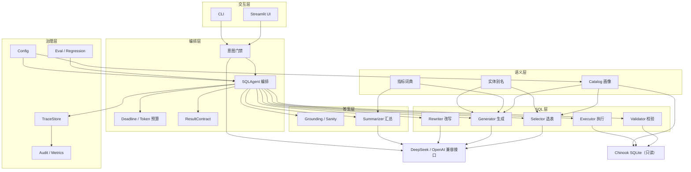
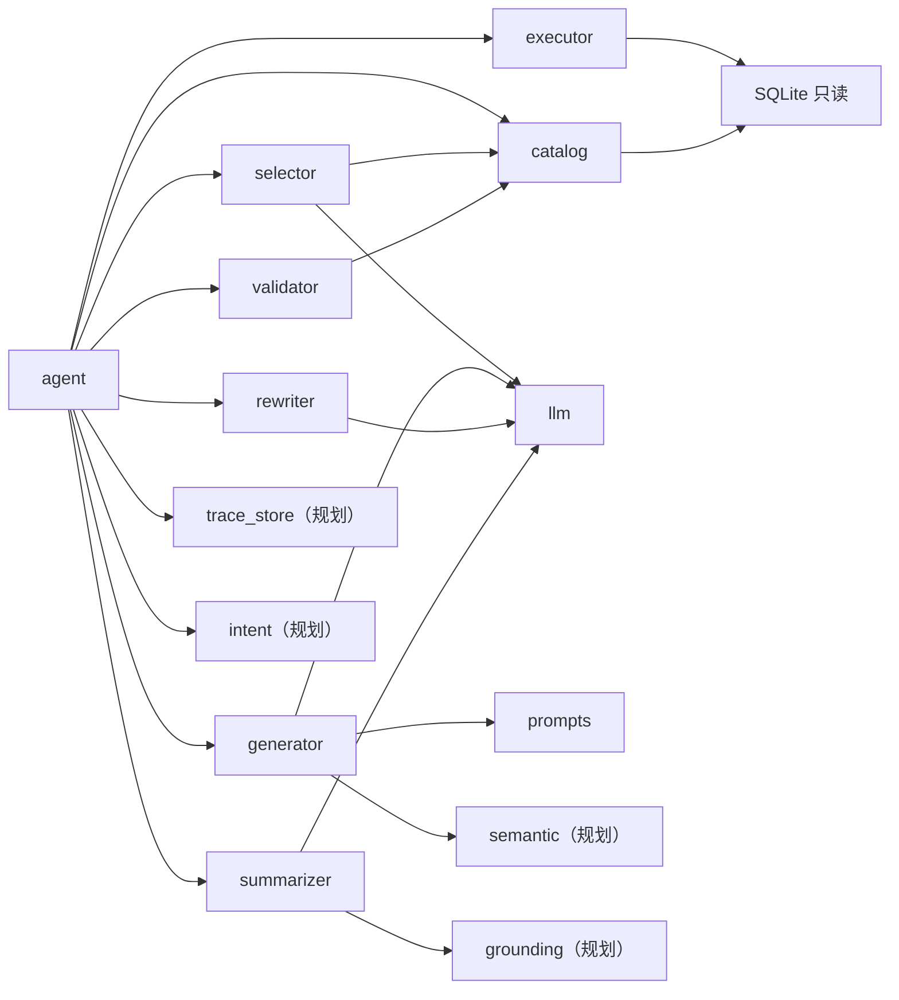
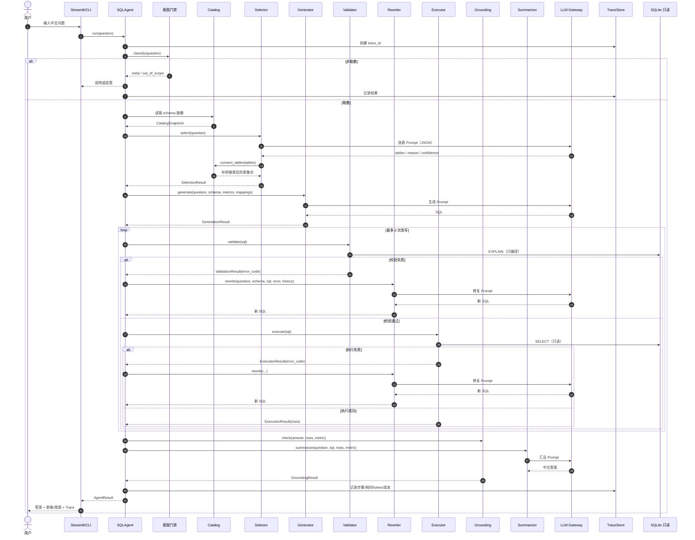
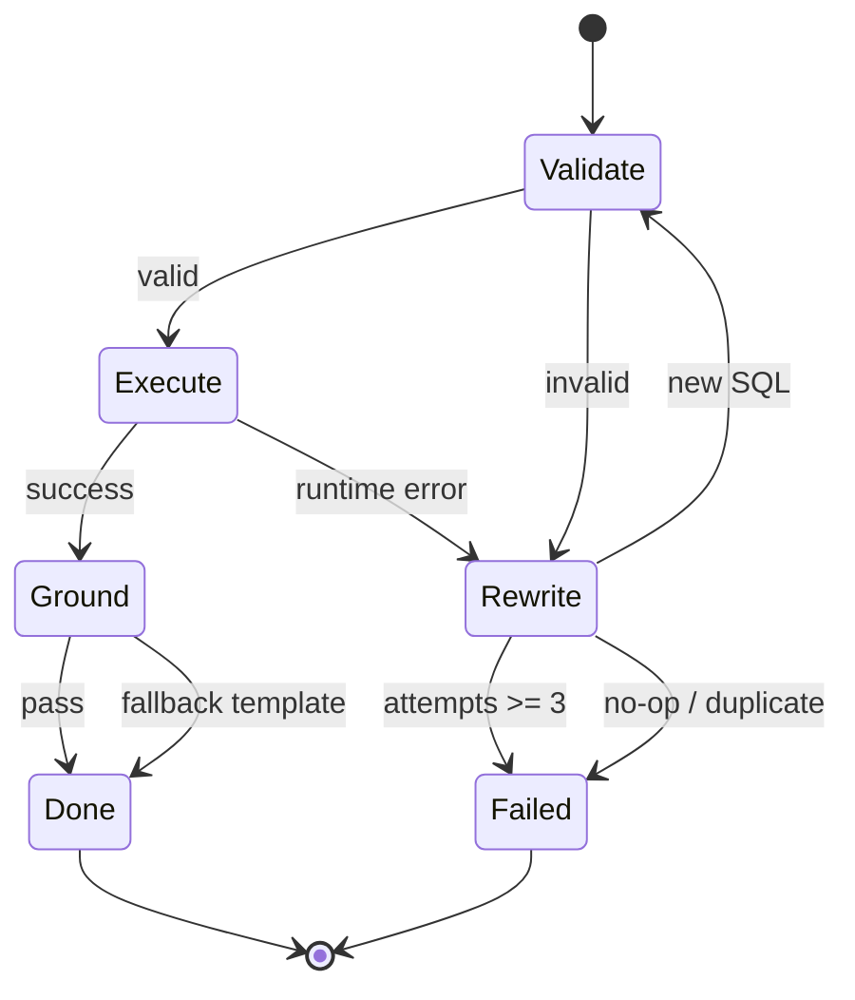
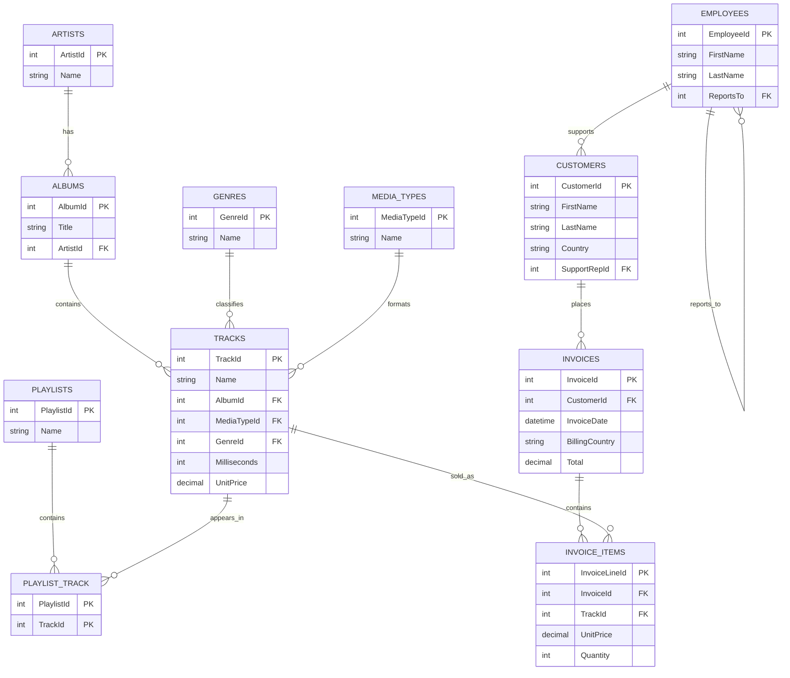

# 03 · Chinook ChatBI 技术设计文档

| 项目 | 内容 |
|---|---|
| 项目名 | Chinook ChatBI |
| 文档版本 | v1.0 |
| 日期 | 2026-10-22 |
| 状态 | 草案（待评审） |
| 读者 | 技术负责人、开发、测试、课程评审 |
| 关联文档 | `01_项目设计.md`、`02_功能设计.md`、`04_统一能力地图与差距分析.md`、`05_范围定稿.md` |
| 架构阶段 | 本期 A（轻量单机版）；以 B 的边界写 A，B/C 只作演进路线 |
| 代码基线 | `06_SQL-Agent-Project/`（2026-10-22） |

> 阅读说明：本文区分**当前实现**与**MVP 目标**。标“已实现”的部分以代码为准；标“MVP 待补”的部分是本期要落地的设计，不代表当前已有。

---

## 0. 结论摘要

1. **本期架构维持 A：单进程 Python + SQLite 只读 + Streamlit/CLI + DeepSeek。** 在单库、单用户、只读约束下，服务化（B）与平台化（C）的收益尚未成为瓶颈；现在把接口抽出来，未来升级成本最低。
2. **七步流水线是骨架，MVP 补四座桥：意图门禁、指标口径、结果 grounding、Trace/审计。** 没有这四座桥，“能跑”会被误判为“答对”。
3. **SQL 安全采用纵深防御**：Prompt 约束只是第一层，真正兜底的是静态校验（sqlglot）+ 动态校验（`EXPLAIN`）+ 只读 URI + 超时/行数限制。
4. **评测是技术体系的一部分，不是附属脚本。** 当前 30/30 存在 few-shot 泄漏、集合比较、只算 recall 三个问题；必须重建 dev30/holdout30，并把回归门槛写进发布流程。
5. **最危险的失败不是“SQL 报错”，而是“看起来全对”。** 因此答案必须先 grounding 再展示，空结果/截断/NULL 必须有统一契约。

---

## 1. 架构总览

### 1.1 架构图



### 1.2 分层说明

| 层 | 职责 | 边界 | 当前状态 |
|---|---|---|---|
| 交互层 | 接收问题、展示答案/表格/图表/Trace/反馈 | 不直接拼 SQL、不直接连库 | Streamlit + CLI 已实现 |
| 编排层 | 串联步骤、失败传播、重试、deadline、Trace | 不实现具体 SQL 逻辑 | `SQLAgent` 已实现；意图门禁/预算/契约待补 |
| 语义层 | schema 画像、指标定义、中文别名 | 不执行查询 | catalog 已实现；指标/别名待补 |
| SQL 层 | 选表、生成、校验、改写、执行 | 只处理单条 SELECT | 已实现；安全/结果校验待补 |
| 答案层 | 结果 grounding、中文汇总、结果契约 | 不新增结果集之外的数字 | 汇总已实现；grounding/契约待补 |
| 治理层 | Trace、审计、评测、配置 | 不参与业务查询 | Trace 进程内；审计/评测治理待补 |

### 1.3 运行时拓扑（MVP）

```text
┌──────────────────────────────┐
│ 本机进程                      │
│  Streamlit / CLI             │
│    └── SQLAgent              │
│          ├── Catalog JSON    │
│          ├── metrics.yaml    │
│          ├── aliases.yaml    │
│          ├── Trace JSONL     │
│          └── Eval JSON       │
└──────────────┬───────────────┘
               │ HTTPS
               ▼
      DeepSeek / OpenAI 兼容 API
               │
               ▼（只读）
      chinook.db (SQLite, mode=ro)
```

**特点：**

- 单进程、无状态（除本地缓存/审计文件）；重启即可恢复。
- LLM 是唯一外部依赖；故障时降级为模板答案/可读错误。
- SQLite 只读 URI 从连接层禁止写入；即使校验被绕过也无法落盘。
- 无 HTTP 服务、无鉴权、无并发队列；这些属于 B 阶段。

### 1.4 架构目标与非目标

| 目标 | 设计响应 |
|---|---|
| 正确性可证明 | 双层校验 + 结果 sanity + grounding + holdout 评测 |
| 安全可兜底 | 只读 URI + 单语句 + 危险关键字 + AST 允许列表 + 超时/行数 |
| 失败可解释 | 错误码 + 中文文案 + Trace + 下一步建议 |
| 成本可控 | token 计量 + 预算 + 缓存 + 限制改写/输出 |
| 可演进 | 抽 `LLMGateway`、`TraceStore`、`SemanticCatalog`、`DataSource` 接口 |
| 非目标 | 生产 SLA、多租户、多数据源、自动建模、因果推断 |

---

## 2. 模块划分与职责

### 2.1 模块总表

| 模块 | 代码位置 | 职责 | 输入 | 输出 | 当前状态 |
|---|---|---|---|---|---|
| config | `sql_agent/config.py` | 环境变量、路径、限制项 | `.env`/环境变量 | `Settings` | 已实现 |
| llm | `sql_agent/llm.py` | OpenAI 兼容封装、重试、JSON 提取 | messages、温度、token | 文本/JSON | 已实现；无计量/缓存 |
| prompts | `sql_agent/prompts.py` | Prompt 与 few-shot 集中管理 | — | 模板字符串 | 已实现；需版本化/去泄漏 |
| catalog | `sql_agent/catalog.py` | 解析 schema、外键、样例、统计、缓存、外键图 | db_path、cache_dir | `CatalogSnapshot` | 已实现 |
| selector | `sql_agent/selector.py` | 关键词提示 + LLM 选表 + 桥接表补全 | 问题、catalog | `SelectionResult` | 已实现；缺 precision/置信度 |
| generator | `sql_agent/generator.py` | 组装生成 Prompt、调用 LLM、提取 SQL | 问题、schema、few-shot | SQL | 已实现；缺口径假设结构 |
| validator | `sql_agent/validator.py` | 静态 sqlglot + 动态 EXPLAIN 校验 | SQL、catalog | `ValidationResult` | 已实现；CTE 作用域/允许列表待补 |
| rewriter | `sql_agent/rewriter.py` | 带错误与历史修复 SQL | 问题、schema、SQL、错误、历史 | 新 SQL | 已实现；缺 no-op 检测 |
| executor | `sql_agent/executor.py` | 只读执行、超时、行数截断 | SQL、db_path、限制 | `ExecutionResult` | 已实现 |
| summarizer | `sql_agent/summarizer.py` | 中文结果解释、空结果话术、模板兜底 | 问题、SQL、结果 | 中文答案 | 已实现；缺 grounding/口径 |
| agent | `sql_agent/agent.py` | 七步编排、Trace、失败终态 | 问题 | `AgentResult` | 已实现；缺意图门禁/预算 |
| semantic（规划） | `semantic/metrics.yaml` | 指标公式、粒度、时间口径、同义词 | — | `MetricBinding` | MVP 待补 |
| aliases（规划） | `semantic/entity_aliases.yaml` | 中文实体到库内值 | — | `EntityMapping` | MVP 待补 |
| grounding（规划） | `sql_agent/grounding.py` | 结果 sanity + 数字 grounding | 答案、结果集、指标 | `GroundingResult` | MVP 待补 |
| trace（规划） | `sql_agent/trace_store.py` | `trace_id`、步骤、token、落盘 | `TraceRecord` | JSONL/SQLite | MVP 待补 |
| eval（已有） | `eval/evaluate.py` | 评测、指标汇总、失败样本 | gold.jsonl | `EvalReport` | 已有；需 dev/holdout/断言 |

### 2.2 模块依赖关系



**边界原则：**

1. **模块不互相反向依赖**：`selector`/`generator` 不调用 `agent`；`validator` 不调用 LLM。
2. **LLM 调用集中在 gateway**：所有模块通过 `LLMGateway`，便于计量、重试、缓存、切换模型。
3. **纯函数优先**：校验、grounding、结果比较尽量纯函数，便于单测。
4. **catalog 只读**：任何模块不得修改传播中的 catalog 快照。
5. **答案层不新增事实**：summarizer/grounding 只能使用 `ExecutionResult` 中的数字。

### 2.3 关键接口定义

#### 2.3.1 编排入口

```python
class SQLAgent:
    def run(
        self,
        question: str,
        *,
        session_id: str | None = None,
        trace_id: str | None = None,
    ) -> AgentResult: ...
```

**输入示例：**

```json
{
  "question": "销售额最高的前5个国家是哪些？",
  "session_id": "s_001",
  "trace_id": null
}
```

**输出示例：**

```json
{
  "trace_id": "tr_20261022_0001",
  "question": "销售额最高的前5个国家是哪些？",
  "success": true,
  "answer": "销售额最高的前 5 个国家是：USA（523.06）、Canada（303.96）……（口径：SUM(invoices.Total)，按账单日期）",
  "sql": "SELECT BillingCountry AS country, ROUND(SUM(Total), 2) AS revenue FROM invoices GROUP BY BillingCountry ORDER BY revenue DESC LIMIT 5",
  "tables": ["invoices"],
  "columns": ["country", "revenue"],
  "rows": [["USA", 523.06], ["Canada", 303.96]],
  "truncated": false,
  "attempts": 1,
  "validated": true,
  "executed": true,
  "error_code": null,
  "steps": [
    {"name": "① 意图门禁", "status": "ok", "elapsed_ms": 120.0, "detail": "analytics"},
    {"name": "② 表选择", "status": "ok", "elapsed_ms": 620.0, "detail": "选中表: invoices"},
    {"name": "③ SQL 生成", "status": "ok", "elapsed_ms": 1400.0, "detail": "SELECT ..."},
    {"name": "④ SQL 校验", "status": "ok", "elapsed_ms": 35.0, "detail": "静态/动态校验通过"},
    {"name": "⑥ SQL 执行", "status": "ok", "elapsed_ms": 12.0, "detail": "返回 5 行"},
    {"name": "⑦ Grounding / 汇总", "status": "ok", "elapsed_ms": 900.0, "detail": "数字一致"}
  ],
  "total_ms": 3120.0,
  "tokens": {"input": 2100, "output": 180},
  "cost_cny": 0.0031
}
```

> 注：当前 `AgentResult` 没有 `trace_id`/`error_code`/`tokens`/`cost_cny` 字段，MVP 待补。

#### 2.3.2 意图门禁

```python
def classify(question: str, catalog_summary: str) -> IntentResult: ...
```

```json
// 输入
{"question": "数据库里有什么数据？", "catalog_summary": "11 张表：artists, albums, ..."}
// 输出
{"intent": "meta", "confidence": 0.95, "reason": "用户在询问数据库内容", "suggested_response": "可以查询歌曲、专辑、客户、发票等..."}
```

#### 2.3.3 表选择

```python
def select(question: str, catalog: CatalogSnapshot) -> SelectionResult: ...
```

```json
// 输出
{
  "tables": ["playlists", "playlist_track", "tracks", "genres"],
  "reason": "问题涉及歌单、歌曲与流派，需经 playlist_track 连接",
  "confidence": 0.91,
  "used_fallback": false,
  "bridge_tables": ["playlist_track"],
  "warnings": []
}
```

#### 2.3.4 SQL 生成

```python
def generate(
    question: str,
    schema: str,
    metrics: list[MetricBinding],
    mappings: list[EntityMapping],
    few_shots: str,
) -> GenerationResult: ...
```

```json
// 输出
{
  "sql": "SELECT BillingCountry AS country, ROUND(SUM(Total), 2) AS revenue FROM invoices GROUP BY BillingCountry ORDER BY revenue DESC LIMIT 5",
  "assumptions": ["销售额 = SUM(invoices.Total)", "国家 = BillingCountry"],
  "prompt_version": "generator-v1.2",
  "model": "deepseek-chat",
  "tokens": {"input": 1800, "output": 120}
}
```

#### 2.3.5 SQL 校验

```python
def validate(sql: str, catalog: CatalogSnapshot) -> ValidationResult: ...
```

```json
// 失败示例
{
  "ok": false,
  "stage": "unknown_column",
  "error_code": "E5007",
  "message": "列不存在: invoices.CustomerID",
  "warnings": []
}
```

#### 2.3.6 执行

```python
def execute(sql: str, max_rows: int = 100, timeout_s: int = 10) -> ExecutionResult: ...
```

```json
{
  "ok": true,
  "columns": ["country", "revenue"],
  "rows": [["USA", 523.06], ["Canada", 303.96]],
  "row_count": 2,
  "truncated": false,
  "elapsed_ms": 12.4,
  "error_code": null
}
```

#### 2.3.7 Grounding 与汇总

```python
def check(answer: str, result: ExecutionResult, metric: MetricBinding) -> GroundingResult: ...
def summarize(question: str, sql: str, result: ExecutionResult, metric: MetricBinding) -> SummaryResult: ...
```

```json
// SummaryResult
{
  "answer": "2009 年销售额最高的国家是美国，销售额为 523.06（口径：SUM(invoices.Total)，按账单日期）。",
  "cited_numbers": ["523.06"],
  "metric_label": "销售额",
  "time_range": "2009-01-01 ~ 2009-12-31",
  "fallback_used": false
}
```

---

## 3. 数据流与时序

### 3.1 一次问答的完整时序



### 3.2 步骤、输入、输出与失败处理

| 步骤 | 输入 | 处理 | 输出 | 失败处理 |
|---|---|---|---|---|
| ⓪ 意图门禁 | 问题、catalog 摘要 | 规则 + LLM 分类 | `IntentResult` | 非取数直接返回；LLM 失败降级为取数并告警 |
| ① Catalog | db_path、cache | 解析/缓存 | `CatalogSnapshot` | 启动失败，提示配置 |
| ② 选表 | 问题、catalog | 关键词 + LLM + 外键 BFS | `SelectionResult` | LLM 失败回退关键词/全表 |
| ③ 生成 | 问题、schema、指标、别名 | Prompt + LLM + 提取 | SQL/`GenerationResult` | 无 SQL → `E4002`；无法回答 → `E4003` |
| ④ 校验 | SQL、catalog | 静态 + 动态 | `ValidationResult` | 失败进入改写；超过次数终态 |
| ⑤ 改写 | SQL、错误、历史 | LLM 修复 | 新 SQL | no-op/超时 → 停止 |
| ⑥ 执行 | SQL、限制 | 只读连接、超时、截断 | `ExecutionResult` | 运行时错误进入改写；超时终态 |
| ⑦ Grounding | 答案、结果、指标 | sanity + 数字比对 | `GroundingResult` | 不通过 → 模板答案 |
| ⑦ 汇总 | 问题、SQL、结果、指标 | LLM/模板 | 中文答案 | LLM 失败 → 模板兜底 |
| ⑧ 治理 | Trace/反馈 | 落盘、聚合 | `TraceRecord`/指标 | 落盘失败降级，不阻断回答 |

### 3.3 改写状态机



**状态机约束：**

- 最多 `max_rewrites=3` 次；总尝试次数 = 初始 1 + 3。
- 每次改写必须与历史 SQL 不同；相同/等价立即停止（no-op）。
- 端到端 20 s deadline 优先于改写次数；超时即终止。
- 改写失败必须返回最后一次 SQL、错误码、已完成步骤。

### 3.4 延迟预算

| 步骤 | P50 目标 | P95 目标 | 说明 |
|---|---:|---:|---|
| 意图门禁 | 0.4 s | 0.8 s | 可用规则减少 LLM 调用 |
| 选表 | 0.6 s | 1.2 s | schema 裁剪 + 紧凑 catalog |
| 生成 | 1.4 s | 2.8 s | 主要 LLM 成本 |
| 校验 | 0.15 s | 0.4 s | 本地 sqlglot + EXPLAIN |
| 执行 | 0.05 s | 0.2 s | 小库；复杂 join 可能更高 |
| Grounding | 0.1 s | 0.3 s | 本地计算 |
| 汇总 | 0.9 s | 1.8 s | 可降级为模板 |
| 编排/IO | 0.2 s | 0.4 s | 本地开销 |
| **合计** | **3.8 s** | **7.9 s** | 不含改写；改写额外 ≤2.5 s，受 20 s deadline 约束 |

### 3.5 边界情况

| 情况 | 处理 |
|---|---|
| 空结果 | 不返回 0；返回固定话术 + `data_until` + 可能原因 |
| 结果截断 | `truncated=true`；明确“仅展示前 100 行”；不得当全量 |
| NULL 值 | 统一显示 `NULL`；汇总不得把 NULL 当 0 |
| LLM 超时 | 重试/降级；超过 deadline 返回 `E8004` |
| 数据库不可用 | 启动/执行前检查；返回 `E2001`/`E6003` |
| 改写打转 | no-op 检测；最多 3 次 |
| 用户重复提问 | V1 语义缓存；MVP 正常重跑 |

---

## 4. 数据模型与 Schema 画像

### 4.1 Chinook 实体关系



### 4.2 表清单与规模

| 表 | 主键 | 关键外键 | 行数 | 业务含义 |
|---|---|---|---:|---|
| artists | ArtistId | — | 275 | 艺人 |
| albums | AlbumId | ArtistId → artists | 347 | 专辑 |
| tracks | TrackId | AlbumId → albums；MediaTypeId → media_types；GenreId → genres | 3,503 | 歌曲 |
| genres | GenreId | — | 25 | 流派 |
| media_types | MediaTypeId | — | 5 | 媒体类型 |
| playlists | PlaylistId | — | 18 | 歌单 |
| playlist_track | PlaylistId + TrackId | 复合主键；双外键 | 8,715 | 歌单-歌曲桥接 |
| customers | CustomerId | SupportRepId → employees | 59 | 客户 |
| employees | EmployeeId | ReportsTo → employees（自连接） | 8 | 员工/客服 |
| invoices | InvoiceId | CustomerId → customers | 412 | 发票 |
| invoice_items | InvoiceLineId | InvoiceId → invoices；TrackId → tracks | 2,240 | 发票明细 |

**数据边界：** `invoices.InvoiceDate` 范围 `2009-01-01 00:00:00` 至 `2013-12-22 00:00:00`；2014 年及以后 0 行。该边界必须进入 `data_until`，并注入生成/汇总 Prompt。

### 4.3 Schema 画像数据模型

```json
{
  "db_path": ".../chinook.db",
  "schema_version": "chinook-v1",
  "data_until": "2013-12-22",
  "generated_at": "2026-10-22T20:20:00+08:00",
  "tables": [
    {
      "name": "tracks",
      "row_count": 3503,
      "columns": [
        {
          "name": "GenreId",
          "type": "INTEGER",
          "nullable": true,
          "primary_key": false,
          "default": null,
          "distinct_count": 25,
          "null_count": 0,
          "min_value": 1,
          "max_value": 25,
          "top_values": [1, 2, 3]
        }
      ],
      "foreign_keys": [
        {
          "table": "tracks",
          "columns": ["GenreId"],
          "referred_table": "genres",
          "referred_columns": ["GenreId"]
        }
      ],
      "sample_rows": [
        {"TrackId": 1, "Name": "For Those About To Rock (We Salute You)", "GenreId": 1}
      ]
    }
  ]
}
```

**画像规则：**

| 项 | 规则 | 目的 |
|---|---|---|
| 表/列/类型/NULL/PK/默认值 | `PRAGMA table_info` | 让模型看到真实结构 |
| 外键 | `PRAGMA foreign_key_list`，合并复合外键 | 桥接表/多跳 |
| 行数 | `COUNT(*)` | 量级约束与 sanity check |
| distinct/NULL/min/max | 每列统计 | 值域与异常检测 |
| top 值 | 文本列 distinct ≤50 时取 top 20 | 中文实体映射 |
| 值域提示 | 仅文本、非日期、1 < distinct ≤30、非敏感列 | 控制 Prompt 体积与隐私 |
| 样例行 | 每表 3 行 | 帮助理解数据格式 |
| `data_until` | 日期列 max 值 | 数据新鲜度声明 |
| 缓存 | JSON + DB mtime + schema 版本 | 加速启动、可重建 |
| 大表 | MVP 全量统计；V1 采样/上限 | 避免解析超时 |
| 敏感列 | 排除 email/phone/address/company 等 | 降低 PII 进入 Prompt |

### 4.4 指标与口径模型

```yaml
# semantic/metrics.yaml
version: metrics-v1
metrics:
  - id: revenue
    label: 销售额
    synonyms: [销售额, 收入, 营收, 消费金额]
    formula: SUM(invoices.Total)
    grain: invoice
    time_field: invoices.InvoiceDate
    unit: CNY
    default_country_field: invoices.BillingCountry
  - id: sales_volume
    label: 销量
    synonyms: [销量, 售出数量, 销售数量]
    formula: SUM(invoice_items.Quantity)
    grain: invoice_item
    time_field: invoices.InvoiceDate
    unit: 件
  - id: customer_count
    label: 客户数
    synonyms: [客户数, 用户数, 顾客数]
    formula: COUNT(DISTINCT customers.CustomerId)
    grain: customer
    unit: 人
  - id: track_count
    label: 歌曲数
    synonyms: [歌曲数, 曲目数, 歌的数量]
    formula: COUNT(DISTINCT tracks.TrackId)
    grain: track
    unit: 首
  - id: avg_spend_per_customer
    label: 客单价
    synonyms: [人均消费, 客户人均消费, 客单价]
    formula: SUM(invoices.Total) / COUNT(DISTINCT invoices.CustomerId)
    grain: customer
    time_field: invoices.InvoiceDate
    unit: CNY/人
dimensions:
  - id: country_attribution
    label: 国家归属
    rules:
      - when: revenue
        field: invoices.BillingCountry
      - when: customer_count
        field: customers.Country
```

**使用规则：**

1. 指标词典在生成前注入，生成/汇总/grounding 共用同一版本。
2. 答案必须输出 `metric_label`、`time_range`、`assumptions`。
3. 未定义指标（如“利润”）不得猜测，返回 `E7005`。
4. 指标版本变更必须跑回归；holdout 不参与调参。

### 4.5 实体别名词典

```yaml
# semantic/entity_aliases.yaml
version: aliases-v1
entities:
  - mention: 摇滚
    table: genres
    column: Name
    value: Rock
  - mention: 美国
    table: customers
    column: Country
    value: USA
  - mention: MPEG
    table: media_types
    column: Name
    value: MPEG audio file
  - mention: 曲风
    table: genres
    column: Name
    value: null   # 维度别名，需结合值域
```

**匹配顺序：** 精确别名 → 大小写不敏感 → 模糊匹配（阈值）→ LLM 结合值域 → 未命中不编造。

### 4.6 ResultContract（结果契约）

```json
{
  "status": "ok | empty | truncated | error",
  "columns": ["country", "revenue"],
  "rows": [["USA", 523.06]],
  "row_count": 1,
  "truncated": false,
  "metric": {"id": "revenue", "label": "销售额", "version": "metrics-v1"},
  "time_range": "2009-01-01 ~ 2013-12-22",
  "data_until": "2013-12-22",
  "warnings": [],
  "trace_id": "tr_20261022_0001"
}
```

| 状态 | 含义 | 展示要求 |
|---|---|---|
| `ok` | 有结果且未截断 | 答案 + 表格/图表 |
| `empty` | 0 行 | 固定话术 + `data_until` + 可能原因 |
| `truncated` | 超过最大行数 | 明确“仅展示前 N 行” |
| `error` | 执行/校验失败 | 错误码 + 中文原因 + 下一步 |

---

## 5. LLM 编排与 Prompt 契约

### 5.1 编排原则

| 原则 | 说明 |
|---|---|
| 固定流水线优先 | 不用自主 Agent 循环；步骤可预测、可计时、可审计 |
| LLM 只做“语言/生成” | 选表、生成、改写、汇总；校验/执行/grounding 用确定性代码 |
| 每次调用有契约 | 输出 JSON/SQL 必须可解析；解析失败可重试/降级 |
| 有预算 | 每阶段 max_tokens；整请求 token/时间预算 |
| 可版本化 | 模型、Prompt、few-shot、指标、别名均有版本号 |

### 5.2 LLM Gateway

```python
class LLMGateway:
    def chat(
        self,
        messages: list[dict],
        *,
        temperature: float = 0.0,
        max_tokens: int = 2048,
        timeout_s: int = 90,
    ) -> LLMResponse: ...

    def chat_json(self, messages: list[dict], **kwargs) -> dict: ...
```

```json
// LLMResponse
{
  "content": "SELECT ...",
  "model": "deepseek-chat",
  "usage": {"prompt_tokens": 1800, "completion_tokens": 120, "total_tokens": 1920},
  "latency_ms": 1420.5,
  "finish_reason": "stop",
  "attempts": 1
}
```

**重试策略：**

| 情况 | 策略 |
|---|---|
| 400/401/403/404 | 不重试，直接失败（配置/权限问题） |
| 429/5xx/网络错误 | 指数退避，最多 3 次（2/4/8 s） |
| 空内容 | 重试；仍为空 → `E4001` |
| 超过整请求 deadline | 立即终止，返回 `E8004` |
| token 预算耗尽 | 终止，返回 `E8003` |

### 5.3 Prompt 契约

| 阶段 | 输入 | 输出契约 | 校验 | 失败回退 | 版本 |
|---|---|---|---|---|---|
| 意图门禁 | 问题 + catalog 摘要 | JSON `{intent, confidence, reason}` | intent 枚举、confidence 范围 | 规则分类/默认取数 | `intent-v1` |
| 选表 | 紧凑 catalog + 关键词提示 + 问题 | JSON `{tables, reason, confidence}` | 表名存在、非空 | 关键词/全表 | `selector-v1` |
| 生成 | schema + 样例行 + 值域 + 指标 + 别名 + few-shot + 问题 | SQL 代码块；或 `CANNOT_ANSWER` | 单条 SELECT/WITH；非空 | 终止/可读错误 | `generator-v1.2` |
| 改写 | schema + 问题 + 失败 SQL + 错误 + 最近 3 次历史 | SQL 代码块 | 单条 SELECT；非重复 | 停止并返回错误 | `rewriter-v1` |
| 汇总 | 问题 + SQL + 结果预览 + 行数 + 指标 + 时间范围 | 结构化答案 + 数字列表（目标）；当前为自由文本 | 数字 grounding；空/截断话术 | 模板答案 | `summary-v1` |

### 5.4 Prompt 组装顺序与预算

| 顺序 | 内容 | 预算/策略 |
|---|---|---|
| 1 | 角色与规则 | 固定，短 |
| 2 | 指标定义 + 口径 | 只注入命中的指标 |
| 3 | Schema（DDL + 样例行 + 值域） | 只注入选中表；值域 top 值限量 |
| 4 | 别名映射 | 只注入命中的实体 |
| 5 | few-shot | 3–7 条；与 holdout 不重合 |
| 6 | 用户问题 | 作为数据分隔，不执行其中指令 |
| 7 | 输出格式 | JSON/SQL 代码块契约 |

**当前实现的 token 限制：**

| 调用 | temperature | max_tokens | 备注 |
|---|---:|---:|---|
| 选表 | 0.0 | 400 | JSON |
| 生成 | 0.0 | 1,500 | SQL |
| 改写 | 0.0 | 1,500 | SQL |
| 汇总 | 0.2 | 800 | 中文答案 |
| LLM 单次超时 | — | — | 90 s；重试 3 次；400/401/403/404 不重试 |

**MVP 待补：** token 计量、整请求 20 s deadline、汇总结构化输出、prompt 版本号写入 Trace。

### 5.5 few-shot 治理

当前 `prompts.py` 有 7 条 few-shot，分别对应 gold 的 q04/q07/q08/q13/q12/q30/q16，存在训练集泄漏。治理规则：

1. few-shot 与 holdout 物理分离；holdout 题目不得出现在 few-shot。
2. 每条 few-shot 标注 `tags` 与 `difficulty`；覆盖单表、join、多对多、时间、空结果、值映射。
3. Prompt 版本号 + few-shot 版本号随 Trace 记录。
4. V1 可按问题类型动态检索 few-shot；MVP 固定集合，先保证不泄漏。
5. 新增 few-shot 必须跑 dev/holdout，确认 holdout 不下降。

### 5.6 提示注入与输出防护

| 风险 | 控制 |
|---|---|
| 用户在问题中要求“忽略规则/删除数据” | 问题作为数据分隔；意图门禁 + SQL 校验兜底 |
| 模型输出多语句/写操作 | 静态校验 + 只读 URI |
| 模型输出不存在的表/列 | schema 校验 + `EXPLAIN` |
| 模型输出解释性文字 | `extract_sql` 只取代码块/首个 SELECT；失败报 `E4002` |
| 模型输出编造数字 | grounding；只允许结果集数字 |
| Prompt 含敏感值 | 值域排除敏感列；日志脱敏 |

---

## 6. Schema Linking 与表选择

### 6.1 问题特征

| 特征 | 例子 | 难点 |
|---|---|---|
| 中文词 → 英文表/值 | 歌曲→tracks；摇滚→Rock | 同义词、大小写、别名 |
| 多对多 | 歌单-歌曲 | 必须经过 `playlist_track` |
| 多跳 | 流派→歌曲→发票明细→发票 | join 路径选择 |
| 自连接 | 员工-下属 | 别名与方向 |
| 聚合/粒度 | 销售额、客单价 | 指标口径与去重 |
| 歧义 | 国家（客户国家/账单国家） | 需要口径或澄清 |

### 6.2 选表算法

```text
输入：question, catalog, metrics, aliases
1. 关键词提示：TABLE_HINTS 命中候选表
2. LLM 选表：紧凑 catalog + 提示 + 问题 → JSON {tables, reason, confidence}
3. 校验：表名必须存在；去重；按 catalog 顺序
4. 桥接：对选中表两两求外键图最短路，加入中间表
5. 兜底：LLM 失败/空 → 关键词表；无关键词 → 全部表（标记 fallback）
6. 输出：SelectionResult + bridge_tables + warnings
```

**外键图：**

- 节点：11 张表。
- 边：外键双向连接（A→B 与 B→A 都可走）。
- 最短路：BFS；同长度按表名排序，保证可复现。
- 复合外键：按 `ForeignKeyInfo.columns` 合并；MVP 主要处理单列，V1 完整支持复合。

### 6.3 当前实现与目标

| 项 | 当前 | MVP 目标 |
|---|---|---|
| 关键词提示 | `TABLE_HINTS` 约 40 词，缺“曲风”等 | 补别名，覆盖流派/国家/媒体类型 |
| LLM 选表 | JSON + reason | 加 confidence；低置信标记 |
| 桥接表 | 外键 BFS 最短路 | 保持；输出 `bridge_tables` |
| 兜底 | 关键词/全表 | 全表兜底 ≤5%；超阈值告警 |
| 指标 | 无显式指标 | 选表时注入指标维度 |
| 列级链接 | 无 | V1 列级 linking + 置信度 |
| fan-out | 无告警 | 检测一对多 join；提示去重 |
| 评测 | 只算 recall | 加 precision；全选表策略 precision <70% |

### 6.4 示例

**问题：** “Grunge 歌单里有多少首摇滚歌曲？”

```text
关键词：歌单 → playlists, playlist_track；摇滚 → genres
LLM 选表：playlists, playlist_track, tracks, genres
外键补全：路径已包含 playlist_track
值映射：Grunge → playlists.Name；Rock → genres.Name
生成 SQL：
SELECT COUNT(*) AS rock_tracks
FROM playlists p
JOIN playlist_track pt ON p.PlaylistId = pt.PlaylistId
JOIN tracks t ON pt.TrackId = t.TrackId
JOIN genres g ON t.GenreId = g.GenreId
WHERE p.Name = 'Grunge' AND g.Name = 'Rock';
```

### 6.5 失败模式与应对

| 失败 | 信号 | 应对 |
|---|---|---|
| 漏桥接表 | SQL 缺 `playlist_track`/`invoice_items`；结果异常大/小 | 外键 BFS + 生成规则 + fan-out 告警 |
| 选表过多 | Prompt token 上升；生成噪声 | precision 指标；低置信裁剪 |
| 选表过少 | `unknown_column` 改写集中 | 关键词补全；V1 列级链接 |
| 值映射错 | 空结果/结果明显偏小 | `entity_aliases.yaml` + 未命中日志 |
| 多路径 join | 结果重复/口径不一致 | 指标定义固定路径；V1 join 基数估算 |
| 自连接方向错 | 下属/上级颠倒 | few-shot + 别名规则 + 结果 sanity |

---

## 7. SQL 校验与安全执行

### 7.1 纵深防御

```text
第 1 层：Prompt 约束（只生成单条 SELECT）
   ↓
第 2 层：静态校验（空/多语句/类型/危险关键字/sqlglot AST/表列存在）
   ↓
第 3 层：动态校验（只读 EXPLAIN，只编译不执行）
   ↓
第 4 层：只读执行（file:...?mode=ro）
   ↓
第 5 层：资源限制（10 s 超时、100 行、20 s deadline）
   ↓
第 6 层：审计（trace_id、SQL、行数、错误码）
```

### 7.2 静态校验流水线

| # | 检查 | 规则 | 错误码 | 当前状态 |
|---|---|---|---|---|
| 1 | 空 SQL | 去围栏/分号后为空 | `E5001` | 已实现 |
| 2 | 多语句 | 剥离字面量/注释后含 `;` | `E5002` | 已实现 |
| 3 | 语句类型 | 首关键字 `SELECT`/`WITH` | `E5003` | 已实现 |
| 4 | 危险关键字 | insert/update/delete/drop/alter/attach/detach/pragma/vacuum/reindex/analyze | `E5004` | 已实现 |
| 5 | 语法解析 | sqlglot `parse(read="sqlite")` | `E5005` | 已实现 |
| 6 | 单语句 AST | 只允许 `Select/Union/Intersect/Except` | `E5003` | 已实现 |
| 7 | 表存在 | `catalog.resolve_table` | `E5006` | 已实现 |
| 8 | 列存在 | 限定列按表检查；未限定列按已知列检查 | `E5007` | 已实现；CTE 时跳过未限定列 |
| 9 | 别名存在 | 未知限定别名 | `E5008` | 已实现 |
| 10 | 函数白名单 | 禁止 `load_extension` 等 | `E5011` | MVP 待补 |
| 11 | AST 允许列表 | 替代纯黑名单；限制 `PRAGMA`/写节点 | `E5010` | MVP 待补 |
| 12 | 完整作用域 | CTE/子查询作用域解析 | `E5007` | V1 |

### 7.3 动态校验

```python
conn = sqlite3.connect(db_path.as_uri() + "?mode=ro", uri=True)
conn.execute("EXPLAIN " + body)
```

| 优点 | 局限 |
|---|---|
| 能发现 SQLite 层面的表/列/语法错误 | 不覆盖运行时错误（除零、数据相关） |
| 不真正执行，成本低 | 不提供成本/扫描量 |
| 与最终执行同一引擎 | 需要额外连接 |

**V1 增强：** `EXPLAIN QUERY PLAN` 检查全表扫描/无 join 条件/巨大笛卡尔积；设置扫描阈值。

### 7.4 执行安全

| 控制 | 实现 |
|---|---|
| 只读 | `sqlite3.connect(db_path.as_uri() + "?mode=ro", uri=True)` |
| 超时 | `set_progress_handler`，每 10,000 步检查 deadline |
| 行数 | `fetchmany(max_rows + 1)`，超过 100 行截断 |
| 连接回收 | `finally: conn.close()` |
| 错误处理 | 统一捕获 `sqlite3.Error`，映射错误码 |
| 写保护 | 即使校验绕过，只读 URI 也会拒绝写入 |

**MVP 待补：** 连接超时（当前 `timeout=5`）、内存上限、最大 join 数、超时后连接回收、执行前 `LIMIT` 保护。

### 7.5 错误码表

| 错误码 | 名称 | 阶段 | 严重级 | 用户文案 | 可重试 | 处理 |
|---|---|---|---|---|---|---|
| `E1001` | EMPTY_INPUT | 输入 | warn | 请输入一个具体的数据问题 | 否 | 不调用 LLM |
| `E1002` | INPUT_TOO_LONG | 输入 | warn | 问题过长，请精简到 500 字以内 | 否 | 不调用 LLM |
| `E1003` | NOT_ANALYTICS | 意图 | info | 这个问题不需要查询数据库 | 否 | 返回说明/示例 |
| `E1004` | OUT_OF_SCOPE | 意图 | warn | 我只能做只读查询，不能修改数据 | 否 | 明确拒答 |
| `E1005` | AMBIGUOUS | 意图 | info | 请补充时间范围/指标口径 | 否 | V1 澄清；MVP 默认口径+标注 |
| `E1006` | SESSION_NOT_FOUND | 会话 | info | 会话不存在，已新建 | 否 | 自动创建 |
| `E2001` | DB_NOT_FOUND | Catalog | fatal | 数据库不存在，请检查 `CHINOOK_DB` | 否 | 启动失败 |
| `E2002` | CATALOG_PARSE_FAILED | Catalog | error | 数据库结构解析失败 | 是 | 跳过列统计/重建缓存 |
| `E2003` | CACHE_INVALID | Catalog | warn | 缓存已失效，正在重建 | 是 | 自动重建 |
| `E3001` | SELECTOR_LLM_FAILED | 选表 | error | 选表失败，已使用兜底策略 | 是 | 关键词/全表回退 |
| `E3002` | NO_TABLE_SELECTED | 选表 | error | 未能确定相关数据表 | 是 | 回退 + 告警 |
| `E3003` | UNKNOWN_TABLE_SELECTED | 选表 | warn | 模型选择了不存在的表 | 是 | 丢弃 + 回退 |
| `E3004` | FALLBACK_ALL_TABLES | 选表 | warn | 已使用全部表，结果可能较慢 | 是 | 记录 fallback 率 |
| `E3005` | FANOUT_RISK | 选表 | warn | 检测到一对多关联，可能重复计数 | 否 | 生成去重提示/告警 |
| `E3006` | ENTITY_UNMAPPED | 映射 | warn | 未找到中文实体对应的库内值 | 是 | 保留原文/低置信 |
| `E3007` | ENTITY_AMBIGUOUS | 映射 | info | 实体存在多个匹配值 | 否 | V1 澄清 |
| `E4001` | LLM_CALL_FAILED | 生成 | error | 调用大模型失败，请稍后重试 | 是 | 重试/降级 |
| `E4002` | NO_SQL_IN_RESPONSE | 生成 | error | 模型未能生成查询，请换个问法 | 是 | 终止/改写 |
| `E4003` | CANNOT_ANSWER | 生成 | info | 当前数据无法回答该问题 | 否 | 返回说明/替代问法 |
| `E4004` | LLM_TIMEOUT | 生成 | error | 模型响应超时 | 是 | 重试/返回 deadline |
| `E5001` | EMPTY_SQL | 校验 | warn | 查询为空 | 否 | 终止/改写 |
| `E5002` | MULTI_STATEMENT | 校验 | error | 只能执行一条查询 | 否 | 拦截 |
| `E5003` | STATEMENT_TYPE | 校验 | error | 只能做只读查询 | 否 | 拦截 |
| `E5004` | FORBIDDEN_KEYWORD | 校验 | error | 检测到不允许的操作 | 否 | 拦截 + 审计 |
| `E5005` | SYNTAX_ERROR | 校验 | warn | 查询语法有误，系统将尝试修复 | 是 | 进入改写 |
| `E5006` | UNKNOWN_TABLE | 校验 | warn | 未找到相关数据表 | 是 | 进入改写 |
| `E5007` | UNKNOWN_COLUMN | 校验 | warn | 未找到相关字段 | 是 | 进入改写 |
| `E5008` | UNKNOWN_ALIAS | 校验 | warn | 查询别名有误 | 是 | 进入改写 |
| `E5009` | EXPLAIN_FAILED | 校验 | warn | 查询无法执行，系统将尝试修复 | 是 | 进入改写 |
| `E5010` | READ_ONLY_VIOLATION | 校验 | fatal | 只允许只读查询 | 否 | 拦截 + 安全告警 |
| `E5011` | FUNCTION_NOT_ALLOWED | 校验 | error | 使用了不允许的函数 | 否 | 拦截 |
| `E6001` | QUERY_TIMEOUT | 执行 | warn | 查询超时，请缩小时间范围 | 是 | 中断；可改写 |
| `E6002` | SQLITE_ERROR | 执行 | warn | 查询执行失败，系统将尝试修复 | 是 | 进入改写 |
| `E6003` | CONNECTION_FAILED | 执行 | fatal | 数据库连接失败，请检查配置 | 否 | 终止 |
| `E6004` | RESULT_TRUNCATED | 执行 | info | 结果已截断，仅展示前 100 行 | 否 | 标记 `truncated` |
| `E6005` | RESOURCE_LIMIT | 执行 | warn | 查询过大，请缩小范围 | 是 | 终止/降级 |
| `E6010` | REWRITE_NOOP | 改写 | warn | 修复未产生新查询，已停止 | 否 | 停止改写 |
| `E7001` | SUMMARY_FAILED | 汇总 | warn | 结果已返回，但自然语言解释失败 | 是 | 模板答案 |
| `E7002` | GROUNDING_FAILED | 质量 | warn | 答案中的数字无法核对，已改用模板 | 是 | 模板答案 |
| `E7003` | EMPTY_RESULT | 质量 | info | 没有查询到符合条件的数据 | 否 | 固定话术 + `data_until` |
| `E7004` | TRUNCATED_RESULT | 质量 | info | 结果已截断，仅展示前 100 行 | 否 | 明确提示 |
| `E7005` | METRIC_UNDEFINED | 质量 | warn | 当前未定义该指标 | 否 | 说明 + 替代指标 |
| `E7006` | METRIC_AMBIGUOUS | 质量 | info | 指标存在多种口径 | 否 | 默认口径 + 标注；V1 澄清 |
| `E7007` | TIME_RANGE_UNSPECIFIED | 质量 | info | 未指定时间范围，已使用全量数据 | 否 | 标注时间范围 |
| `E7008` | SANITY_CHECK_FAILED | 质量 | warn | 结果量级/重复度异常 | 是 | 低置信/改写/人工复核 |
| `E7009` | GOLD_SQL_FAILED | 评测 | error | 评测 gold SQL 执行失败 | 否 | 该题判失败 |
| `E8001` | LLM_CONFIG_MISSING | 系统 | fatal | 未配置 API Key | 否 | 启动阻断 |
| `E8002` | LLM_RATE_LIMIT | 系统 | warn | 模型限流，请稍后重试 | 是 | 退避重试 |
| `E8003` | BUDGET_EXCEEDED | 系统 | warn | 本次查询超出预算，已终止 | 否 | 终止/降级 |
| `E8004` | DEADLINE_EXCEEDED | 系统 | warn | 查询超时，已返回已完成部分 | 否 | 终止 |
| `E8005` | INTERNAL_ERROR | 系统 | error | 系统繁忙，请稍后重试 | 是 | 记录 + 通用提示 |
| `E8006` | CONFIG_INVALID | 系统 | warn | 配置值无效，已使用默认值 | 否 | 默认值 + 告警 |
| `E8007` | PII_DETECTED | 安全 | error | 检测到敏感信息，已阻断 | 否 | 脱敏/阻断 |
| `E8008` | STORAGE_FULL | 系统 | warn | 审计存储已满，正在清理 | 否 | 清理/告警 |
| `E8009` | AUDIT_WRITE_FAILED | 系统 | warn | 审计暂不可用，本次回答仍有效 | 是 | 本地日志兜底 |

**HTTP 映射（V1）：**

| 错误段 | HTTP | 说明 |
|---|---|---|
| E1xxx | 400/403 | 输入/意图问题；越权 403 |
| E2xxx | 500/503 | 配置/数据源问题 |
| E3xxx/E4xxx | 422/502 | 语义/生成失败 |
| E5xxx | 422 | 校验失败 |
| E6xxx | 408/500 | 超时/执行失败 |
| E7xxx | 200（带 warning） | 结果可用但质量降级 |
| E8xxx | 429/500/503 | 限流/预算/系统 |

### 7.6 安全控制清单

| 控制 | MVP | V1 | V2 |
|---|---|---|---|
| 只读 URI | ✓ | ✓ | ✓ |
| 单语句/类型校验 | ✓ | ✓ | ✓ |
| 危险关键字黑名单 | ✓ | — | — |
| AST 允许列表 | 待补 | ✓ | ✓ |
| 函数白名单/禁扩展 | 待补 | ✓ | ✓ |
| 超时/行数 | ✓ | ✓ | ✓ |
| 20 s deadline | 待补 | ✓ | ✓ |
| 审计落盘 | 待补 | ✓ | ✓ |
| 登录/RBAC | — | ✓ | ✓ |
| 行/列级策略 | — | — | ✓ |
| PII 脱敏/导出配额 | 部分 | 部分 | ✓ |

---

## 8. 缓存、性能与成本

### 8.1 缓存层次

| 缓存 | 键 | 失效条件 | 当前 | 目标 |
|---|---|---|---|---|
| Catalog JSON | `db_path` + `db_mtime` + `schema_version` | DB 变更/强制刷新 | ✓ | 保持；加采样上限 |
| 指标/别名 | `metrics_version`/`aliases_version` | 文件变更 | — | MVP |
| few-shot | `prompt_version` | Prompt 变更 | 内存常量 | MVP 版本化 |
| 语义查询缓存 | 归一化问题 + schema/metrics/aliases 版本 + `data_until` | 任一版本变更/数据刷新 | — | V1 |
| LLM 响应缓存 | 模型 + Prompt 版本 + 输入哈希 | 模型/Prompt 变更 | — | V1 |
| 评测结果 | 数据集版本 + 代码版本 + 模型版本 | 任一变更 | `results.json` | 保持 + 对比 |

**缓存原则：**

1. 缓存键必须包含 `schema_version`、`metrics_version`、`aliases_version`、`data_until`，避免“旧口径回答新问题”。
2. 结果缓存不得跨权限复用；V1 加入 `user_scope`。
3. Catalog 缓存可删除重建；不得缓存半成品。
4. 命中率、平均节省 token 要记录到 Trace/指标。

### 8.2 延迟预算与优化

| 优化 | 效果 | 风险 |
|---|---|---|
| 只注入选中表 schema | 减少输入 token/延迟 | 选表过少导致漏列 |
| 值域 top 值限量 | 降低 Prompt 体积 | 低频值映射不到 |
| few-shot 裁剪 | 降低 token | 复杂题型稳定性下降 |
| 限制输出 token | 降低生成时间 | SQL 被截断 |
| 限制改写 ≤3 | 控制最坏延迟 | 复杂错误无法自愈 |
| 计划缓存/结果缓存 | 重复问题近实时 | 口径/数据更新不一致 |
| 模型降级 | 保底可用 | 准确率下降 |
| 20 s deadline | 防止无限等待 | 部分请求被终止 |

### 8.3 成本模型

**典型 token 预算（单题，不含改写）：**

| 阶段 | 输入 tokens | 输出 tokens | 说明 |
|---|---:|---:|---|
| 意图门禁 | 400 | 80 | 可规则化 |
| 选表 | 800 | 150 | 紧凑 catalog |
| 生成 | 2,200 | 300 | schema + few-shot |
| 汇总 | 1,200 | 300 | 结果预览 |
| **合计** | **4,600** | **830** | 约 5.4k tokens |

**成本控制：**

- 单题成本目标 ≤¥0.02；按 DeepSeek 实际单价与 token 日志核算，不以估算代替账单。
- 单请求预算：输入 ≤8k、输出 ≤2k；超预算返回 `E8003`。
- 改写每次增加约 2.5k tokens；改写率 >20% 触发告警。
- V1 引入语义缓存/模型路由；缓存命中时成本接近 0。
- 成本看板：日/周花费、单题均值、P95、缓存命中率。

### 8.4 容量规划

| 阶段 | 并发 | 部署 | 限制 |
|---|---:|---|---|
| MVP | 1（本地） | 单进程 | 无队列；LLM 限流时直接失败/重试 |
| V1 | 5–20 | FastAPI + Worker + Redis | 队列、限流、超时、熔断 |
| V2 | 100+ | 多实例 + 连接池 + 多数据源 | 租户隔离、配额、审计 |

### 8.5 性能基准方法

1. 60 题 × 3 次，记录端到端耗时、各步骤耗时、token、成本。
2. 排除首次冷启动（catalog 解析）；单独报告冷启动。
3. 分别报告无改写/有改写；P50/P95/P99。
4. 以 holdout 为准，dev 仅用于调参。
5. 每次 Prompt/模型/指标变更后重跑，结果归档。

---

## 9. 可观测性

### 9.1 Trace 模型

```json
{
  "trace_id": "tr_20261022_0001",
  "session_id": "s_001",
  "user_id": "local",
  "question": "销售额最高的前5个国家是哪些？",
  "model": "deepseek-chat",
  "prompt_version": "generator-v1.2",
  "metrics_version": "metrics-v1",
  "aliases_version": "aliases-v1",
  "steps": [
    {"name": "① 意图门禁", "status": "ok", "elapsed_ms": 120.0, "error_code": null, "detail": "analytics"},
    {"name": "② 表选择", "status": "ok", "elapsed_ms": 620.0, "error_code": null, "detail": "invoices"},
    {"name": "③ SQL 生成", "status": "ok", "elapsed_ms": 1400.0, "error_code": null, "detail": "SELECT ..."},
    {"name": "④ SQL 校验", "status": "ok", "elapsed_ms": 35.0, "error_code": null, "detail": "静态/动态通过"},
    {"name": "⑥ SQL 执行", "status": "ok", "elapsed_ms": 12.0, "error_code": null, "detail": "5 行"},
    {"name": "⑦ Grounding", "status": "ok", "elapsed_ms": 80.0, "error_code": null, "detail": "数字一致"}
  ],
  "sql": "SELECT ...",
  "tables": ["invoices"],
  "row_count": 5,
  "truncated": false,
  "tokens": {"input": 2100, "output": 180},
  "cost_cny": 0.0031,
  "total_ms": 3120.0,
  "created_at": "2026-10-22T21:00:03+08:00"
}
```

### 9.2 指标清单

| 类别 | 指标 | 用途 | 目标 |
|---|---|---|---|
| 质量 | SQL 成功率、校验通过率、执行准确率 | 能力 | holdout ≥95% |
| 质量 | 选表 precision/recall | Schema linking | ≥85%/≥95% |
| 质量 | grounding 一致率 | 答案可信 | 100% |
| 质量 | 空结果率、截断率、错误分布 | 失败分析 | 监控 |
| 性能 | P50/P95/P99、超时率 | 响应 | P95 ≤8 s；超时 <1% |
| 成本 | 单题 token、单题成本、日成本 | 成本 | ≤¥0.02/题 |
| 稳定性 | LLM 失败率、重试率、改写率 | 依赖/质量 | 改写率 <20% |
| 使用 | 提问数、采纳率、回访率、反馈分布 | 产品 | ≥60% 采纳 |
| 安全 | 写操作拦截数、PII 事件、越权请求 | 安全 | 写操作 100% 拦截；PII 0 |

### 9.3 日志与审计

| 项 | 规范 |
|---|---|
| 格式 | JSONL，一行一事件 |
| 必填字段 | `trace_id`、`timestamp`、`event`、`status`、`error_code` |
| 可选字段 | 问题、SQL、表、行数、耗时、token、成本、模型/Prompt 版本 |
| 脱敏 | 不记录完整结果行；敏感列值掩码；Key 永不记录 |
| 保留 | MVP 30 天；V1 按合规要求 |
| 回放 | 按 `trace_id` 还原步骤、SQL、错误、结果行数 |

### 9.4 告警（V1）

| 条件 | 级别 | 动作 |
|---|---|---|
| P95 >8 s 持续 10 分钟 | 警告 | 检查 LLM/查询/缓存 |
| 错误率 >5% | 警告 | 看错误分布 |
| 写操作拦截 >0 | 严重 | 安全事件流程 |
| PII 检测事件 >0 | 严重 | 阻断 + 清理 |
| 单题成本 >¥0.05 | 警告 | 检查 token/改写/缓存 |
| 审计写入失败 | 警告 | 本地日志兜底 |

---

## 10. 评测体系

### 10.1 数据集设计

| 项 | 当前 | MVP 目标 |
|---|---|---|
| 规模 | 30 条 | 60 条：dev30 + holdout30 |
| 来源 | 人工构造 | 真实/模拟提问 + 人工构造 |
| 标签 | 部分 tags | 单表/join/多对多/时间/空结果/值映射/自连接/单位换算/NULL/TopN |
| 泄漏 | few-shot 与 gold 重合 | few-shot 与 holdout 物理分离 |
| holdout | 无 | 不参与调参；污染即降级 |
| 运行 | 1 次 | 3 次，报波动 |

### 10.2 指标定义

| 指标 | 定义 | 目标 |
|---|---|---|
| SQL 成功率 | Agent 最终产出可执行 SQL | ≥98% |
| 校验通过率 | 通过静态 + 动态校验 | ≥98% |
| 执行准确率 | 结果集 + TopN 顺序 + 列名 + 指标口径与 gold 一致 | holdout ≥95%；dev ≥93% |
| 分 tag 准确率 | 每个 tag 单独统计 | ≥90% |
| 选表 precision | 选中表中与 gold 相关的比例 | ≥85% |
| 选表 recall | gold 表被选中的比例 | ≥95% |
| 全选表策略 precision | 永远选全部表的 precision | <70% |
| grounding 一致率 | 答案数字可在结果集中找到 | 100% |
| 改写恢复率 | 首轮失败后最终成功 | ≥80% |
| P50/P95 | 端到端延迟 | ≤4 s/≤8 s |
| 单题成本 | token × 单价 | ≤¥0.02 |
| 采纳率 | 未点踩且 60 s 内未重述 | ≥60% |

### 10.3 评测流程

```text
1. 加载 dev/holdout
2. 对每题：
   a. agent.run(question)
   b. 执行 gold SQL
   c. 比较：行集合 + 顺序 + 列名 + 指标口径 + 数值容差
   d. 计算选表 precision/recall
   e. 检查答案 grounding
   f. 记录耗时/token/成本/错误码
3. 汇总总指标 + 分 tag + 3 次运行区间
4. 与基线比较
5. 输出 EvalReport + 失败样本
6. gate_result=pass/blocked
```

### 10.4 回归门槛

| 门槛 | 规则 | 动作 |
|---|---|---|
| holdout 准确率 | <95% | 阻断发布 |
| 分 tag 准确率 | 任一 <90% | 阻断/评审 |
| 指标下降 | 任一 >2pp | 阻断 |
| grounding | <100% | 阻断 |
| 选表 precision | <85% | 阻断 |
| 全选表 precision | ≥70% | 指标设计无效，重做 |
| 3 次波动 | >5pp | 检查非确定性/环境 |
| 安全红线 | 写操作/PII/编造数字 | 立即阻断 |

### 10.5 当前基线的问题

| 问题 | 证据 | 影响 |
|---|---|---|
| few-shot 泄漏 | 7 条 few-shot 对应 q04/q07/q08/q13/q12/q30/q16 | 30/30 高估泛化 |
| 集合比较 | `evaluate.py` 排序后比集合 | TopN 顺序/列名错误仍可能通过 |
| 只算 recall | 全选表也能 100% | 选表能力未被证明 |
| 指标口径冲突 | q07 用 `invoices.Total`；q22 用 `UnitPrice*Quantity` | 同一“销售额”多口径 |
| 无 holdout | 30 条全部参与调参 | 无法判断真实能力 |
| 无 grounding | 汇总自由生成 | 数字幻觉未被度量 |

### 10.6 失败分析与版本管理

1. 每次评测输出失败样本：问题、gold SQL、agent SQL、结果差异、错误码、Trace。
2. 按 tag/错误码聚类；优先修复高频、影响大的失败。
3. Prompt、模型、指标、别名、评测集均有版本号；报告记录版本组合。
4. holdout 不参与调参；一旦用于调参，降级为 dev 并补新题。
5. V1 接入 CI：每次变更自动跑评测，门槛不通过阻断合并。

---

## 11. 安全与合规

### 11.1 威胁模型

| 威胁 | 影响 | 控制 | 阶段 |
|---|---|---|---|
| 写操作/DDL | 数据被修改/删除 | 单语句 + 类型校验 + 危险关键字 + 只读 URI + AST 允许列表 | MVP |
| 多语句注入 | 执行额外语句 | 剥离字面量/注释后检查分号 + sqlglot 单语句 | MVP |
| 资源耗尽 | 服务不可用/成本飙升 | 10 s 查询超时、100 行、20 s deadline、改写 ≤3、token 预算 | MVP |
| 提示注入 | 绕过规则/导出数据 | 问题作为数据分隔；意图门禁；SQL 校验；导出限制 | MVP |
| PII 泄漏 | 隐私/合规风险 | 敏感列排除；日志/结果脱敏；V2 列级策略 | MVP/V2 |
| 密钥泄漏 | API 被盗用 | `.env`/环境变量；不写代码；UI/日志掩码 | MVP |
| 越权访问 | 看到不该看的数据 | V1 JWT + RBAC；V2 行/列策略 | V1/V2 |
| 模型供应商风险 | 服务中断/数据外发 | 网关抽象；不发送敏感数据；备用供应商 | MVP/V1 |
| 审计缺失 | 无法追责/复盘 | `trace_id` + 审计落盘 + 保留期 | MVP |
| 导出滥用 | 批量泄露 | V1 导出配额；V2 审批/水印 | V1/V2 |

### 11.2 数据隐私

| 数据 | 处理 |
|---|---|
| Chinook 客户姓名/城市/公司 | 值域提示中排除 email/phone/address/company 等；姓名/城市仍可能进入样例行，V2 脱敏 |
| 查询结果 | UI 展示；日志只记录行数/列名，不记录完整行 |
| Prompt | 只注入选中表的 schema/样例行/值域；不注入整库 |
| 导出 | MVP 关闭；V1 仅分析师 + 配额；V2 审批 |
| 审计 | 记录 SQL/表/行数/token；敏感字段掩码；保留 30 天 |

### 11.3 访问控制

| 阶段 | 机制 |
|---|---|
| MVP | 单机单用户；无登录；角色为逻辑角色 |
| V1 | JWT + RBAC；`user_id/role/allowed_tables`；权限在 SQL 编译期注入 |
| V2 | ABAC/行级过滤/列级脱敏；多租户隔离；导出审批 |

### 11.4 合规与审计

- 只读、最小权限、可追溯是底线。
- 审计记录：who/what/when/SQL/rows/tokens/model/trace_id。
- 保留期：MVP 30 天；V1 按组织合规要求；V2 不可篡改存储。
- 数据边界：`data_until=2013-12-22`，超出范围明确说明，不编造。
- 安全事件：写操作尝试、PII 泄漏、Key 泄漏 → 停止发布、清理、复盘。

---

## 12. 部署与扩展

### 12.1 MVP 部署

| 项 | 要求 |
|---|---|
| Python | 3.11+ |
| 依赖 | `openai`、`python-dotenv`、`pandas`、`sqlglot`、`streamlit` |
| 数据 | `chinook.db`（SQLite，只读） |
| 配置 | `.env`：`DEEPSEEK_API_KEY`、`DEEPSEEK_BASE_URL`、`DEEPSEEK_MODEL`、`CHINOOK_DB`、`SQL_AGENT_MAX_REWRITE`、`SQL_AGENT_MAX_ROWS`、`SQL_AGENT_QUERY_TIMEOUT` |
| 启动 | `streamlit run app.py` / `python main.py` |
| 缓存 | `.cache/catalog.json` |
| 审计 | `traces/*.jsonl`（MVP 待补） |
| 评测 | `python eval/evaluate.py` |

### 12.2 配置项

| 配置 | 默认 | 说明 |
|---|---|---|
| `DEEPSEEK_API_KEY` | 空 | 必填；缺失则启动阻断 |
| `DEEPSEEK_BASE_URL` | `https://api.deepseek.com` | OpenAI 兼容地址 |
| `DEEPSEEK_MODEL` | `deepseek-chat` | 模型名 |
| `CHINOOK_DB` | `../04_SQL-Code-Agent-Demo/chinook.db` | 数据库路径 |
| `SQL_AGENT_MAX_REWRITE` | 3 | 最大改写次数 |
| `SQL_AGENT_MAX_ROWS` | 100 | 最大返回行数 |
| `SQL_AGENT_QUERY_TIMEOUT` | 10 | 查询超时（秒） |
| `SQL_AGENT_DEADLINE` | 20（MVP 待补） | 端到端 deadline（秒） |
| `SQL_AGENT_BUDGET_CNY` | 0.05（MVP 待补） | 单题预算上限 |

### 12.3 演进架构

```text
A 轻量单机版（本期）
  Python + SQLite + Streamlit/CLI + DeepSeek
  ↓ 触发：>5 并发 / HTTP 集成 / >500 查询/日
B 服务化版（V1/V2）
  FastAPI + Worker + Redis + Postgres + 前端
  ↓ 触发：第二数据源 / 多团队 / 合规要求
C 平台化版（V2+）
  语义层服务 + 权限策略引擎 + 多数据源连接器 + 评测平台 + 模型网关
```

| 维度 | A（本期） | B | C |
|---|---|---|---|
| 并发 | 1 | 5–20 | 100+ |
| 鉴权 | 无 | JWT + RBAC | ABAC + 行/列策略 |
| 存储 | 本地 JSON | Redis + Postgres | 多租户存储 |
| 数据源 | SQLite 单库 | 单/双库 | 多源连接器 |
| 运维 | 一条命令 | Docker Compose + 监控 | Kubernetes + SLA |
| 适用 | Demo/课程/单团队验证 | 团队试用/内部 API | 多业务线/合规规模化 |

### 12.4 降级与故障处理

| 故障 | 降级 |
|---|---|
| LLM 超时/限流 | 重试/退避；仍失败 → 可读错误；汇总失败 → 模板 |
| 数据库不可用 | 启动检查；执行前检查；返回 `E2001`/`E6003` |
| Catalog 缓存损坏 | 自动重建；失败提示 |
| 审计存储满 | 清理过期记录；仍失败 → 本地日志兜底 |
| 成本超预算 | 终止/降级模型/减少改写 |
| 结果截断 | 明确提示；建议缩小范围 |

### 12.5 备份与恢复

| 数据 | 备份 |
|---|---|
| Catalog 缓存 | 可重建；可不备份 |
| 指标/别名 | Git 版本化；必须备份 |
| 评测集/报告 | Git + 归档；必须备份 |
| 审计/反馈 | 定期导出；MVP 30 天保留 |
| 配置 | `.env.example` + 密钥托管；不提交真实 Key |

---

## 13. 技术选型与权衡

### 13.1 选型表

| 技术 | 选择 | 理由 | 替代 |
|---|---|---|---|
| 语言 | Python 3.11+ | 生态、LLM/SQL 工具成熟 | Node/Go（V2 服务化可重写） |
| 数据库 | SQLite + Chinook | 单文件、零运维、只读 URI | PostgreSQL/MySQL（V2） |
| LLM | DeepSeek `deepseek-chat` | 中文/SQL 能力、成本、OpenAI 兼容 | GPT/Claude/本地模型 |
| SQL 解析 | sqlglot | 多方言 AST、轻量 | sqlparse（能力弱） |
| UI | Streamlit | 快速聊天界面 | React/FastAPI（V1） |
| 数据处理 | pandas | 结果表/图表 | 原生 list（更轻） |
| 评测 | 自研 `evaluate.py` | 可控、可扩展 | Promptfoo/DeepEval（V1 评估） |
| 存储 | JSON/JSONL | 简单、可审计 | SQLite/Postgres（V1） |

### 13.2 权衡 1：SQLite 只读 + 原生 SQL vs ORM/数仓

| 维度 | 方案 A：SQLite 只读 + 原生 SQL | 方案 B：ORM/数仓/语义层 |
|---|---|---|
| 优点 | 零运维、快、只读安全、SQL 可审计 | 类型安全、跨库、权限/指标治理强 |
| 缺点 | 锁死 SQLite；复杂权限/多源弱 | 引入依赖/部署/迁移成本；LLM 生成 ORM 更难 |
| 本期选择 | **A** | V2 视第二数据源再引入 |
| 触发切换 | 第二数据源、>100 万行、需要行/列权限 | — |

**理由：** 本期是单库、只读、小数据量；原生 SQL 让 LLM 生成/校验/审计更直接。ORM 会把“SQL 正确性”问题变成“ORM 映射正确性”问题，反而增加不确定性。

### 13.3 权衡 2：LLM 生成 SQL + 校验 vs 纯模板/语义层

| 维度 | 方案 A：LLM + 校验 | 方案 B：纯模板/语义层 |
|---|---|---|
| 优点 | 覆盖开放问题、灵活 | 稳定、口径可控、成本低 |
| 缺点 | 非确定、可能语义错、需 grounding | 覆盖有限、模板维护成本 |
| 本期选择 | **A 为主，模板为辅** | V1 扩模板 |
| 触发切换 | 高频题型稳定后模板化；开放问题保留 LLM | — |

**理由：** 纯模板无法覆盖真实用户的多样问法；纯 LLM 无法保证口径。MVP 用指标词典 + 校验 + grounding 约束 LLM，V1 把 TopN/趋势/占比模板化，形成混合架构。

### 13.4 权衡 3：固定流水线 vs 自主 Agent 循环

| 维度 | 方案 A：固定七步 | 方案 B：自主规划/多轮工具调用 |
|---|---|---|
| 优点 | 可预测、可计时、易排障、成本可控 | 灵活、可处理复杂多步问题 |
| 缺点 | 复杂问题需人工编排 | 不可预测、成本高、难以审计 |
| 本期选择 | **A** | V2 多查询编排 |
| 触发切换 | 出现稳定的多步分析需求（对比/归因） | — |

**理由：** ChatBI 的核心风险是“不可信”，不是“不够智能”。固定流水线让每一步可校验、可回放；自主循环会把失败模式变得不可解释。

### 13.5 权衡 4：双层校验 vs 仅数据库校验

| 维度 | 方案 A：sqlglot + EXPLAIN | 方案 B：仅 `EXPLAIN` |
|---|---|---|
| 优点 | 早期发现表/列/类型/危险结构；可 AST 允许列表 | 实现简单、与 DB 一致 |
| 缺点 | sqlglot 方言/作用域覆盖有限；维护成本 | 错误发现晚；难以做结构安全策略 |
| 本期选择 | **A** | 保留 `EXPLAIN` 兜底 |
| 触发切换 | — | — |

**理由：** 只靠 `EXPLAIN` 无法可靠识别“多语句/写操作/危险函数”，也无法做 AST 允许列表；只靠 sqlglot 又可能与 SQLite 实际行为有差异。双层互补是最低成本的稳妥方案。

### 13.6 权衡 5：单进程 vs 服务化

| 维度 | 方案 A：单进程 | 方案 B：FastAPI + 队列 + Redis + Postgres |
|---|---|---|
| 优点 | 一条命令、无运维、调试快 | 并发、鉴权、审计、可扩展 |
| 缺点 | 无并发/鉴权/持久化 | 分布式复杂度、成本、故障面 |
| 本期选择 | **A** | V1 触发后升级 |
| 触发切换 | >5 并发、HTTP 集成、>500 查询/日、审计要求 | — |

**理由：** 当前没有真实并发与合规要求；过早服务化会把时间花在基础设施，而不是准确率与可信度。先抽接口，升级成本最低。

### 13.7 权衡 6：JSONL 审计 vs 完整可观测性平台

| 维度 | 方案 A：JSONL/SQLite + 汇总脚本 | 方案 B：OpenTelemetry + Prometheus + Grafana |
|---|---|---|
| 优点 | 轻量、可读、易回放 | 聚合、告警、可视化强 |
| 缺点 | 无聚合/告警；需自建 | 部署/维护成本高 |
| 本期选择 | **A** | V1 接看板 |
| 触发切换 | 需要多人协作/告警/长期留存 | — |

**理由：** MVP 的关键是“能回放一次查询”，不是“大屏”。JSONL 足够定位问题；等查询量和团队规模上来再上平台。

---

## 14. 风险与演进

### 14.1 技术风险

| # | 风险 | 概率 | 影响 | 早期信号 | 应对 |
|---|---|---|---|---|---|
| T1 | 评测泄漏/失真 | 高 | 极高 | 指标全 100%；换模型不变；真实问题失败 | 去泄漏、holdout、顺序/列名/指标断言、3 次运行 |
| T2 | Schema linking 偏差 | 高 | 高 | recall 高 precision 低；改写集中；fallback 率升 | 别名、列级链接、precision 指标、低置信提示 |
| T3 | SQL 语义错误/fan-out | 高 | 极高 | 量级异常；行数超基表；SUM 与明细不一致 | 指标词典、grain/去重、sanity checks、golden |
| T4 | 汇总幻觉 | 高 | 高 | 答案数字不在结果集；空结果答 0 | grounding、模板、温度 0、结果表优先 |
| T5 | 数据新鲜度误读 | 中高 | 高 | 时间题空结果；用户问为什么没数据 | `data_until`、空结果三分法、新鲜度徽标 |
| T6 | 性能/超时 | 中 | 中高 | P95 上升、超时率 >1%、改写率升 | 20 s deadline、缓存、计划门槛、限制改写 |
| T7 | 成本失控 | 中 | 中高 | token/单题成本上升；缓存命中 0 | 预算、计量、缓存、模型降级、限制输出 |
| T8 | 模型/供应商漂移 | 中 | 高 | 评测下降、JSON 解析失败、429 | 网关、固定版本、回归、备用供应商 |
| T9 | 安全/PII | 中 | 极高 | 写操作尝试、敏感值进 Prompt/日志 | 只读、AST 允许列表、PII 排除、审计、V1 RBAC |
| T10 | 工程化欠账 | 中 | 高 | 回归靠人发现；问题不可复现 | 测试、版本化、CI、Trace 落盘、容器化 |

### 14.2 演进路线

| 阶段 | 时间 | 关键动作 | 验收 |
|---|---|---|---|
| A0 现状加固（MVP） | 1–2 周 | 抽接口；去泄漏；60 题；指标/别名；grounding；Trace/审计；deadline；token 计量 | holdout ≥95%；grounding 100%；P95 ≤8 s；单题 ≤¥0.02 |
| A → B | 3–6 周 | FastAPI `/v1/query`、`/v1/catalog`、`/v1/feedback`、`/health`；队列；Redis 缓存/限流；Postgres 审计；JWT+RBAC；SSE；Docker Compose | 20 并发稳定；审计可回放；越权 0 |
| B → C | 3–6 个月 | 语义层服务（指标 YAML/版本/审批）；策略引擎（行/列）；多源连接器；评测平台（版本/CI/灰度）；模型网关（路由/降级/预算） | 新源 ≤1 周；指标变更可追溯；权限绕过 0 |

**升级触发条件：** 外部用户 >5 并发、需要 HTTP 集成、查询量 >500/日、出现第二数据源、审计/合规要求、超过 3 个团队使用。未触发就留在 A/B。

### 14.3 下一步（P0）

| # | 动作 | 产出 | 验收 |
|---|---|---|---|
| 1 | 评测去泄漏 + 60 题 | dev30/holdout30 | holdout 独立报告 |
| 2 | 6 指标 + 别名 | `metrics.yaml`、`entity_aliases.yaml` | 指标一致率 100%；实体映射 ≥95% |
| 3 | grounding + ResultContract | `grounding.py`、契约 | 数字一致率 100%；边界题 100% |
| 4 | Trace/审计 + token/成本 | `trace_store.py`、JSONL | 100% 可回放；成本可查 |
| 5 | 20 s deadline + 预算 | 配置/编排 | P95 ≤8 s；超时率 <1% |
| 6 | 安全加固 | AST 允许列表、函数白名单 | 写操作/危险函数 100% 拦截 |

### 14.4 待确认问题

1. 指标口径（销售额是否含税/退款；国家取账单国家还是客户国家）需业务签字。
2. 是否允许小范围重构（接口/目录级，不改外部行为）。
3. 评测集来源（真实提问/模拟/人工构造）与 holdout 维护责任人。
4. 是否在 V1 引入 HTTP API/鉴权；若引入，优先 FastAPI + JWT + RBAC。
5. 数据截止 2013-12 是否可接受；若不可接受，数据刷新升级为 Must。

---

## 附录 A · 代码落点索引

| 模块 | 文件 | 关键位置 |
|---|---|---|
| 配置 | `sql_agent/config.py` | `Settings`、`load_settings` |
| LLM 封装 | `sql_agent/llm.py:41` | `chat`、`chat_json`、重试与退避 |
| 数据库画像 | `sql_agent/catalog.py:124` | `_parse`、`compact_catalog`、`schema_text`、`connect_tables` |
| 表选择 | `sql_agent/selector.py:56` | `select`、`TABLE_HINTS`、`_fallback` |
| SQL 生成 | `sql_agent/generator.py:39` | `generate`、`extract_sql` |
| 校验 | `sql_agent/validator.py:66` | 静态 + `EXPLAIN` 动态校验 |
| 改写 | `sql_agent/rewriter.py:12` | `rewrite`、最近 3 次历史 |
| 执行 | `sql_agent/executor.py:27` | 只读 URI、超时、行数截断 |
| 汇总 | `sql_agent/summarizer.py:14` | `summarize`、模板兜底 |
| 编排 | `sql_agent/agent.py:77` | `SQLAgent.run`、`TraceStep` |
| 提示词 | `sql_agent/prompts.py` | `FEW_SHOTS`、各阶段 Prompt |
| 评测 | `eval/evaluate.py:42` | `rows_match`、指标汇总 |
| 评测集 | `eval/gold.jsonl` | 30 条中文 gold |
| UI | `app.py` | Streamlit 聊天、Trace、柱状图 |
| CLI | `main.py` | 单问与交互模式 |

## 附录 B · 当前与目标差异

| 能力 | 当前 | MVP 目标 | 差距 |
|---|---|---|---|
| 意图门禁 | 无 | 三类门禁 | 新增 |
| 指标口径 | 无显式词典 | 6 指标 + 口径标注 | 新增 |
| 值域映射 | 值域提示 + LLM | 别名词典 + 模糊匹配 | 补词典 |
| 选表 | recall 未度量 | precision/recall | 补指标 |
| 校验 | 黑名单 + CTE 跳过 | AST 允许列表/函数白名单 | 加固 |
| 改写 | ≤3 次 | + no-op 检测 | 补检测 |
| 执行 | 10 s/100 行 | + 20 s deadline/内存/join 上限 | 补限制 |
| 汇总 | 自由生成 | grounding + 结构化 + 模板 | 补 grounding |
| Trace | 进程内 | `trace_id` + JSONL/审计 | 落盘 |
| 评测 | 30 条/集合比较 | 60 条 dev/holdout + 断言 | 重建 |
| 成本 | 无计量 | token/成本/预算 | 补计量 |
| 安全 | 只读 + 黑名单 | AST 允许列表 + 审计 | 加固 |

## 附录 C · 术语

| 术语 | 含义 |
|---|---|
| Schema Linking | 把问题实体/指标映射到表、列、枚举值 |
| Bridge Table | 多对多关系的中间表，如 `playlist_track`、`invoice_items` |
| Fan-out | 一对多 join 导致行数放大，SUM/COUNT 重复 |
| Grain | 一行数据代表的业务粒度 |
| Grounding | 答案数字/结论绑定到结果集，禁止编造 |
| ResultContract | 空/截断/NULL/错误状态的统一呈现 |
| Dev/Holdout | 调参集/留出集；holdout 不参与调参 |
| Trace ID | 一次请求的唯标识，用于审计与回放 |
| `data_until` | 数据截止时间，本期 2013-12-22 |
| AST 允许列表 | 只允许特定 SQL 语法节点，替代纯黑名单 |

---

## 变更记录

| 版本 | 日期 | 说明 |
|---|---|---|
| v0.1 | 2026-10-22 | 初稿：技术能力地图、架构对比、失败模式 |
| v1.0 | 2026-10-22 | 按技术设计文档 14 章提纲重写：Mermaid 架构/时序/状态/ER 图、模块职责、接口契约、Prompt 契约、错误码、缓存/性能/成本、可观测性、评测、安全、部署、6 项技术权衡与演进 |
