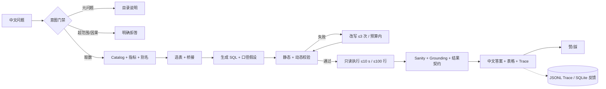

# 01 · Chinook ChatBI 项目设计（定稿）

| 项目 | 内容 |
|---|---|
| 项目名 | Chinook ChatBI |
| 文档版本 | v2.0-final |
| 日期 | 2026-10-22 |
| 状态 | 定稿，可进入排期；待签字事项见 §5.5 |
| 适用范围 | MVP（6 周）；V1/V2 仅作演进方向 |
| 上游输入 | `00_context.md`、原 `01_项目设计.md`、`02_功能设计.md`、`03_技术设计.md`、`04_统一能力地图与差距分析.md`、`05_范围定稿.md` 及评审/失败预演结论 |
| 下游文档 | `02_功能设计.md`（功能与验收）、`03_技术设计.md`（实现与评测） |

---

## 0. 结论摘要

1. **本期只做一件事：单库、只读、单轮、中文的可信取数。** 数据库固定为 SQLite + Chinook，只允许单条 SELECT，答案必须可回溯到结果集。
2. **MVP 为 6 周、10 个能力包、30 人日（26 计划 + 4 缓冲）。** W1–W2 先做 A0 加固与评测重建，W5 启动试点，W6 完成验收。
3. **42 项统一能力中，P0 23 项、P1 15 项、P2 4 项。** MVP 只做 10 个能力包，并包含 8 个 P1 最小切片：反馈采集、可读错误、token 计量、结果契约、敏感列排除、审计落盘、运行汇总、20 s 硬 deadline。
4. **当前 30/30 不是验收证据。** few-shot 与 gold 重合、结果集排序后比较、选表只算 recall；该结果降级为 demo 基线，MVP 第 1 天在 holdout 上重测。
5. **三个支点决定项目成败：可信评测、指标口径、答案 grounding。** 执行链路（生成—校验—执行—改写）是现有强项，不作为本期主要投入。
6. **口径固定为 5 个指标 + 1 个维度规则。** 销售额、销量、客户数、歌曲数、人均消费；国家归属是维度规则，不是指标。“客单价”本期不定义。
7. **不引入登录与 RBAC。** MVP/V1 无鉴权，角色只是逻辑角色；JWT + RBAC 放 V2。MVP 只抽 `TraceStore` 与 `SemanticCatalog` 两个接口。
8. **上线门槛是数字，不是感觉。** holdout 执行准确率 ≥95%（29/30）、dev ≥93%、grounding 100%、10 条边界题 10/10、无改写 P95 ≤8 s、20 s 硬 deadline、单题 ≤¥0.02。

---

## 1. 背景与问题

### 1.1 现状

Chinook 是一个包含 11 张表、3,503 首歌曲的音乐商店示例库，发票日期为 `2009-01-01` 至 `2013-12-22`。现有系统已经具备：

- 固定流水线：数据库解析 → 表选择 → SQL 生成 → 静态/动态校验 → 失败改写 → 只读执行 → 结果汇总；
- SQLite 只读 URI、10 s 查询超时、最多 100 行、最多 3 次改写；
- Schema 画像与缓存、值域提示、桥接表 BFS、失败重试；
- Streamlit 页面与 CLI 两个入口；
- 30 题自动评测，记录成功率、校验通过率、执行准确率、平均尝试次数与耗时。

这套链路“能跑通”，但还不能证明“答得对”。

### 1.2 核心矛盾

| 表象 | 真实问题 | 后果 |
|---|---|---|
| 30/30 全部通过 | 7 条 few-shot 与 gold 全部重合或近义；评测先排序再比集合 | 高估泛化能力，换题即失效 |
| SQL 能执行 | 同一个“销售额”存在 `invoices.Total` 与 `UnitPrice*Quantity` 两种口径 | 技术正确、业务不可信 |
| 答案读起来通顺 | 汇总只看前 20 行、自由生成、无程序化数字校验 | 数字幻觉不会被发现 |
| Trace 看得到 | Trace 只在进程内，无 `trace_id`、无落盘 | 无法回放、审计与统计采纳率 |
| 有超时 | 单次 LLM 90 s、内部重试 3 次、最多 3 次改写，无整请求 deadline | 最坏分钟级，P95 与成本不可验收 |

### 1.3 本期命题

> 在 6 周内，把“能生成 SQL”提升为“在未见过的题目上稳定答对，且每个数字都能被证明来自结果集”。

因此本期优先补可信度，而不是增加入口、图表或多轮。

---

## 2. 目标与非目标

### 2.1 目标

| # | 目标 | 可量化指标 | 测量方式 |
|---|---|---|---|
| G1 | 取数准确 | holdout 执行准确率 ≥95%（29/30）；dev ≥93%（28/30）；6 个核心 tag 各 ≥4/5；3 次运行取中位数 | 60 题核心集，dev30/holdout30；结果集 + 顺序 + 列名 + 指标口径 |
| G2 | 答案可信 | 结果数字 grounding 一致率 100%；10 条边界题 10/10；人工抽检 30 条答案 0 编造 | 结构化 claims 与结果集逐项比对 |
| G3 | 口径统一 | 5 个指标 × 3 种问法结果 100% 一致；100% 答案标注指标、粒度、时间范围、数据截止 | 指标回归集 + 答案契约检查 |
| G4 | 响应与成本可控 | P50 ≤4 s；无改写 P95 ≤8 s；含改写 P95 单独报告，目标 ≤10 s；20 s 硬 deadline；超时率 <1%；单题 ≤¥0.02 | 50 次采样 + token 日志 |
| G5 | 可被真实用户采纳 | 4–5 名试用者，每人 ≥15 次，总样本 ≥60；20 个预设任务完成率 ≥80%（16/20）；采纳率 ≥60%（≥36/60）；≥50% 用户在 2 周内至少 2 天使用 | W5–W6 试点日志 + 赞/踩 + 60 s 重问判定 |

### 2.2 非目标

- 任何写操作：INSERT、UPDATE、DELETE、DDL、PRAGMA。
- 多数据源、跨库查询、方言抽象实现；本期只保留接口边界。
- 生产部署：容器、HTTP API、SLA、监控告警、CI/CD 上线流水线。
- 生产级鉴权：登录、RBAC、多租户、行/列级权限；全部 V2。
- 多轮对话、完整澄清反问、完整意图路由；本期只做最小意图门禁。
- 历史记录、CSV 导出、分享、定时推送；V1。
- 自动图表选型、折线图、复杂可视化；V1。
- 因果推断、预测、完整归因；本期明确拒答（`E1007`）。
- 自动建模、ETL、指标平台、看板搭建。
- 无监督自动调优（自动改 Prompt、自动扩 few-shot）。
- PII 完整脱敏与合规留存策略；本期只做敏感列排除与掩码。
- 数据刷新与 2014 年以后数据；本期声明 `data_until=2013-12-22`。

---

## 3. 用户与场景

### 3.1 用户画像

| 角色 | 关心什么 | 典型问题 | 对系统的要求 |
|---|---|---|---|
| 业务分析 | 数字是否可信、口径是什么 | “美国客户贡献了多少销售额？” | 答案 + 口径 + 时间范围 |
| 运营 | 趋势、TopN、分组对比 | “2009 年每月销售额走势？” | 正确分组、空月处理、可读表格 |
| 管理者 | 快速结论、能否追溯 | “销售额最高的 5 个国家？” | 先结论后数据，可展开 SQL/Trace |
| 评审/审计 | 过程是否可回放 | “这条答案用了什么 SQL、多少 token？” | `trace_id`、审计记录、评测报告 |

### 3.2 核心场景

| ID | 场景 | 示例问题 | 关键能力 | 成功定义 |
|---|---|---|---|---|
| S1 | 单表计数 | 曲库有多少首歌？ | 选表、COUNT DISTINCT | 3,503，注明“曲库歌曲数” |
| S2 | TopN | 销售额最高的前 5 个国家？ | 指标口径、排序、LIMIT | 顺序与数值均正确，标注 `BillingCountry` |
| S3 | 时间趋势 | 2009 年每个月的销售额？ | 日期分组、空月补 0 | 12 行，时间范围正确 |
| S4 | 多对多/桥接 | Grunge 歌单里有多少首摇滚歌曲？ | 值映射、桥接表、去重 | 选表含 `playlist_track`，计数不重复 |
| S5 | 中文实体 | 美国有多少客户？ | 别名映射、国家维度 | `USA` + `customers.Country` |
| S6 | 空结果/数据截止 | 2014 年以后还有发票吗？ | `data_until`、空结果三分法 | 明确“数据截止 2013-12-22”，不答成 0 销售 |
| S7 | 歧义/超范围 | 客户表现怎么样？/ 为什么销售额下降？ | 歧义处理、超范围拒答 | 有默认口径则标注假设；否则 `E1005`；因果类 `E1007` |
| S8 | 元问题 | 数据库里有什么数据？ | 意图门禁 | 返回表清单，不生成 SQL |
| S9 | 失败恢复 | 首轮 SQL 列名错误 | 错误分类、改写、no-op 检测 | ≤3 次内恢复；失败给可读原因 |
| S10 | 治理 | 改了 Prompt 后还能达标吗？ | 评测、回归门槛、审计 | holdout 不污染；下降 ≥2 题即阻断 |

场景 S1–S10 与 `02_功能设计.md` 的 J1–J7 对应；S7 是本期新增的显式失败分支。

---

## 4. 成功指标与测量口径

| 类别 | 指标 | 目标 | 口径 | 基线 |
|---|---|---|---|---|
| 准确 | holdout 执行准确率 | ≥95%（29/30） | 结果集 + 顺序 + 列名 + 指标；3 次取中位数 | 30/30 仅 demo，不作基线 |
| 准确 | dev 执行准确率 | ≥93%（28/30） | 同上 | 未度量 |
| 准确 | 核心 tag 准确率 | 每 tag ≥4/5 | 单表/join/多对多/时间/空结果/值映射 | 未度量 |
| 准确 | 覆盖 tag | 只报告不设门槛 | 自连接/单位换算/NULL/TopN | 未度量 |
| 可信 | grounding | 100% | 结果 claims 可在结果集或确定性派生中找到 | 未度量 |
| 可信 | 边界正确率 | 10/10 | 空/截断/NULL/超范围/数据截止各 2 条 | 未度量 |
| 性能 | P50 / P95 | ≤4 s / ≤8 s（无改写） | 提交到答案渲染；50 次采样；冷启动排除 | 平均约 3.0 s，P95 未测 |
| 性能 | 含改写 P95 | 报告，目标 ≤10 s | 单独统计，不混入主 P95 | 未度量 |
| 性能 | 硬 deadline | 20 s，超时率 <1% | 从请求进入到返回终态 | 无 |
| 成本 | 单题成本 | ≤¥0.02 | token × DeepSeek 单价；50 题均值 | 未度量 |
| 采纳 | 任务完成率 | ≥80%（16/20） | 20 个预设任务，用户确认可用 | 未度量 |
| 采纳 | 回答采纳率 | ≥60%（≥36/60） | 未点踩且 60 s 内未重述同一问题 | 未度量 |
| 采纳 | 回访率 | ≥50% 用户 ≥2 天使用 | 2 周试点日志，按用户/日期去重 | 未度量 |
| 治理 | 回归门槛 | 下降 ≥2 题或核心 tag ≥2 失败即阻断 | 一键评测，dev/holdout 分开报告 | 无门槛 |

**统计口径说明：** 原方案 30 条 holdout 分 10 个 tag，每 tag 仅 3 条，“每 tag ≥90%”实际要求 3/3，统计上不可判定；本期改为 6 个核心 tag ×5 条，门槛 4/5，并报告 Wilson 95% 置信区间。该项决策见 ADR-005。

---

## 5. 项目范围与边界

### 5.1 MVP 的 10 个能力包

> 10 项是可验收的能力包，不是 10 个代码模块；括号内为 `04` 文档的统一能力编号。

| # | 能力包 | 统一编号 | 交付物 | 验收标准 |
|---|---|---|---|---|
| 1 | 端到端可信 SQL 链路 | 2.1、4.2、5.1、5.2、5.3、5.4、6.1、6.2 | CLI/UI 共用流水线；双层校验；只读执行 | 60 题无崩溃；SQL 产出率 ≥98%；写操作/多语句 100% 拦截；超时 100% 中断；≤100 行 |
| 2 | Schema/值域画像与中文映射 | 3.1、3.2、6.4 | catalog 缓存；`entity_aliases.yaml`；敏感列排除 | 20 条实体题映射 ≥95%（19/20）；缓存刷新可用；敏感列不进值域 |
| 3 | 表/列选择与 Join 桥接 | 3.3 | 选表器；precision/fan-out 日志 | holdout 选表 precision ≥85%、recall ≥95%；全表兜底 ≤5%；fan-out 告警 |
| 4 | 指标词典与口径输出 | 1.1、1.2 | `semantic/metrics.yaml`（5 指标 + 1 维度规则）；口径假设 | 5 指标 × 3 问法 100% 一致；100% 答案标注口径、时间范围、`data_until` |
| 5 | 结果 grounding 与结果契约 | 3.4、4.5、5.5、5.6 | claims 校验器；ResultContract；sanity checks | 数字一致率 100%；10 条边界题 10/10；10 条注入异常拦截 ≥9 |
| 6 | 失败反思改写 | 4.3 | 改写器；no-op/重复 SQL 检测 | 10 条首轮失败恢复 ≥8 条；同一 SQL 重复改写 0 次 |
| 7 | 可信评测与回归门槛 | 1.3、7.1、7.2 | dev30/holdout30；顺序/列名/指标断言；一键评测 | holdout ≥95%；核心 tag 各 ≥4/5；全选表 precision <70%；下降 ≥2 题阻断 |
| 8 | 最小意图门禁与可读错误 | 2.5、4.4 | 取数/元问题/超范围/歧义四类；错误文案映射 | 20 条非取数问题 100% 正确分流；10 类错误 100% 有中文原因 + 下一步 |
| 9 | 实时 Trace 与审计记录 | 1.6、2.3、6.5、7.3 | `trace_id`；JSONL 审计；token/成本；赞/踩 | 100% 回答可按 `trace_id` 回放；token/成本可查；反馈入口 100% 展示 |
| 10 | 运行保障 | 4.6、7.4 | 20 s 整请求 deadline；预算传播；取消；SQL 超时 | P50 ≤4 s；无改写 P95 ≤8 s；超时率 <1%；单题 ≤¥0.02；取消后不再发起新调用 |

### 5.2 MVP 内的 P1 最小切片

以下 8 项在能力地图中是 P1，但作为 MVP 的“最小切片”交付，超出部分仍归 V1：

| 统一编号 | 切片内容 | 不做的部分 |
|---|---|---|
| 1.6 用户反馈闭环 | 赞/踩 + 原因，落 SQLite；本周报告可见 | 自动回流评测、采纳看板 |
| 2.5 可读错误 | 10 类错误中文原因 + 下一步 | 全量错误知识库、引导式修复 |
| 4.6 成本与缓存 | token/成本字段；问题归一化缓存（可选） | 模型降级、LLM 网关、响应缓存全量 |
| 5.6 结果契约 | ResultContract 四态、NULL/截断/空结果统一呈现 | 列名全量中文化、SQL 规范全量 |
| 6.4 隐私 | 敏感列标签、值域/样例排除、日志掩码 | 完整 PII 分类、列级脱敏策略 |
| 6.5 审计 | `trace_id` + JSONL 追加写 + 30 天留存 | 不可篡改存储、SIEM 集成 |
| 7.3 运行汇总 | 成功/耗时/改写/token/错误分布落盘与汇总脚本 | 看板、告警平台 |
| 7.4 可靠性 | 20 s deadline、预算传播、取消、429 退避 | 熔断、限流、队列、查询计划门槛 |

### 5.3 V1 / V2

| 阶段 | 能力 | 退出标准 |
|---|---|---|
| V1（3–6 周） | 多轮上下文；完整澄清；完整意图路由；折线/自动选图；历史记录 + 示例引导 + CSV；反馈回流 + 采纳看板；响应缓存/模型降级 + 限流；CI + Prompt/模型/数据版本；查询计划门槛、熔断 | 3 轮连续追问 ≥80%；20 条歧义题澄清触发 ≥80%；采纳率 ≥70%；P95 ≤6 s；成本较 MVP 降 ≥30%；CI 自动阻断回归 |
| V2（3–6 个月） | 多查询编排 + 对比/归因洞察；语义层服务化；HTTP API + JWT/RBAC + 审计；多数据源/方言；部署/监控/告警/成本看板；PII 脱敏与留存策略 | 20 并发稳定；审计 100% 可回放；越权 0；新数据源接入 ≤1 周；20 条“为什么”类问题人工评分 ≥70%；无编造因果 |

**升级触发条件：** 外部用户 >5 并发、需要 HTTP 集成、查询量 >500/日、出现第二数据源、审计/合规要求、超过 3 个团队使用。未触发就留在 MVP/V1。

### 5.4 变更规则

1. MVP 能力包上限为 10；新增一项必须移除一项或移入 V1，不允许净增范围。
2. 任何指标目标调整，必须同时更新测量口径、基线值与负责人签字。
3. holdout 题目一旦用于调参，立即降级为 dev，并补充同分布新题；污染必须为 0。
4. 每项 MVP 能力验收通过后才进入 V1；未通过不靠“下一阶段补”。
5. 术语以本文 §12 为准；其他文档出现冲突写法时，以本文为准并回改。

### 5.5 待签字事项

| # | 事项 | 本定稿结论 | 签字人 | 时点 |
|---|---|---|---|---|
| 1 | 销售额与国家口径 | 销售额默认 `SUM(invoices.Total)`，账单粒度，USD；销售题国家默认 `BillingCountry`；客户数题用 `customers.Country`；含税/退款本期不单列 | 业务/产品负责人 | 编码前 |
| 2 | MVP 是否含最小意图门禁 | 含；否则元问题会被硬生成 SQL | 产品负责人 | 评审会 |
| 3 | 结果正确性与数据新鲜度是否升为 Must | 是；范围增加 2–3 人日，已计入 WBS | 产品负责人 | 评审会 |
| 4 | 接口抽象范围 | 只做 `TraceStore`、`SemanticCatalog`；`DataSource`/`LLMGateway` 延后 | 技术负责人 | 启动前 |
| 5 | 是否允许小范围重构 | 允许接口/目录级，不改外部行为 | 项目负责人 | 启动前 |
| 6 | 试点参与方式 | 4–5 名用户，共享受控笔记本上的 Streamlit，无登录，仅样例数据 | 产品负责人 | W1 末 |
| 7 | 数据截止是否可接受 | 接受 `data_until=2013-12-22`；如需 2014+ 数据，数据刷新升为 Must，追加 2–3 人日 | 产品负责人 | W1 |
| 8 | 单题成本口径 | 仅统计模型 token 成本，不含机器与人力；按 DeepSeek 官方单价折算人民币 | 项目负责人 | W2 |

---

## 6. 总体方案概述

- **架构 A：单进程本地应用。** Streamlit 页面与 CLI 共用 `SQLAgent.run()`；不做服务化。
- **执行链路仍是七步**：选表、生成、校验、改写、执行、汇总，加上前置意图门禁与后置 grounding，不引入自主 Agent 循环。
- **只抽两个接口**：`TraceStore`（记录与回放）、`SemanticCatalog`（Schema/指标/别名版本）。LLM 调用集中在 `llm.py`，但不为 MVP 造完整网关。
- **预算从入口传到底**：20 s deadline 是唯一总预算；每次 LLM 调用、重试、改写、SQL 执行都消耗同一预算，超时即返回 `E8004`。
- **答案先结构化再渲染**：汇总输出 claims（文本 + 数字 + 来源），校验通过后才渲染；失败回退模板。

---

## 7. 统一能力地图

### 7.1 口径与计数

- 产品 48 项、技术 31 项，合并去重后为 **42 项**。
- 状态以当前代码实际行为为准：**已覆盖 10、部分覆盖 18、完全缺失 14**。
- 优先级：**P0 23、P1 15、P2 4**。P0 = MVP 必须；P1 = V1 或 MVP 最小切片；P2 = V2/非本期。
- 工作量：S ≤0.5 人日、M 1–2 人日、L 3–5 人日（按熟悉代码的 1 名开发估算）。

### 7.2 能力表

| 域 | 编号 | 能力 | 定义（简） | 优先级 | 当前状态 | MVP 动作 |
|---|---|---|---|---|---|---|
| 1 业务与语义 | 1.1 | 业务问题理解 | 还原意图、实体、指标、维度、时间、过滤 | P0 | 部分：仅 Prompt | 输出结构化问题解析与口径假设 |
| 1 业务与语义 | 1.2 | 指标口径与语义层 | 指标公式、粒度、单位、同义词、时间口径、版本 | P0 | 缺失：无指标文件 | 建 `metrics.yaml`，5 指标 + 1 维度 |
| 1 业务与语义 | 1.3 | 场景分析模板 | TopN、趋势、占比等范式 | P1 | 部分：仅 few-shot | V1；MVP 用评测题覆盖 |
| 1 业务与语义 | 1.4 | 澄清与超范围拒答 | 歧义提问；非取数/超范围明确拒答 | P0 | 缺失：只有 `CANNOT_ANSWER` | 最小四类门禁；歧义默认口径或 `E1005` |
| 1 业务与语义 | 1.5 | 结果解释与洞察 | 数字之外说明趋势与可能原因 | P2 | 部分：仅客观汇总 | V2；本期禁止因果外推 |
| 1 业务与语义 | 1.6 | 用户反馈闭环 | 对错反馈回流评测与提示词 | P1 | 缺失 | MVP 切片：赞/踩落库；回流 V1 |
| 2 交互与交付 | 2.1 | 中文自然语言输入 | 中文单轮提问 | P0 | 已覆盖 | 保持 |
| 2 交互与交付 | 2.2 | 多轮上下文 | “那去年呢”等增量改写 | P1 | 缺失：消息不进生成 | V1 |
| 2 交互与交付 | 2.3 | 实时 Trace | 选表理由、SQL、错误、改写、耗时 | P0 | 已覆盖（进程内） | 补 `trace_id` 与前端展示 |
| 2 交互与交付 | 2.4 | 结果可视化 | 表格/柱状/折线自动选择 | P1 | 部分：仅 2 列柱状图 | V1；MVP 保持现状 |
| 2 交互与交付 | 2.5 | 可读错误与失败引导 | 用户语言说明原因与下一步 | P1 | 部分：直接展示原始错误 | MVP 切片：10 类错误文案 |
| 2 交互与交付 | 2.6 | 历史与示例引导 | 会话历史、常用问题推荐 | P1 | 缺失 | V1；MVP 仅当前会话 |
| 2 交互与交付 | 2.7 | 结果导出与分享 | CSV、链接、定时推送 | P1 | 缺失 | V1 CSV；分享 V2 |
| 3 语义与数据 | 3.1 | Schema 采集与画像 | 表列类型、主外键、样例、值域、缓存 | P0 | 已覆盖 | 补 `data_until`、敏感列标签 |
| 3 语义与数据 | 3.2 | 中文实体与值域映射 | 摇滚→Rock、美国→USA 等 | P0 | 部分：值域提示 + LLM | `entity_aliases.yaml` + 未命中日志 |
| 3 语义与数据 | 3.3 | 表/列选择与 Join | 选表、桥接、列级链接、fan-out | P0 | 部分：LLM + BFS；只算 recall | precision、列级链接、fan-out 告警 |
| 3 语义与数据 | 3.4 | 数据质量与新鲜度 | 空值、重复、范围、截止、空结果归因 | P0 | 部分：有 NULL/min/max | `data_until` + 空结果三分法 |
| 3 语义与数据 | 3.5 | 多数据源与方言 | DataSource/Dialect 抽象 | P2 | 缺失：SQLite 硬编码 | 本期只留边界，V2 实现 |
| 4 LLM 编排 | 4.1 | 结构化 Prompt + few-shot | DDL、样例、值域、示例 | P0 | 已覆盖；7/7 与 gold 重合 | few-shot 与 holdout 物理分离 |
| 4 LLM 编排 | 4.2 | 固定流水线 | 顺序执行、状态与耗时可见 | P0 | 已覆盖 | 补 deadline 与终态 |
| 4 LLM 编排 | 4.3 | 失败反思与重试 | 带错误修复，≤3 次 | P0 | 已覆盖 | no-op/重复检测、错误分类、总调用上限 |
| 4 LLM 编排 | 4.4 | 意图路由 | 取数/元问题/超范围/追问分流 | P0 | 缺失 | 最小四类门禁 |
| 4 LLM 编排 | 4.5 | 幻觉抑制与事实一致性 | 只用结果数字；空/截断/单位/口径正确 | P0 | 部分：仅 Prompt + 温度 0.2 | 结构化 claims + 程序化 grounding + 温度 0 |
| 4 LLM 编排 | 4.6 | 成本、缓存与网关 | token 计量、缓存、降级 | P1 | 部分：仅 catalog 缓存 | MVP 切片：token/成本；其余 V1 |
| 5 SQL 工程 | 5.1 | SQL 生成 | 方言正确、可执行 SELECT | P0 | 已覆盖 | 输出口径假设 |
| 5 SQL 工程 | 5.2 | 静态校验 | 单语句、类型、表列、AST 白名单 | P0 | 部分：黑名单；CTE 漏检 | AST 允许列表 + 函数/表白名单 |
| 5 SQL 工程 | 5.3 | 动态校验 | 只读 `EXPLAIN`，只编译不执行 | P0 | 已覆盖 | 保持 |
| 5 SQL 工程 | 5.4 | 只读执行与资源限制 | 只读 URI、超时、行数上限 | P0 | 已覆盖 | 预算内超时、连接回收 |
| 5 SQL 工程 | 5.5 | 结果正确性校验 | 量级、重复、负值、列契约、指标 | P0 | 缺失 | sanity checks + 10 条陷阱题 |
| 5 SQL 工程 | 5.6 | SQL 规范与结果契约 | 别名、列名、空/截断/NULL 呈现 | P1 | 部分：仅空结果话术 | MVP 切片：ResultContract；中文化 V1 |
| 5 SQL 工程 | 5.7 | 性能防护 | 笛卡尔积、全表扫描、慢查询 | P1 | 部分：仅 10 s 超时 | V1 查询计划门槛；MVP 不加 |
| 6 安全与治理 | 6.1 | SQL 安全与越权防护 | 防注入、防写、扩展禁用、导出限制 | P0 | 部分：单语句 + 黑名单 + 只读 | AST/函数白名单；禁 `load_extension` |
| 6 安全与治理 | 6.2 | 密钥与配置管理 | Key 不入代码，配置分层校验 | P0 | 已覆盖 | 启动配置校验 |
| 6 安全与治理 | 6.3 | 认证、授权与多用户 | 登录、RBAC、行/列级策略 | P2 | 缺失 | V2 |
| 6 安全与治理 | 6.4 | 隐私与日志脱敏 | PII 分类、敏感列不采样、日志脱敏 | P1 | 部分：仅排除 email/phone/address | MVP 切片：敏感列清单 + 掩码 |
| 6 安全与治理 | 6.5 | 审计与 Trace 持久化 | who/what/when/SQL/rows/tokens 可回放 | P1 | 缺失：Trace 进程内 | MVP 切片：`trace_id` + JSONL + 30 天 |
| 7 工程化与评测 | 7.1 | 评测集与自动评测 | gold 集 + 自动比对 | P0 | 部分：30 条，泄漏、集合比较 | 60 核心 + 70 专项；顺序/列名/指标断言 |
| 7 工程化与评测 | 7.2 | 回归门槛与版本管理 | 版本字段、一键评测、阻断 | P0 | 缺失 | 版本字段 + 2 题门槛 |
| 7 工程化与评测 | 7.3 | 可观测性与监控 | 成功率、P95、改写率、token、错误分布 | P1 | 部分：Trace 进程内 | MVP 切片：落盘 + 汇总脚本；看板 V1 |
| 7 工程化与评测 | 7.4 | 可靠性与 deadline | 整请求 deadline、熔断、限流 | P1 | 部分：只有 SQL 10 s | MVP 切片：20 s deadline + 取消 |
| 7 工程化与评测 | 7.5 | 测试与 CI | 单测、集成、CI | P1 | 缺失 | V1；MVP 只补关键单测 |
| 7 工程化与评测 | 7.6 | 部署与 API | 容器、HTTP、健康检查 | P2 | 缺失 | V2 |

### 7.3 汇总

| 已覆盖（10） | 部分覆盖（18） | 缺失（14） |
|---|---|---|
| 2.1、2.3、3.1、4.1、4.2、4.3、5.1、5.3、5.4、6.2 | 1.1、1.3、1.5、2.4、2.5、3.2、3.3、3.4、4.5、4.6、5.2、5.6、5.7、6.1、6.4、7.1、7.3、7.4 | 1.2、1.4、1.6、2.2、2.6、2.7、4.4、5.5、6.5、7.2、7.5、3.5、6.3、7.6 |

优先级合计：P0 23、P1 15、P2 4。MVP 直接做全部 P0 与 8 个 P1 切片；其余 7 项 P1（1.3、2.2、2.4、2.6、2.7、5.7、7.5）进 V1，P2 进 V2/非本期。

---

## 8. 里程碑与交付物

### 8.1 六周计划

| 周 | 主题 | 关键交付 | 退出标准 |
|---|---|---|---|
| W1 | 重测基线、冻结口径 | 60 核心题框架；gold schema；5 指标定义草案；few-shot/holdout 分离；试点招募 | holdout 可跑；指标定义待签字；基线报告 |
| W2 | A0 加固、可观测 | AST/函数/表白名单；20 s deadline + 预算传播 + 取消；`trace_id` + JSONL；token/成本字段 | 写操作 100% 拦截；超时可控；Trace 可回放 |
| W3 | 语义与选择 | `metrics.yaml` + `entity_aliases.yaml`；precision/fan-out 日志；歧义与超范围门禁 | 5 指标 ×3 问法一致；实体题 ≥95%；20 条非取数 100% 分流 |
| W4 | 答案可信 | claims + grounding；ResultContract；sanity checks；空结果三分法；`data_until`；可读错误 | 数字一致率 100%；10 条边界 10/10；10 条注入拦截 ≥9 |
| W5 | 评测与试点启动 | 一键评测；回归门槛；130 题专项集；试点开始 | holdout 达 29/30；核心 tag ≥4/5；试点首日无阻断 |
| W6 | 试点、修复、验收 | 试点报告；Top 失败修复；验收材料；ADR/文档定稿 | G1–G5 达标或形成书面偏差；签字 |

### 8.2 关键依赖

| # | 依赖 | 影响 | 负责人 | 截止 |
|---|---|---|---|---|
| D1 | DeepSeek API 可用与限额 | 全链路 | 项目负责人 | W1 |
| D2 | 业务方确认 5 指标口径 | 生成、grounding、评测 | 产品负责人 | W1 末 |
| D3 | 60+70 题评测集与 gold | 验收 | 产品 + 开发 | W2 末 |
| D4 | 4–5 名试点用户 | G5 | 产品负责人 | W1 末 |
| D5 | 受控试点环境 | G5 | 项目负责人 | W4 末 |
| D6 | Chinook 数据冻结 | 口径与复现 | 开发 | W1 |
| D7 | 评审签字（§5.5） | 范围冻结 | 项目负责人 | W1 末 |
| D8 | 样例数据不含真实 PII | 合规 | 产品负责人 | W4 末 |

### 8.3 RACI（简）

| 事项 | 负责 R | 批准 A | 咨询 C | 知会 I |
|---|---|---|---|---|
| 范围与指标 | 产品负责人 | 项目负责人 | 技术负责人 | 评审组 |
| 技术方案 | 技术负责人 | 项目负责人 | 开发 | 产品 |
| 评测集与 gold | 产品 + 开发 | 产品负责人 | 业务专家 | 评审组 |
| 试点 | 产品负责人 | 项目负责人 | 开发 | 评审组 |
| 验收 | 项目负责人 | 评审组 | 产品/技术 | 全体 |

---

## 9. 资源、分工与工作量

### 9.1 WBS

| 工作包 | 内容 | 人日 |
|---|---|---:|
| WP1 评测重建 | 60 核心 + 70 专项；gold schema；断言；3 次运行；报告 | 6 |
| WP2 指标与语义 | 5 指标 + 1 维度规则；别名；签字；注入 | 3 |
| WP3 意图与错误 | 四类门禁；`E1005`/`E1007`；10 类错误文案 | 3 |
| WP4 答案可信 | claims/grounding；ResultContract；sanity；`data_until`；空结果/截断/NULL | 3 |
| WP5 治理与可观测 | `trace_id`；JSONL；token/成本；反馈 SQLite | 3 |
| WP6 安全与预算 | AST/函数/表白名单；20 s deadline；取消；429 退避 | 3 |
| WP7 测试与硬化 | 关键单测；回归门槛；缺陷修复 | 2 |
| WP8 试点与验收 | 试点组织、报告、验收材料、文档 | 3 |
| **计划合计** |  | **26** |
| **缓冲** | 需求澄清、环境、未知缺陷 | **4** |
| **总计** |  | **30** |

### 9.2 人力假设

- 1 名主开发全职 6 周（30 个工作日），产品/业务支持按需投入，不计入 30 人日。
- **30 人日等于 1 FTE 满负荷，没有额外余量。** 若只能投入 0.8 FTE，必须延长到 7.5 周，或移出 WP7 与部分 P1 切片；该取舍由项目负责人签字。
- 不设专职测试与运维；关键单测由开发自测，验收由评审组执行。

### 9.3 成本预算

- LLM：以 60 题 ×3 次 + 试点 ≥60 次估算，单题 ≤¥0.02，模型成本上限约 ¥10；缓存与重试另计，预算上限 ¥30。
- 机器与人力不计入单题成本；成本口径见 §5.5 第 8 项。

---

## 10. 风险与应对

| # | 风险 | 可能性 | 触发/早期信号 | 预防 | 止损 |
|---|---|---|---|---|---|
| R1 | 评测继续“假达标” | 高 | holdout 与 few-shot 重合；指标只升不降 | 物理分离；gold schema；3 次中位数；全选表基线 | 立即冻结发布，重做评测集 |
| R2 | 指标口径漂移 | 高 | 同一问题两次 SQL 口径不同；答案无口径标注 | 5 指标词典；生成前绑定；评测断言 `expected_metric` | 回滚指标版本，暂停相关题型 |
| R3 | 数字幻觉/过度解读 | 高 | 答案出现结果集外数字；因果措辞 | claims + grounding；温度 0；禁用因果 | 模板答案；人工抽检 30 条 |
| R4 | 超时与成本失控 | 中高 | 改写次数上升；P95 >10 s；token 异常 | 20 s deadline；预算传播；总调用上限 | 降级为单次生成 + 模板；暂停试点 |
| R5 | 空结果被答成“0” | 中高 | 2014 年问题、无匹配国家 | `data_until`；空结果三分法；边界题 | 强制固定话术；阻断发布 |
| R6 | 选表漏桥接/fan-out 重复计数 | 中高 | 多对多题数值偏大；precision 下降 | 桥接 BFS；fan-out 告警；precision 门槛 | 该 tag 回炉；必要时限制题型 |
| R7 | 安全拦截被绕过 | 中 | CTE 未限定列、函数调用、表外引用 | AST/函数/表白名单；只读 URI | 安全红线立即阻断，审计复核 |
| R8 | 试点样本不足/用户不用 | 中高 | 招募 <4 人；提问 <60；回访 <50% | W1 锁定用户；预设 20 任务；共享环境 | 延长 1 周或降低 G5 为“方向性验证”，需签字 |
| R9 | 范围蔓延 | 中高 | 中途加多轮/图表/导出 | 10 包上限；新增即移除；变更规则 | 移入 V1，保持 MVP |
| R10 | 单点人力/环境故障 | 中 | 主开发请假；API 不可用；数据被改 | 文档化；API 重试；数据快照 | 缩减 P1 切片；用缓存结果完成验收 |

---

## 11. 验收标准

| # | 能力包 | 验收标准 | 证据 |
|---|---|---|---|
| A1 | 端到端 SQL 链路 | 60 题无崩溃；SQL 产出 ≥59/60；写操作/多语句 100% 拦截；超时 100% 中断；≤100 行 | 评测报告 + 安全用例 |
| A2 | Schema/值域 | 20 条实体题 ≥19；缓存刷新可用 | 实体题报告 |
| A3 | 选表/Join | holdout precision ≥85%、recall ≥95%；全表兜底 ≤5%；fan-out 有告警 | 选表报告 |
| A4 | 指标口径 | 5 指标 ×3 问法 100% 一致；答案 100% 标注口径/时间/`data_until` | 指标回归报告 + 抽样 |
| A5 | grounding/契约 | 数字一致 100%；10 条边界 10/10；10 条注入拦截 ≥9 | grounding 报告 + 边界用例 |
| A6 | 失败改写 | 10 条首轮失败恢复 ≥8；重复 SQL 改写 0 次 | 改写报告 |
| A7 | 评测与门槛 | holdout ≥29/30；dev ≥28/30；核心 tag 各 ≥4/5；下降 ≥2 题阻断 | EvalReport + gate 结果 |
| A8 | 意图/错误 | 20 条非取数 100% 分流；10 类错误 100% 中文原因 + 下一步 | 意图/错误用例 |
| A9 | Trace/审计 | 100% 回答可按 `trace_id` 回放；token/成本 100% 可查；反馈入口 100% | 审计抽样 |
| A10 | 运行保障 | P50 ≤4 s；无改写 P95 ≤8 s；超时率 <1%；单题 ≤¥0.02 | 性能与成本报告 |

**验收方式：** 自动评测 + 安全用例 + 人工抽检 30 条 + 试点报告。任何安全红线（写操作、PII 泄露、编造数字）一票否决，不因其他指标达标而豁免。

---

## 12. 术语表（统一）

| 术语 | 统一含义 | 不再使用的写法 |
|---|---|---|
| 指标 | 有唯一公式、粒度、单位、时间口径的业务度量 | “度量”“KPI”混用 |
| 口径 | 指标公式 + 粒度 + 单位 + 时间字段 + 过滤/归属规则 | “计算方式” |
| 维度 | 分组或过滤的业务视角，如国家、流派、月份 | 把“国家归属”叫指标 |
| 粒度 | 一行代表的业务对象：invoice / invoice_item / customer / track | “级别” |
| 值域 | 某列在库中的实际取值集合 | “枚举值” |
| 实体别名 | 中文提及到库内值的确定性映射 | “同义词表” |
| 结果契约 | `ok/empty/truncated/error` 四态及展示要求 | “返回格式” |
| Grounding | 答案中的结果数字必须能回溯到结果集或确定性派生 | “事实校验” |
| Trace | 一次请求内各步骤的实时记录 | “日志” |
| 审计 | 落盘、可按 `trace_id` 回放的持久记录 | “监控” |
| 意图门禁 | 进入取数前的四类分流：取数/元问题/超范围/歧义 | “路由”（完整路由属 V1） |
| 最小切片 | P1 能力中本期必须交付的最小可用部分 | “顺手做一下” |
| dev / holdout | 可调参集 / 不参与调参的验收集 | “训练集/测试集” |
| 执行准确率 | 结果集 + 顺序 + 列名 + 指标口径与 gold 一致 | “准确率” |
| 选表 precision / recall | 选中表的准确率 / gold 表被覆盖的比例 | 只报 recall |
| 硬 deadline | 从请求进入到终态的 20 s 总预算，不可被重试突破 | “超时时间” |
| A0 | 在扩展功能前对现有链路做安全、预算、可观测加固 | “重构期” |
| 采纳率 | 未点踩且 60 s 内未重述同一问题 | “满意度” |
| 客单价（AOV） | 本期未定义；`avg_spend_per_customer` 是人均消费，不叫客单价 | 混用“客单价/人均消费” |
| 销售额 | `SUM(invoices.Total)`，账单粒度，USD，默认 `BillingCountry` | 与 `UnitPrice*Quantity` 混用 |
| 销售额（行粒度） | `SUM(invoice_items.UnitPrice * Quantity)`，仅用于流派/曲目等行粒度维度，必须标注 | 与账单粒度混用 |

---

## 13. 附录 · 关键决策记录（ADR）

### ADR-001 · 采用 6 周 MVP，W1–W2 先做 A0 加固

- **决策：** MVP 固定 6 周；W1–W2 不扩功能，只做评测重建、安全/预算/可观测加固；W5 启动试点，W6 验收。
- **背景：** 原文档同时出现“6 周 MVP”和“A0 1–2 周”，且把评测放在最后，导致前 4 周在不可信的基线上优化。
- **备选方案：** (a) 4 周功能优先、评测后置；(b) 6 周但功能与加固并行；(c) 8 周做完整范围。
- **选择理由：** 评测与预算是所有后续优化的前提；A0 不完成，30/30 无法解释，20 s deadline 也无法验收。6 周与现有资源匹配，8 周超出课程周期。
- **影响：** W1–W2 不交付用户可见新功能；若 A0 延期，优先砍 P1 切片，不砍 A0。

### ADR-002 · 42 项能力统一为 P0 23 / P1 15 / P2 4，MVP 收敛为 10 个能力包

- **决策：** 以 42 项统一能力为准；P0 全部进 MVP，另加 8 个 P1 最小切片；MVP 用 10 个能力包验收，不用 42 项逐项验收。
- **背景：** 原文档存在 44 行/42 项/40 项三种计数，P0 数量也不一致；能力项与交付物混在一起，无法排期。
- **备选方案：** (a) 按 42 项逐项交付；(b) 只做 10 个包、不建能力地图；(c) 42 项映射到 10 包并保留优先级。
- **选择理由：** 能力地图保证不漏项，能力包保证可验收；逐项交付会把 MVP 拉成 40+ 人日。
- **影响：** 任何新增能力必须映射到 10 包之一或移入 V1；P1 切片清单冻结，不再扩张。

### ADR-003 · MVP/V1 不做登录与 RBAC，V2 再引入

- **决策：** MVP 与 V1 均为单机/受控环境，无登录；角色仅为逻辑角色；JWT + RBAC + 行/列权限放 V2。
- **背景：** 原 `02`/`03` 把 JWT/RBAC 放在 V1，而 `01`/`05` 放在 V2；同时 MVP 是本地 Streamlit，无真实多用户。
- **备选方案：** (a) MVP 做简单登录；(b) V1 做 JWT + RBAC；(c) 全部后置到 V2。
- **选择理由：** 无外部用户与多租户需求时，鉴权只增加 3–5 人日却不提升“答得对”；试点用受控环境与样例数据即可控制风险。
- **影响：** 试点不能暴露在公网；若出现外部并发或真实数据，立即触发 V2 安全门槛，不得沿用无鉴权方案。

### ADR-004 · 试点改为 4–5 人 × ≥15 次、总样本 ≥60

- **决策：** 4–5 名用户，每人至少 15 次，总样本 ≥60；20 个预设任务；W5–W6 两周。
- **背景：** 原文“3–5 人 ×15 次 ≥50”在 3 人时只有 45 次，样本量自相矛盾；两周试点也无法塞进 W6。
- **备选方案：** (a) 3 人 ×15；(b) 5 人 ×10；(c) 4–5 人 ×15，总样本 ≥60。
- **选择理由：** 60 次才能支撑 60% 采纳率的粗略区间；4 人是最低可行样本，5 人留冗余；W5 启动才能覆盖两周回访。
- **影响：** 招募不足 4 人时，G5 降级为方向性验证并需签字；不得用开发自测替代用户样本。

### ADR-005 · 评测目标改为 holdout 29/30 + 核心 tag 4/5 + 3 次中位数

- **决策：** holdout ≥95%（29/30）、dev ≥93%（28/30）；6 个核心 tag 各 ≥4/5；覆盖 tag 只报告；3 次运行取中位数；回归以下降 ≥2 题为门槛。
- **背景：** 30 条 holdout 分 10 个 tag 后每 tag 仅 3 条，“每 tag ≥90%”实际要求 3/3；5 个百分点波动在 30 题上只有 1.5 题，统计上不可判定。
- **备选方案：** (a) 维持每 tag ≥90%；(b) 扩大到 100 条 holdout；(c) 减为 6 个核心 tag、4/5 门槛、报告置信区间。
- **选择理由：** 6 个 tag 覆盖主要失败模式；4/5 允许一次合理波动；Wilson 区间让评审看到不确定性。扩到 100 条超出 6 周。
- **影响：** 覆盖 tag 的失败不阻断，但必须进入失败分析；holdout 不得用于调参，否则降级为 dev。

### ADR-006 · 工作量按 30 人日封顶，范围与人力二选一

- **决策：** 26 人日计划 + 4 人日缓冲 = 30 人日；1 名主开发全职 6 周；不设专职测试/运维。
- **背景：** 原文 17–23 人日与能力地图 27.5–40.5 人日冲突；新增 grounding、审计、deadline 后不可能维持 17–23。
- **备选方案：** (a) 压到 20 人日、砍 A0；(b) 30 人日、保 A0 与 3 个支点；(c) 40 人日、扩到 8 周。
- **选择理由：** 30 人日与 6 周 1 FTE 对齐；砍 A0 会让验收失真；8 周不可用。
- **影响：** 满负荷无余量；0.8 FTE 需延长至 7.5 周或移出 WP7/P1 切片；范围变更必须同步改 WBS。

---

## 变更记录

| 版本 | 日期 | 说明 |
|---|---|---|
| v1.0 | 2026-10-22 | 原项目设计初稿 |
| v2.0-final | 2026-10-22 | 合并 04/05 与评审结论：42 项能力、P0 23/P1 15/P2 4、10 包、30 人日、6 周、试点与验收重定；新增 ADR-001~006 |
