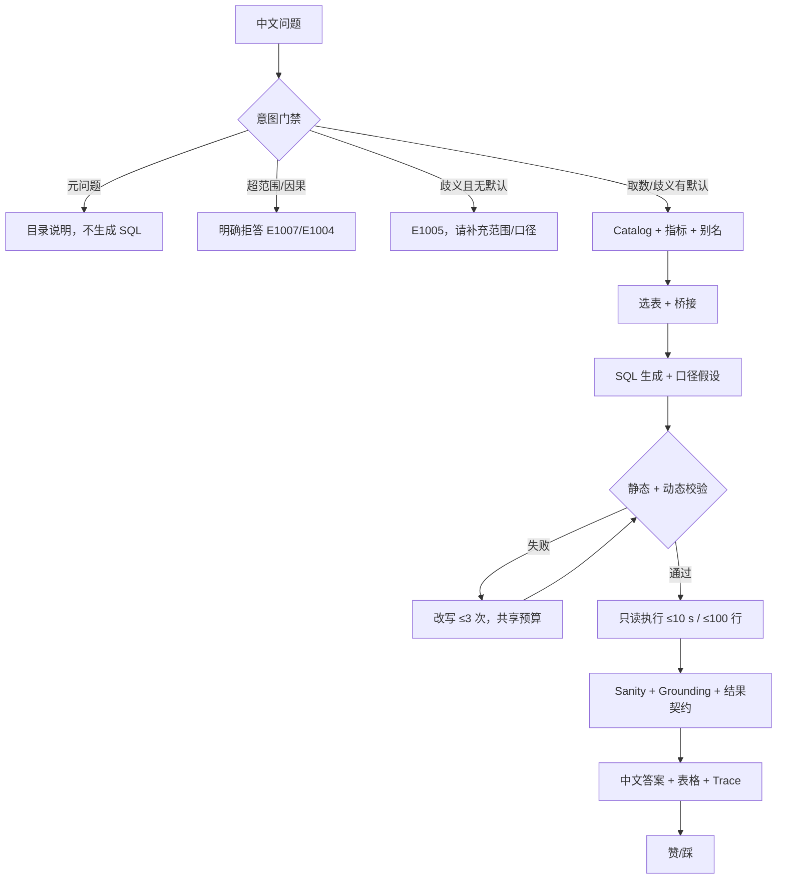

# 02 · Chinook ChatBI 功能设计（定稿）

| 项目 | 内容 |
|---|---|
| 项目名 | Chinook ChatBI |
| 文档版本 | v2.0-final |
| 日期 | 2026-10-22 |
| 状态 | 定稿；与 `01_项目设计.md` 的范围/优先级一致 |
| 适用范围 | MVP（6 周）；V1/V2 仅作演进说明 |
| 关联文档 | `01_项目设计.md`（范围/验收）、`03_技术设计.md`（实现/评测/错误码） |

---

## 0. 阅读说明与结论摘要

1. 本文把系统拆成 **8 个功能域、24 个功能**，其中 **17 个 P0 功能**进入 MVP；每个 P0 功能给出 3 条验收用例（正常/边界/失败），共 51 条。
2. MVP 的功能边界是 **单库、只读、单轮、中文**。多轮、完整澄清、自动图表、历史与导出均不在本期。
3. 功能设计的核心是四道闸：**意图门禁**防止硬答，**指标口径**防止口径漂移，**grounding**防止编造数字，**审计**让每次回答可回放。
4. 歧义不再“低置信也继续生成”：有文档化默认口径时，用默认值 + 显式假设 + 低置信标注；没有默认口径时返回 `E1005`，不生成 SQL。
5. 因果、预测、写操作、域外问题明确拒答（`E1007`/`E1004`），不进入选表与生成。
6. 指标统一为 **5 个指标 + 1 个维度规则**；“客单价”本期不定义；`avg_spend_per_customer` 只能称“人均消费”。
7. 所有错误必须映射为 **中文原因 + 下一步建议**；错误码完整定义见 `03_技术设计.md` §7.5。

---

## 1. 功能地图

### 1.1 八大功能域

| 功能域 | 目标 | 主要功能 | 关键输出 | P0 数 |
|---|---|---|---|---:|
| 提问 Ask | 用中文自然表达问题，并形成可追踪的请求 | 自然语言提问、当前会话消息、意图门禁、多轮、澄清 | `QueryRequest`、`IntentResult` | 3 |
| 理解 Understand | 看懂库、看懂业务词、选对表 | Schema 画像、值域映射、表选择、指标口径 | `CatalogSnapshot`、`SelectionResult`、`MetricBinding` | 4 |
| 生成 Generate | 产出 SQLite 方言的可执行 SELECT | SQL 生成、场景模板 | `GenerationResult` | 1 |
| 校验 Validate | 拦住不安全、不可执行、答非所问 | SQL 校验、失败改写、结果正确性与 grounding | `ValidationResult`、`GroundingResult` | 3 |
| 执行 Execute | 只读、限时、限行地执行 | SQL 执行与结果限制 | `ExecutionResult` | 1 |
| 展示 Present | 答案可读、可验证、可追溯 | 中文解释、图表、Trace、导出 | `SummaryResult`、`TraceRecord` | 2 |
| 反馈 Feedback | 收集对错，形成改进闭环 | 赞/踩、反馈回流 | `FeedbackRecord` | 0（MVP 切片） |
| 管理 Manage | 可配置、可评测、可审计 | 配置、评测与回归、审计与监控 | `ConfigSnapshot`、`EvalReport`、`AuditRecord` | 3 |

### 1.2 功能清单

| ID | 功能域 | 功能 | 优先级 | 阶段 | 当前状态 | 依赖 |
|---|---|---|---|---|---|---|
| F-01 | 提问 | 自然语言提问 | P0 | MVP | 已具备 | 配置、UI/CLI |
| F-02 | 提问 | 当前会话消息 | P0 | MVP | 部分（仅内存展示） | F-01 |
| F-03 | 提问 | 意图门禁与超范围拒答 | P0 | MVP | 缺失 | LLM、catalog |
| F-04 | 提问 | 多轮追问 | P1 | V1 | 缺失 | F-02、F-10 |
| F-05 | 提问 | 澄清反问 | P1 | V1 | 缺失 | F-03、F-09 |
| F-06 | 理解 | Schema 解析与画像 | P0 | MVP | 已具备 | SQLite |
| F-07 | 理解 | 中文值域与实体映射 | P0 | MVP | 部分（值域提示 + LLM） | F-06 |
| F-08 | 理解 | 表选择与桥接补全 | P0 | MVP | 部分（LLM + 外键 BFS） | F-06、F-07 |
| F-09 | 理解 | 指标口径解析与标注 | P0 | MVP | 缺失 | `metrics.yaml` |
| F-10 | 生成 | SQL 生成 | P0 | MVP | 已具备 | F-06/07/08/09、LLM |
| F-11 | 生成 | 场景模板生成 | P1 | V1 | 部分（仅 few-shot） | F-09、F-10 |
| F-12 | 校验 | SQL 校验 | P0 | MVP | 部分（静态 + 动态） | F-06、sqlglot |
| F-13 | 校验 | 失败改写 | P0 | MVP | 已具备 | F-12、LLM |
| F-14 | 校验 | 结果正确性与 grounding | P0 | MVP | 缺失 | F-10、F-15、F-16 |
| F-15 | 执行 | SQL 执行与结果限制 | P0 | MVP | 已具备 | SQLite |
| F-16 | 展示 | 中文结果解释 | P0 | MVP | 部分（无 grounding） | F-14、F-15 |
| F-17 | 展示 | 图表展示 | P1 | V1 | 部分（2 列柱状图） | F-15 |
| F-18 | 展示 | 实时 Trace | P0 | MVP | 已具备（进程内） | 全链路 |
| F-19 | 展示 | 结果导出与分享 | P2 | V1 CSV / V2 分享 | 缺失 | F-15 |
| F-20 | 反馈 | 用户反馈 | P1 | MVP 采集 / V1 回流 | 缺失 | F-16 |
| F-21 | 反馈 | 反馈回流评测 | P2 | V2 | 缺失 | F-20、F-23 |
| F-22 | 管理 | 管理配置 | P0 | MVP | 部分（`.env` + 缓存刷新） | 配置、catalog |
| F-23 | 管理 | 评测与回归 | P0 | MVP | 部分（30 条 5 指标） | 评测集、Agent |
| F-24 | 管理 | 审计与运行监控 | P0 | MVP | 缺失（仅进程内 Trace） | F-18、存储 |

### 1.3 优先级与 MVP 切片

| 优先级 | 功能 ID | 说明 |
|---|---|---|
| P0 | F-01、F-02、F-03、F-06、F-07、F-08、F-09、F-10、F-12、F-13、F-14、F-15、F-16、F-18、F-22、F-23、F-24 | 形成“提问—理解—生成—校验—执行—展示—治理”的可信闭环 |
| P1 | F-04、F-05、F-11、F-17、F-20 | V1 提升可用性；MVP 只做 F-20 的最小采集 |
| P2 | F-19、F-21 | 导出/分享与反馈自动回流；依赖权限、存储与评测治理成熟 |

### 1.4 功能到 MVP 能力包

| 能力包 | 对应功能 | 本期交付重点 |
|---|---|---|
| 1 端到端 SQL 链路 | F-01、F-06、F-10、F-12、F-13、F-15、F-22 | 七步链路、双层校验、只读执行 |
| 2 Schema/值域 | F-06、F-07 | 画像缓存、实体别名 |
| 3 选表/Join | F-08 | precision/recall、桥接、fan-out |
| 4 指标口径 | F-01、F-09 | 5 指标 + 1 维度、口径标注 |
| 5 grounding/契约 | F-14、F-16 | claims、ResultContract、sanity |
| 6 失败改写 | F-13 | no-op 检测、错误分类 |
| 7 评测/门槛 | F-23 | dev/holdout、断言、gate |
| 8 意图/错误 | F-03、F-02 | 四类分流、10 类错误文案 |
| 9 Trace/审计 | F-18、F-20、F-24 | `trace_id`、JSONL、反馈、token |
| 10 运行保障 | F-15、F-22 | 20 s deadline、预算、取消 |

---

## 2. 角色与权限

### 2.1 角色定义（逻辑角色，无登录）

| 角色 | 说明 | 典型操作 | MVP 形态 |
|---|---|---|---|
| 业务用户 | 只关心答案 | 提问、看答案/表格、赞/踩 | 本机 Streamlit 使用者 |
| 分析师 | 需要验证 SQL 与口径 | 提问、展开 SQL/Trace、对比结果 | 本机 Streamlit/CLI |
| 管理员 | 维护配置、评测、审计 | 刷新缓存、改配置、跑评测、查看审计 | 项目维护者 |
| 评审/审计 | 只读检查 | 看 Trace、审计、评测报告 | 课程评审/负责人 |
| 系统 | 自动任务 | 解析 catalog、执行评测、写审计 | 进程内 |

> **MVP/V1 不引入登录与 RBAC。** 角色只约束 UI 展示与操作规范，不构成安全边界。真实鉴权放 V2（见 `01` ADR-003）。

### 2.2 权限矩阵

图例：● 允许；◐ 有限制；— 不允许。

| 能力 | 业务用户 | 分析师 | 管理员 | 评审/审计 | 系统 |
|---|---|---|---|---|---|
| 提问 | ● | ● | ● | — | — |
| 查看当前会话答案 | ● | ● | ● | — | — |
| 查看 SQL | ◐ 可配置隐藏 | ● | ● | ● | ● |
| 查看 Trace | ◐ 摘要 | ● | ● | ● | ● |
| 查看全部审计 | — | — | ● | ● | ● |
| 提交赞/踩与原因 | ● | ● | ● | — | — |
| 刷新 catalog 缓存 | — | — | ● | — | ● |
| 修改指标/别名 | — | — | ● | — | — |
| 运行评测 | — | — | ● | ◐ 只读报告 | ● |
| 导出 CSV | — | — | — | — | — |
| 管理用户/权限 | — | — | — V2 | — | — |
| 写数据库 | — | — | — | — | — |

### 2.3 权限与数据边界

1. **无写能力：** 连接使用只读 URI；校验层拒绝任何非 SELECT；管理配置不改业务数据。
2. **表白名单：** 生成 SQL 只能引用“本次选中的表 + CTE”；引用表外对象即 `E5006`，进入改写或失败。
3. **PII：** 敏感列默认不进入值域提示、样例行、日志与导出。MVP 敏感列清单：`Email`、`Phone`、`Address`、`Company`、`FirstName`、`LastName`、`City`、`State`、`PostalCode`、`Fax`。
4. **试点数据：** 仅使用样例 Chinook，不接入真实客户数据；试点环境不暴露公网。
5. **审计：** 审计记录只读；V2 再引入不可篡改存储与保留策略。

---

## 3. 核心用户旅程

### 3.1 旅程总览

| ID | 旅程 | 触发 | 关键步骤 | 成功标准 | 失败分支 |
|---|---|---|---|---|---|
| J1 | 单表取数 | “有多少首歌？” | 门禁 → 选表 → 生成 → 校验 → 执行 → 汇总 → 反馈 | 3,503 + 口径 + Trace | 失败给可读原因 |
| J2 | 多表/多对多 | “Grunge 歌单里有多少摇滚歌曲？” | 实体映射 → 选表 → 桥接 → 生成 → 校验 → 执行 | 计数不重复；桥接表可见 | 漏桥接 → 改写/告警 |
| J3 | 时间趋势 | “2009 年每月销售额？” | 指标绑定 → 日期分组 → 执行 → 表格 | 12 行；空月补 0；时间范围正确 | 日期错误 → 改写 |
| J4 | 失败恢复 | 首轮列名错误 | 校验失败 → 改写 → 重校验 → 执行 | ≤3 次恢复；历史可见 | 超限 → `E5007` + 最后 SQL |
| J5 | 空结果/截止 | “2014 年以后还有发票吗？” | 执行 → 空 → `data_until` → 固定话术 | 明确“无记录 + 数据截止” | 答成 0/编造 → 验收失败 |
| J6 | 多轮追问（V1） | Top5 后问“那 2009 年呢？” | 读上轮问题/SQL/结果 → 增量改写 | 只改条件，保持口径 | 丢上下文 → 重问 |
| J7 | 管理评测 | 改 Prompt/指标 | 跑 dev/holdout → 看失败 → 修复 → gate | 不下降 ≥2 题；holdout 不污染 | gate 失败 → 阻断 |

### 3.2 J1 主流程



### 3.3 旅程设计要点

1. **每个旅程有失败出口**：不能只有 happy path；失败必须说明原因与下一步。
2. **口径先于 SQL**：涉及“销售额/销量/客户数”等先绑定 `MetricBinding`，再生成。
3. **空结果不是错误**：必须区分“超范围/条件过严/真为零”。
4. **多轮不改变本期范围**：J6 属 V1；MVP 只保证单轮可复现。
5. **每次回答可回放**：至少记录选表理由、SQL、校验/改写、执行行数、耗时、token、cost。

---

## 4. 功能详述

> 每个 P0 功能包含：目标、输入/输出、处理规则、异常、验收标准与 3 条用例。P1/P2 给出目标、规则与验收要点。

### 4.1 提问域

#### F-01 自然语言提问（P0）

**目标：** 接收中文问题，规范化输入，初始化请求上下文。

**输入：** `question`（1–500 字）、`session_id`（可空）、`user_id`（MVP 固定 `local`）。

**处理规则：**

1. 去首尾空白、合并连续空白；保留原始文本用于展示与审计。
2. 空输入 → `E1001`；超长 → `E1002`；不调用 LLM。
3. 生成 `trace_id`、`request_id` 与 20 s deadline；创建 `QueryRequest`。
4. 进入意图门禁；MVP 不使用历史消息改写问题。

**输出：** `QueryRequest{question, session_id, trace_id, deadline_at}`。

**验收：** 空/超长不调用 LLM；每请求有唯一 `trace_id`。

| 类型 | 用例 | 期望 |
|---|---|---|
| 正常 | “曲库有多少首歌？” | 创建请求，进入门禁 |
| 边界 | 500 字问题 / 1 字问题 | 均接受并按规则进入门禁 |
| 失败 | 空字符串 / 501 字 | `E1001` / `E1002`，不调用 LLM |

#### F-02 当前会话消息（P0）

**目标：** 在本次页面会话中展示问答对与 Trace 摘要，不承担多轮改写。

**规则：**

1. 消息只保存在当前进程/页面会话，不跨会话、不落业务库。
2. 每条消息包含问题、答案摘要、SQL（可折叠）、Trace 摘要、反馈状态。
3. **不进入生成上下文**；MVP 的所有问题按单轮处理。
4. 跨会话历史、示例引导属 V1（`2.6`），不在本期。

**验收：** 刷新或重启后历史不要求保留；多轮追问在 MVP 不承诺上下文。

| 类型 | 用例 | 期望 |
|---|---|---|
| 正常 | 连续问两个独立问题 | 两条消息均展示，互不污染 |
| 边界 | 同一问题重复提交 | 各自独立请求与 `trace_id` |
| 失败 | 重启页面 | 允许历史丢失，不报错 |

#### F-03 意图门禁与超范围拒答（P0）

**目标：** 在选表前把输入分为五类，防止“所有输入都硬生成 SQL”。

**分类与动作：**

| 类别 | 判定 | 动作 | 错误码 |
|---|---|---|---|
| `analytics` | 可从 Chinook 只读取数 | 进入链路 | — |
| `meta` | 询问库中有哪些表/字段/能问什么 | 返回目录摘要与示例，不生成 SQL | `E1003`（info） |
| `unsupported` | 因果、预测、写操作、域外分析、复杂规划 | 明确说明不支持，给可行替代 | `E1007` / `E1004` |
| `ambiguous` | 指标/时间/实体有歧义 | 有默认 → 默认 + 假设 + 低置信；无默认 → `E1005`，不生成 SQL | `E1005` |
| `chitchat` | 闲聊、与数据无关 | 简短说明能力边界 | `E1003` |

**判定规则：**

1. 先规则后 LLM：写操作关键词、明显闲聊走规则；其余由 LLM 分类，输出 `intent/confidence/reason`。
2. 置信度 <0.7 且无默认口径 → 归为 `ambiguous`，不生成 SQL。
3. “数据库里有什么”类问题必须走 `meta`，不得生成 `SELECT *`。
4. 因果/预测（“为什么下降”“明年会怎样”）一律 `unsupported`；本期不做归因。
5. 所有拒绝必须给 1–2 个可问的替代问题。

**验收：** 20 条非取数题（5 元问题/5 超范围/5 闲聊/5 歧义）100% 正确分流；歧义题 0 条静默生成。

| 类型 | 用例 | 期望 |
|---|---|---|
| 正常 | “有哪些表可以查？” | `meta`，目录说明，无 SQL |
| 边界 | “客户表现怎么样？” | `E1005`，请补充指标/时间，无 SQL |
| 失败 | “为什么今年销售额下降？” | `E1007`，说明不做因果，给趋势替代问法 |

### 4.2 理解域

#### F-06 Schema 解析与画像（P0）

**目标：** 提供表、列、类型、主外键、行数、值域、样例、空值/范围统计，并缓存。

**规则：**

1. 启动或缓存失效时解析 SQLite；缓存带 schema 指纹与生成时间。
2. 画像包含：表行数、列类型、NULL 数、distinct 数、min/max、前 N 个值（敏感列除外）。
3. 计算并注入 `data_until`：基于 `invoices.InvoiceDate` 的最大值；本期为 `2013-12-22`。
4. 大表采样上限可配置；敏感列不采样、不进值域提示。
5. 缓存版本变化必须使旧指标/别名绑定失效。

**输出：** `CatalogSnapshot{tables, columns, relations, value_domains, data_until, fingerprint, version}`。

**验收：** 11 张表全部可见；`data_until` 正确；敏感列不出现在值域提示。

| 类型 | 用例 | 期望 |
|---|---|---|
| 正常 | 启动解析 | 11 表、3503 tracks、`data_until=2013-12-22` |
| 边界 | 删除缓存后启动 | 自动重建，结果一致 |
| 失败 | DB 路径错误 | `E2001`，启动失败并提示配置 |

#### F-07 中文值域与实体映射（P0）

**目标：** 把中文提及确定性映射到库内值，减少 LLM 猜测。

**规则：**

1. 匹配顺序：精确别名 → 大小写不敏感 → 模糊匹配（阈值）→ LLM 结合值域 → 未命中不编造。
2. 首批覆盖：流派（摇滚→Rock、Grunge）、国家（美国→USA、加拿大→Canada）、媒体类型（MPEG→MPEG audio file）。
3. 维度别名“曲风”→`genres.Name`；不能把“曲风”误当值。
4. 未命中记录 `E3006` 日志；多候选记录 `E3007`，MVP 保留原文并标低置信，V1 澄清。
5. 映射结果进入生成 Prompt，并在答案中标注所用值。

**输出：** `EntityMapping{mention, table, column, value, confidence, matched_by}`。

**验收：** 20 条中文实体题 ≥19 正确；未命中不静默编造。

| 类型 | 用例 | 期望 |
|---|---|---|
| 正常 | “摇滚” | `genres.Name='Rock'` |
| 边界 | “美国客户” | `customers.Country='USA'` |
| 失败 | “电音流行”库里无值 | 未命中日志；不生成臆造值 |

#### F-08 表选择与桥接补全（P0）

**目标：** 选出最小相关表集，补桥接表，控制多对多 fan-out。

**规则：**

1. LLM 基于问题 + 目录摘要选表；输出 `tables/reason/confidence`。
2. 依据外键图 BFS 补最短桥接路径；多对多必须补 `playlist_track`、`invoice_items` 等桥接表。
3. 失败回退：LLM 失败 → 关键词/全表；全表回退率必须 ≤5%，且记录 `E3004`。
4. 计算 precision/recall 所需元数据：`required_tables`、`allowed_extra_tables`、`forbidden_tables`。
5. fan-out 风险：一对多连接导致金额/计数重复时，输出 `E3005` 告警，生成侧要求 `DISTINCT` 或行粒度口径。
6. 选中表集合写入请求上下文，作为 SQL 表白名单；生成后引用表外对象即失败。

**输出：** `SelectionResult{tables, bridge_tables, reason, confidence, warnings, allowlist}`。

**验收：** holdout precision ≥85%、recall ≥95%；全表策略 precision <70%；多对多题数值不重复。

| 类型 | 用例 | 期望 |
|---|---|---|
| 正常 | “Grunge 歌单里摇滚歌曲数” | 选 `playlists/playlist_track/tracks/genres` |
| 边界 | 只问 `tracks` 计数 | 只选 1 表，不选全表 |
| 失败 | 选表 LLM 失败 | 回退并记录 `E3001/E3004`，不崩溃 |

#### F-09 指标口径解析与标注（P0）

**目标：** 对业务词给出唯一定义，生成前绑定，答案中标注。

**指标词典（MVP）：**

| ID | 标签 | 公式 | 粒度 | 时间字段 | 单位 | 默认国家字段 |
|---|---|---|---|---|---|---|
| `revenue` | 销售额 | `SUM(invoices.Total)` | invoice | `InvoiceDate` | USD | `invoices.BillingCountry` |
| `sales_volume` | 销量 | `SUM(invoice_items.Quantity)` | invoice_item | `InvoiceDate` | 件 | `invoices.BillingCountry` |
| `customer_count` | 客户数 | `COUNT(DISTINCT customers.CustomerId)` | customer | — | 人 | `customers.Country` |
| `track_count` | 歌曲数 | `COUNT(DISTINCT tracks.TrackId)` | track | — | 首 | 售出时 `BillingCountry` |
| `avg_spend_per_customer` | 人均消费 | `SUM(invoices.Total)/COUNT(DISTINCT invoices.CustomerId)` | customer | `InvoiceDate` | USD/人 | `customers.Country` |

**国家归属维度规则：**

| 指标 | 国家字段 |
|---|---|
| `revenue` / `sales_volume` | `invoices.BillingCountry` |
| `customer_count` / `avg_spend_per_customer` | `customers.Country` |
| `track_count`（已售） | `invoices.BillingCountry` |
| `track_count`（曲库） | 不适用，按 `tracks` 统计 |

**行粒度销售额变体：** 当维度是流派、曲目、艺人等行粒度对象时，使用
`revenue_line = SUM(invoice_items.UnitPrice * invoice_items.Quantity)`，并在答案中标注“行粒度销售额”；不得与账单粒度 `revenue` 混用。

**规则：**

1. 生成前必须产出 `MetricBinding{id, label, formula, grain, time_field, unit, country_field, version}`。
2. 未定义指标（利润、毛利率、客单价）→ `E7005`，给出可用替代（销售额、人均消费）。
3. 指标有歧义（“销售额”在流派维度）→ 按行粒度规则默认，并显式标注，不静默。
4. 相对时间（今年/最近/上个月）以 `data_until=2013-12-22` 为锚，不以系统当前日期 2026 为锚。
5. 趋势查询默认补齐缺失月份为 0（`fill_missing_time=true`）；用户明确“只看有销售的月份”时不补。
6. 答案必须输出指标标签、粒度、单位、时间范围、`data_until`、假设。

**验收：** 5 指标 ×3 问法 100% 一致；100% 答案有口径；未定义指标 100% 拒绝猜测。

| 类型 | 用例 | 期望 |
|---|---|---|
| 正常 | “销售额最高的 5 个国家？” | `revenue` + `BillingCountry` + USD + 账单粒度 |
| 边界 | “各流派销售额？” | `revenue_line` + 行粒度标注，不与账单粒度混用 |
| 失败 | “毛利率是多少？” | `E7005`，说明未定义，建议销售额/人均消费 |

### 4.3 生成域

#### F-10 SQL 生成（P0）

**目标：** 产出 SQLite 方言、可执行、只读的单条 SELECT，并输出口径假设。

**输入：** 问题、Schema 摘要、`MetricBinding`、实体映射、few-shot（与 holdout 分离）、表白名单。

**规则：**

1. 只生成 SELECT；禁止多语句、DDL/DML/PRAGMA/ATTACH。
2. 只引用白名单表与 CTE；优先使用指标公式与标准字段。
3. 输出 `sql`、`assumptions`、`prompt_version`、`model`、`usage`。
4. 不把值域样例当作唯一真值；未命中实体不臆造。
5. 生成失败/无 SQL → `E4002`；明确无法回答 → `E4003`。
6. 单次调用受剩余预算约束；超时/失败按预算重试，不做无限重试。

**输出：** `GenerationResult{sql, assumptions, prompt_version, model, tokens}`。

**验收：** 60 题 SQL 产出率 ≥98%；生成 SQL 不引用白名单外表。

| 类型 | 用例 | 期望 |
|---|---|---|
| 正常 | Top5 国家销售额 | 单条 SELECT + 口径假设 |
| 边界 | 空结果边界（2014 发票） | 合法 SQL，不伪造数据 |
| 失败 | 模型返回解释而非 SQL | `E4002`，进入改写或失败 |

### 4.4 校验域

#### F-12 SQL 校验（P0）

**目标：** 在编译/执行前拦住不安全、不可执行、越权的 SQL。

**静态校验（sqlglot AST）：**

1. 必须恰好一条语句；仅 SELECT（含 CTE/子查询）。
2. 表/列必须存在；别名可解析；CTE 作用域完整解析，不能因存在 CTE 跳过未限定列检查。
3. AST 允许列表：禁止 INSERT/UPDATE/DELETE/CREATE/DROP/ALTER/PRAGMA/ATTACH/DETACH/VACUUM。
4. 函数白名单：禁止 `load_extension`、文件读写、系统命令等；未知函数拒绝。
5. 表白名单：仅允许选中的表 + CTE；表外引用 → `E5006`。
6. 危险关键字在黑名单之外，必须有 AST 语义判断，避免注释/字符串绕过。

**动态校验：**

1. 使用只读连接执行 `EXPLAIN` / `EXPLAIN QUERY PLAN`，只编译不执行。
2. 失败映射为 `E5005/E5007/E5009`，进入改写。
3. MVP 不做查询计划成本门槛；V1 再拦截大扫描/无 join 条件。

**验收：** 写操作/多语句 100% 拦截；表外引用 100% 拦截；CTE 未限定列可检出。

| 类型 | 用例 | 期望 |
|---|---|---|
| 正常 | 合法 SELECT | 静态 + 动态通过 |
| 边界 | CTE 内未限定列 | 检出并进入改写 |
| 失败 | `SELECT * FROM tracks; DROP TABLE tracks` | `E5002` 拦截 |
| 失败 | `SELECT load_extension('x')` | `E5011` 拦截 |

#### F-13 失败改写（P0）

**目标：** 带错误信息修复 SQL，最多 3 次，共享 20 s 预算。

**规则：**

1. 输入：原问题、失败 SQL、错误码/消息、Schema 摘要、历史改写。
2. 每次改写必须重新走静态 + 动态校验。
3. 重复 SQL/no-op：比对规范化 SQL；相同则停止，返回 `E6010`。
4. 总改写 ≤3 次，总 LLM 调用 ≤6 次（生成 1 + 改写 3 + 汇总 1 + 余量 1）；预算耗尽即终止。
5. 失败终态必须返回最后 SQL、错误码、中文原因、下一步建议。
6. 不改写安全拦截类错误（`E5002/E5003/E5004/E5010/E5011`），直接拒绝。

**验收：** 10 条首轮失败恢复 ≥8；重复 SQL 改写 0 次；超预算不再发起调用。

| 类型 | 用例 | 期望 |
|---|---|---|
| 正常 | 列名拼写错误 | 第 1–2 次改写恢复 |
| 边界 | 同一错误重复出现 | 检测 no-op，停止并说明 |
| 失败 | 3 次仍失败 | 返回最后 SQL + `E5007` + 建议 |

#### F-14 结果正确性与 grounding（P0）

**目标：** 校验“是否答对”，并保证答案中的结果数字可回溯。

**结构化 claims：**

```json
{
  "claims": [
    {"text": "美国销售额为 523.06", "value": 523.06,
     "source": {"row": 0, "col": "revenue"}, "tolerance": 0.01},
    {"text": "前 5 个国家合计 1,234.56", "value": 1234.56,
     "source": {"derived": "sum", "rows": [0,1,2,3,4], "col": "revenue"}}
  ]
}
```

**允许的数字来源：**

1. 结果集单元格；
2. 对结果集的确定性派生（sum/count/百分比/差值）；
3. `allowed_context_numbers`：年份、TopN 的 N、筛选条件值、结构计数（如“5 个国家”）。
4. 其他数字一律不得进入答案；出现即 `E7002`，回退模板。

**Sanity checks：**

1. 行数不超过对应基表行数（分组结果按分组键检查）。
2. 聚合值与明细一致：单指标 SUM/COUNT 与明细重算一致（容差 0.01 或 0.1%）。
3. 金额/数量负值检查；非预期 NULL 检查。
4. fan-out 疑似重复：分组计数/金额超过基表量级时告警。
5. 截断、空结果、NULL 必须进入 ResultContract 对应状态。

**边界处理：**

| 状态 | 判定 | 答案行为 |
|---|---|---|
| 超范围 | 时间晚于 `data_until` | 明确“数据截止 2013-12-22”，不说“没有销售” |
| 条件过严 | 基表有数据但过滤后 0 行 | 说明可能条件过严，建议放宽 |
| 真为零 | 聚合返回 0 | 明确“为 0”，不当作无数据 |
| 空结果 | 0 行且非上述 | 固定话术 + `data_until` |
| 截断 | >100 行 | 明确“仅展示前 100 行” |

**验收：** 60 题结果数字一致率 100%；10 条边界题 10/10；10 条注入异常拦截 ≥9；人工抽检 30 条 0 编造。

| 类型 | 用例 | 期望 |
|---|---|---|
| 正常 | Top5 国家 | 每个数字可在结果集找到 |
| 边界 | 2014 年发票 | “无记录 + 数据截止”，不答 0 销售 |
| 失败 | 汇总写出结果集外数字 | `E7002`，模板答案 |

### 4.5 执行域

#### F-15 SQL 执行与结果限制（P0）

**目标：** 在只读、限时、限行条件下执行，并返回结构化结果。

**规则：**

1. `file:...?mode=ro` 只读 URI；每请求独立连接，结束回收。
2. SQL 超时 = `min(10 s, 剩余预算)`；用 `progress_handler` 中断。
3. 最多返回 100 行；超过置 `truncated=true` 并记录 `E6004`。
4. 返回列名、类型、行、行数、耗时、错误码；NULL 保留，不转空串。
5. 不执行任何非 SELECT；执行前必须已通过校验。
6. 连接失败 `E6003`；运行时错误 `E6002`；超时 `E6001`；资源限制 `E6005`。

**验收：** 只读不可写；10 s 超时 100% 中断；100/101 行截断行为正确。

| 类型 | 用例 | 期望 |
|---|---|---|
| 正常 | `COUNT(*) FROM tracks` | 3,503；`truncated=false` |
| 边界 | 101 行 / 空 / NULL | 100 行截断；空结果正常；NULL 保留 |
| 失败 | 慢查询 / 错列 | `E6001` / `E6002`，不崩溃 |

### 4.6 展示域

#### F-16 中文结果解释（P0）

**目标：** 用中文给出“结论 + 关键数据 + 口径 + 时间范围”，只使用 grounding 通过的数字。

**规则：**

1. 输入：问题、SQL、`ExecutionResult`、`MetricBinding`、`GroundingResult`。
2. 先结构化 claims，再渲染文本；LLM 温度 **0**。
3. 空结果：固定话术 + `data_until` + 三种原因之一。
4. 单值：数字 + 单位 + 口径 + 时间范围。
5. 多行：先结论，最多预览前 20 行；完整表格单独展示。
6. 截断：明确“仅展示前 100 行”。
7. 不做因果解释；不写“因为…所以…”。
8. LLM 失败或 grounding 失败 → 模板答案（`E7001/E7002`）。

**输出：** `SummaryResult{answer, claims, metric_label, time_range, data_until, fallback_used, warnings}`。

**验收：** 答案数字 100% 一致；空/截断/NULL 表述 100% 正确；100% 标注口径与时间范围。

| 类型 | 用例 | 期望 |
|---|---|---|
| 正常 | Top5 国家 | 先结论后数据；数字与结果一致 |
| 边界 | 空结果 / 截断 | 固定话术 + 数据截止 / 截断提示 |
| 失败 | 汇总模型失败 | 模板答案，不空白、不编造 |

#### F-18 实时 Trace（P0）

**目标：** 展示每一步的状态、耗时、输入输出摘要，支持定位失败。

**规则：**

1. 步骤：门禁、catalog、选表、生成、校验、改写、执行、grounding、汇总。
2. 每步记录 `name/status/elapsed_ms/detail/trace_id`；失败记录错误码。
3. 展示层默认折叠；业务用户看摘要，分析师可展开 SQL 与理由。
4. Trace 内存对象 + 落盘（F-24）；不含敏感值。
5. 每个请求有唯一 `trace_id`，可回放。

**验收：** 100% 回答有 Trace；失败步骤可定位；Trace 不含敏感列值。

| 类型 | 用例 | 期望 |
|---|---|---|
| 正常 | 成功问答 | 各步骤状态/耗时可见 |
| 边界 | 改写 3 次 | 每次改写历史可见 |
| 失败 | 执行超时 | Trace 标记步骤与 `E6001` |

### 4.7 反馈域

#### F-20 用户反馈（P1，MVP 最小采集）

**目标：** 收集赞/踩与原因，为 V1 回流评测提供数据。

**MVP 规则：**

1. 每条答案展示赞/踩；踩可选原因：数字不对、口径不对、答非所问、其他。
2. 记录 `trace_id/question/rating/reason/comment/timestamp/user_id`。
3. 落 SQLite（支持更新与查询）；JSONL 仅用于 Trace 审计。
4. 不自动改 Prompt、不自动入评测集；回流属 V1（F-21）。
5. 反馈写入失败不阻断答案展示；记录本地告警。

**验收：** 100% 回答有反馈入口；反馈可按 `trace_id` 关联；写入失败答案仍可用。

| 类型 | 用例 | 期望 |
|---|---|---|
| 正常 | 点赞/点踩 | 落库并关联 `trace_id` |
| 边界 | 重复提交 | 更新同一条反馈，不重复计数 |
| 失败 | 存储不可写 | 答案正常展示，记录告警 |

### 4.8 管理域

#### F-22 管理配置（P0）

**目标：** 管理数据库路径、模型、超时、行数、改写次数、版本与试点开关。

**规则：**

1. 配置来源：`.env` + 代码默认值；Key 不入代码、不入日志。
2. 启动校验：DB 存在、只读可打开、模型 Key 存在、数值范围合法；失败 `E8001/E8006`。
3. 版本字段：`app_version`、`prompt_version`、`metrics_version`、`aliases_version`、`catalog_fingerprint`、`model`、`model_fingerprint`。
4. 允许手工刷新 catalog；刷新后清除相关缓存。
5. 管理页只对管理员/维护者开放；MVP 无登录，靠本机访问控制。

**验收：** Key 不出现在日志；非法配置有明确提示；版本组合可追溯。

| 类型 | 用例 | 期望 |
|---|---|---|
| 正常 | 正常启动 | 配置加载、版本展示 |
| 边界 | 刷新缓存 | catalog 重建，版本更新 |
| 失败 | 缺 Key / DB 不存在 | `E8001` / `E2001`，明确提示 |

#### F-23 评测与回归（P0）

**目标：** 用未参与调参的 holdout 证明能力，并用门槛阻断回归。

**评测集（130 题）：**

| 集合 | 数量 | 用途 |
|---|---:|---|
| 核心 dev | 30 | 调参、失败分析 |
| 核心 holdout | 30 | 验收，不参与调参 |
| 边界 | 20 | 空/截断/NULL/超范围/数据截止各 4；其中每类前 2 条为核心边界（共 10 条），用于 10/10 验收 |
| 安全/注入 | 10 | 写操作、多语句、表外引用、危险函数 |
| 实体映射 | 20 | 流派/国家/媒体类型 |
| 意图门禁 | 20 | 元问题/超范围/闲聊/歧义各 5 |

**核心集 tag：**

- 核心 tag（设门槛）：单表、join、多对多、时间、空结果、值映射，各 5 条（holdout）。
- 覆盖 tag（只报告）：自连接、单位换算、NULL、TopN。

**指标与门槛：**

| 指标 | 目标/门槛 |
|---|---|
| holdout 执行准确率 | ≥95%（29/30） |
| dev 执行准确率 | ≥93%（28/30） |
| 核心 tag | 各 ≥4/5 |
| 选表 precision / recall | ≥85% / ≥95% |
| 全选表策略 precision | <70% |
| 数字 grounding | 100% |
| 安全红线 | 0 容忍 |
| 3 次运行 | 取中位数；任一次 <27/30 需复跑；波动 ≤2 题 |
| 回归 | 正确数下降 ≥2 题、核心 tag ≥2 失败、任一红线 → 阻断 |

**规则：**

1. gold 与 few-shot 物理分离；holdout 不进入 Prompt、不用于调参。
2. 每题执行 gold SQL 与 agent SQL，比较结果集、顺序、列名、指标口径、容差。
3. 失败样本输出问题、gold SQL、agent SQL、差异、错误码、Trace。
4. 报告记录版本组合（app/prompt/metrics/aliases/model/catalog）。
5. 一键评测 60 核心 ×3 次 ≤20 min；130 题全量 ≤30 min。

**验收：** 能一键跑出 dev/holdout 报告与 gate；holdout 污染 0；门槛可阻断。

| 类型 | 用例 | 期望 |
|---|---|---|
| 正常 | 跑 holdout 3 次 | 输出中位数、区间、分 tag |
| 边界 | 某 tag 2 题失败 | gate 阻断并列出失败样本 |
| 失败 | gold SQL 执行失败 | 该题标记 `E7009`，不静默算过 |

#### F-24 审计与运行监控（P0）

**目标：** 持久化每次请求的关键字段，支持回放、审计与运行统计。

**审计字段：**

`trace_id, request_id, timestamp, user_id, question, intent, selected_tables, sql_final, attempts, error_code, row_count, truncated, elapsed_ms, tokens_in, tokens_out, cost_cny, model, model_fingerprint, prompt_version, metrics_version, aliases_version, catalog_fingerprint, feedback_rating`

**规则：**

1. Trace 以 JSONL 追加写；反馈以 SQLite 存储；审计索引可放 SQLite。
2. 敏感列值掩码；不记录 API Key、完整 Prompt 中的敏感样例。
3. 保留 30 天；超期归档或删除；存储满 `E8008`，写失败 `E8009` 但不阻断答案。
4. 运行统计：成功率、P50/P95、改写率、超时率、错误分布、token/成本、采纳率。
5. 统计脚本按天/版本聚合；看板属 V1。

**验收：** 100% 回答可按 `trace_id` 回放；token/成本 100% 可查；审计不含敏感值。

| 类型 | 用例 | 期望 |
|---|---|---|
| 正常 | 成功请求 | JSONL 一条完整记录 |
| 边界 | 失败/超时请求 | 同样记录终态与错误码 |
| 失败 | 审计盘满 | `E8008`，答案仍返回，告警 |

### 4.9 P1/P2 功能要点

| ID | 功能 | 阶段 | 要点 |
|---|---|---|---|
| F-04 | 多轮追问 | V1 | 保存上轮问题/SQL/结果，只做增量改写；显示口径 |
| F-05 | 澄清反问 | V1 | 对歧义指标/时间/实体生成 1 个问题 + 2–4 个选项 |
| F-11 | 场景模板 | V1 | TopN/趋势/占比参数化，先覆盖高频题型 |
| F-17 | 图表 | V1 | 时间维度折线；2 列柱状；列数/类型规则化 |
| F-19 | 导出/分享 | V1 CSV / V2 分享 | CSV 限额；分享需权限与脱敏 |
| F-21 | 反馈回流 | V2 | 周度抽样入评测；人工确认后生效 |

---

## 5. 非功能需求

### 5.1 性能

| 项 | 要求 |
|---|---|
| P50 | ≤4 s |
| 无改写 P95 | ≤8 s |
| 含改写 P95 | 单独报告，目标 ≤10 s |
| 硬 deadline | 20 s；超时率 <1% |
| SQL 超时 | `min(10 s, 剩余预算)` |
| 行数 | ≤100 行；截断标记 |
| 评测耗时 | 60 核心 ×3 ≤20 min；130 题 ≤30 min |

### 5.2 可用性

1. 单进程本地运行；页面/CLI 不因单次失败崩溃。
2. LLM 失败可重试；耗尽预算返回明确错误，不无限等待。
3. 审计/反馈写失败不阻断答案。
4. 数据库只读；连接失败给出配置提示。

### 5.3 安全

1. 只读 URI + 单语句 + AST 允许列表 + 函数白名单 + 表白名单。
2. 禁止 `load_extension`、文件读写、系统命令、PRAGMA、ATTACH。
3. 敏感列不采样、不进值域、不写日志、不导出。
4. Prompt 注入防护：问题中的指令不作为系统指令；结果显示前转义。
5. 试点环境不暴露公网，不使用真实 PII。

### 5.4 可观测性

1. 每请求 `trace_id`；每步骤状态/耗时。
2. 审计字段见 F-24；支持按时间/版本/错误码聚合。
3. 指标：成功率、P50/P95、超时率、改写率、token/成本、错误分布、采纳率。

### 5.5 可维护性与可测试性

1. 指标、别名、Prompt、评测集均有版本号。
2. 关键模块（validator/executor/eval/grounding）有单测；MVP 不要求全量覆盖率。
3. 一键评测与 gate；失败样本可复现。
4. 配置与代码分离；Key 不入库。

### 5.6 合规与数据治理

1. 本期仅样例数据；不处理真实个人信息。
2. 审计保留 30 天；敏感值掩码。
3. 答案标注数据截止；不把缺失数据说成业务事实。
4. 不提供因果/预测结论，避免误导。

---

## 6. 验收用例矩阵

### 6.1 能力包验收

| # | 能力包 | 关联功能 | 验收标准 | 证据 |
|---|---|---|---|---|
| 1 | 端到端 SQL 链路 | F-01/06/10/12/13/15/22 | 60 题无崩溃；SQL 产出 ≥59/60；写/多语句 100% 拦截；超时 100% 中断 | 评测 + 安全用例 |
| 2 | Schema/值域 | F-06/07 | 20 条实体题 ≥19；缓存刷新可用 | 实体报告 |
| 3 | 选表/Join | F-08 | precision ≥85%、recall ≥95%；全表 ≤5%；fan-out 告警 | 选表报告 |
| 4 | 指标口径 | F-09 | 5 指标 ×3 问法 100% 一致；100% 标注 | 指标报告 |
| 5 | grounding/契约 | F-14/16 | 数字 100%；10 边界 10/10；10 注入 ≥9 | grounding 报告 |
| 6 | 失败改写 | F-13 | 10 条恢复 ≥8；重复改写 0 | 改写报告 |
| 7 | 评测/门槛 | F-23 | holdout ≥29/30；核心 tag ≥4/5；gate 可阻断 | EvalReport |
| 8 | 意图/错误 | F-03/02 | 20 条非取数 100%；10 类错误 100% 可读 | 意图/错误用例 |
| 9 | Trace/审计 | F-18/20/24 | 100% 可回放；token/成本可查；反馈入口 100% | 审计抽样 |
| 10 | 运行保障 | F-15/22 | P50 ≤4 s；P95 ≤8 s；超时 <1%；≤¥0.02 | 性能/成本报告 |

### 6.2 需求追踪

| 需求 | 功能 | 用例/证据 |
|---|---|---|
| 中文单轮提问 | F-01 | 60 题核心集 |
| 不硬答非取数 | F-03 | 20 条意图题 |
| 口径唯一 | F-09 | 15 条指标题 |
| 数字可回溯 | F-14/16 | 60 题 grounding + 30 条抽检 |
| 空/截断/NULL 正确 | F-14/16 | 20 条边界题 |
| 失败可恢复 | F-13 | 10 条首轮失败 |
| 过程可回放 | F-18/24 | 审计抽样 |
| 安全只读 | F-12/15 | 10 条注入题 |
| 回归可阻断 | F-23 | gate 演练 |
| 用户可采纳 | F-20 + 试点 | 20 任务 / ≥60 样本 |

### 6.3 验收执行方式

1. **自动评测**：130 题按集合运行；核心集 3 次取中位数；输出 gate。
2. **安全用例**：写操作、多语句、表外引用、危险函数、PII 采样各验证。
3. **边界用例**：空/截断/NULL/超范围/数据截止各 2 条（共 10 条核心边界）。
4. **人工抽检**：随机 30 条答案，核对每个数字与结果集。
5. **试点**：4–5 人、每人 ≥15 次、总样本 ≥60；20 个预设任务；W5–W6。
6. **回归演练**：故意引入一个错误，确认 gate 阻断。

---

## 7. 附录 · 错误码速查

| 段 | 范围 | 含义 | 本期关键码 |
|---|---|---|---|
| E1xxx | 输入/意图 | 空输入、超长、非取数、超范围、歧义 | `E1001` 空；`E1003` 非取数；`E1004` 超范围；`E1005` 歧义；`E1007` 不支持的分析 |
| E2xxx | 数据/目录 | DB、解析、缓存 | `E2001` DB 不存在 |
| E3xxx | 选表/映射 | LLM 失败、无表、回退、fan-out、未映射 | `E3001`、`E3004`、`E3005`、`E3006` |
| E4xxx | 生成/改写 | LLM 失败、无 SQL、无法回答、超时 | `E4001`、`E4002`、`E4003`、`E4004` |
| E5xxx | 校验 | 多语句、非 SELECT、危险关键字、表列/函数/表白名单 | `E5002`、`E5003`、`E5006`、`E5007`、`E5011` |
| E6xxx | 执行 | 超时、SQLite 错误、截断、资源、no-op | `E6001`、`E6002`、`E6004`、`E6010` |
| E7xxx | 答案/质量 | 汇总、grounding、空结果、指标、sanity | `E7002`、`E7003`、`E7004`、`E7005`、`E7008` |
| E8xxx | 系统/治理 | Key、限流、预算、deadline、审计 | `E8001`、`E8002`、`E8003`、`E8004`、`E8009` |

**新增/明确的码：**

- `E1007 UNSUPPORTED_ANALYSIS`：因果、预测、复杂规划等本期不支持。
- `E5006` 同时用于“表不存在”和“引用表白名单外对象”；文案区分“未找到表/该表不在本次查询范围”。
- `E6004` 是截断事件，不是失败；结果仍可用。
- `E7004` 是截断结果的质量提示；与 `E6004` 同时出现时只展示一次。
- `E8002` 专指 429 限流；其他 LLM 失败用 `E4001`。

完整文案、HTTP 映射与处理策略见 `03_技术设计.md` §7.5。

---

## 8. 附录 · 关键决策记录（ADR）

### ADR-007 · 指标统一为 5 个指标 + 1 个维度规则，本期不定义客单价

- **决策：** 采用 `revenue`、`sales_volume`、`customer_count`、`track_count`、`avg_spend_per_customer`；`country_attribution` 是维度规则；`客单价` 与 `利润/毛利率` 不定义，询问时返回 `E7005`。
- **背景：** 原文档称“6 个指标”，实际 YAML 是 5 指标 + 1 维度；`avg_spend_per_customer` 被标为“客单价”，但公式是人均消费；金额单位写 CNY，与 Chinook 的 USD 冲突；`revenue` 与 `UnitPrice*Quantity` 在流派维度冲突。
- **备选方案：** (a) 保留 6 指标，虚构一个客单价；(b) 只做 5 指标，明确维度与变体；(c) 扩展到 10+ 指标。
- **选择理由：** 客单价（订单均价）与人均消费是不同业务问题，Chinook 的发票粒度不足以支撑稳定口径；5 指标覆盖现有 gold 高频题型；行粒度销售额作为 `revenue` 的变体，可解决流派/曲目维度。
- **影响：** 询问客单价/利润时必须拒答并给替代；任何新增指标需版本升级 + 回归；`revenue_line` 必须标注粒度，不能与 `revenue` 混算。

### ADR-008 · 歧义处理改为“有默认则标注，无默认则 E1005”

- **决策：** 低置信或歧义时，若有文档化默认口径，继续生成但输出假设与低置信标记；若没有默认口径，返回 `E1005`，不生成 SQL。
- **背景：** 原功能设计 F-03 允许“低置信也继续按经营分析处理”，与项目设计“必须澄清/拒答”冲突，容易产生看似合理但口径错误的答案。
- **备选方案：** (a) 全部澄清，MVP 做完整反问；(b) 全部继续生成；(c) 默认口径优先，否则拒答。
- **选择理由：** MVP 不做多轮澄清；默认口径能覆盖常见问题，显式标注让用户可判断；无默认时硬答风险最高。
- **影响：** 歧义题 0 条静默生成；默认口径必须写入 `metrics.yaml` 并有版本；`E1005` 文案必须给补充建议。

### ADR-009 · 因果、预测、写操作与域外问题明确拒答

- **决策：** 新增 `unsupported` 类别与 `E1007`；因果/预测/复杂规划不进入选表与生成；写操作 `E1004`；域外分析说明边界并给替代。
- **背景：** 原系统只有 `CANNOT_ANSWER`，无法区分“不会查”和“不该答”；自由生成容易给出因果结论。
- **备选方案：** (a) 让模型尝试回答；(b) 全部统一 `CANNOT_ANSWER`；(c) 分类拒答并给替代。
- **选择理由：** ChatBI 的证据只来自结果集，因果与预测没有数据支撑；分类拒答能减少用户误解，也便于统计。
- **影响：** 意图题 20 条中 5 条为超范围；答案中禁止“因为/导致”等因果措辞；V2 才考虑有据对比。

### ADR-010 · 当前会话消息与跨会话历史分离，MVP 不做多轮

- **决策：** F-02 只做当前页面会话的消息展示，不进入生成上下文；跨会话历史、示例引导属 V1；多轮追问 V1。
- **背景：** 原文把“会话历史”列为 P0，但代码只把消息用于展示；同时多轮被列为 V1，二者边界不清。
- **备选方案：** (a) MVP 做持久历史 + 多轮；(b) 只做当前会话展示；(c) 完全不做会话。
- **选择理由：** 多轮需要上下文选择、指代消解与口径继承，工作量 M 且会扩大失败面；MVP 单轮可复现优先；当前会话展示成本低且保留 Trace。
- **影响：** 用户刷新后历史可丢失；所有问题按单轮处理；V1 引入历史时必须定义保留期与隐私策略。

### ADR-011 · Trace 用 JSONL、反馈用 SQLite，审计保留 30 天

- **决策：** Trace 追加写 JSONL；赞/踩写 SQLite；审计索引可放 SQLite；保留 30 天；敏感值掩码。
- **背景：** 原 Trace 只在进程内；反馈需要更新（重复提交），JSONL 不适合；同时引入两套存储会增加复杂度。
- **备选方案：** (a) 全部 JSONL；(b) 全部 SQLite；(c) Trace JSONL + 反馈 SQLite。
- **选择理由：** Trace 是只追加的事件流，JSONL 简单、可回放、易导出；反馈需要按 `trace_id` 更新，SQLite 更合适；两者都不引入外部依赖。
- **影响：** 需要两个写入路径与失败降级；JSONL 需轮转/清理；V2 再统一到审计存储。

### ADR-012 · SQL 使用请求级表白名单，错误统一映射为可读文案

- **决策：** 选表结果作为请求级表白名单，生成 SQL 只能引用白名单表 + CTE；表外引用 `E5006`。所有错误按 10 类映射为中文原因 + 下一步。
- **背景：** 原校验只做全局表存在性检查，模型可能引用未选表或敏感表；错误直接展示英文/SQLite 文本，用户无法行动。
- **备选方案：** (a) 只依赖全局 Schema 校验；(b) 全局禁用敏感表；(c) 请求级白名单 + 错误文案映射。
- **选择理由：** 请求级白名单同时限制越权与误选，且不牺牲合法跨表查询；错误文案是可用性的最低要求，成本 S。
- **影响：** 选表漏表会导致合法 SQL 被拒，需要改写或回退；白名单必须包含桥接表；错误文案表需与 `03` 错误码保持同步。

---

## 变更记录

| 版本 | 日期 | 说明 |
|---|---|---|
| v1.0 | 2026-10-22 | 原功能设计：8 域 24 功能、17 P0、验收用例 |
| v2.0-final | 2026-10-22 | 解决歧义/指标/会话/审计冲突；补 130 题评测、意图分类、grounding 与 ADR-007~012 |
